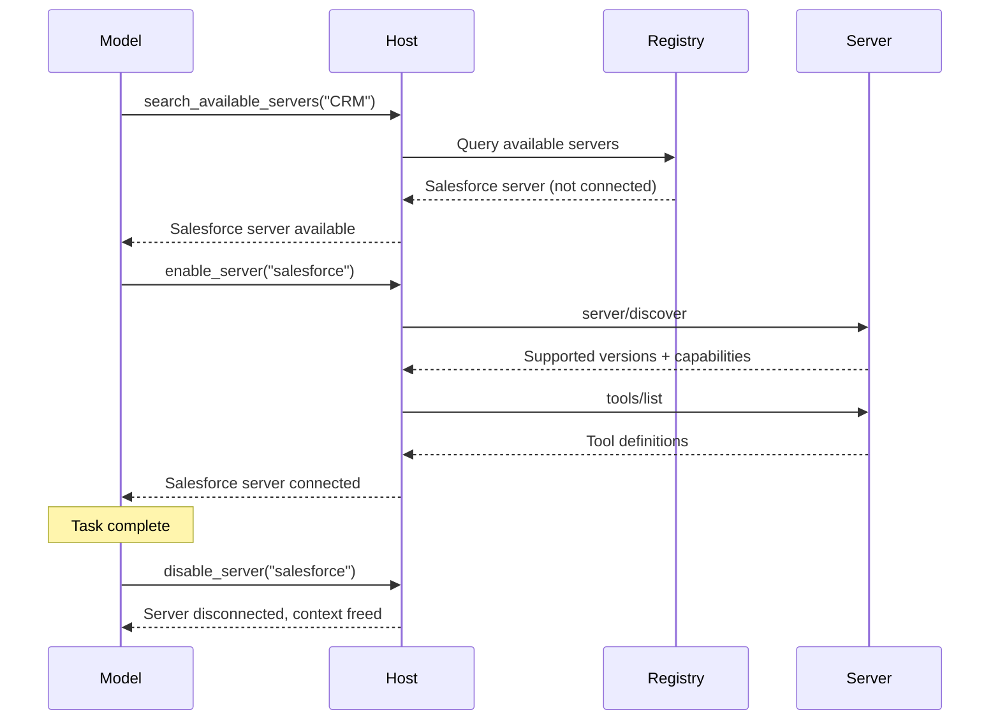
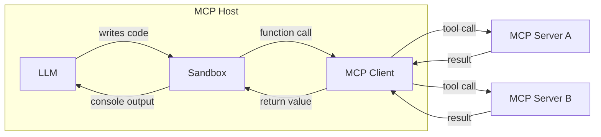

随着智能体等 MCP 宿主应用连接更多 MCP Server，能够访问数百甚至数千个工具，简单的工具管理方式就会难以为继。一开始就把所有工具定义装入模型的上下文窗口，会浪费 token、增加延迟，并降低模型表现。在连续工具调用之间，把大量中间结果交给模型处理，又会进一步放大这个问题。

有两种模式可以应对这些挑战：**渐进式发现**控制工具定义 _何时_ 进入上下文，**编程式工具调用**则控制 _如何_ 调用工具。

## 渐进式工具发现

简单的 MCP Host 实现会在每次对话开始时，将所有已连接服务器的工具定义直接传给模型。工具只有几个时，这样做完全合理。但如果 Host 能访问数十个服务器、数百个工具，仅这些定义就可能在模型读到用户消息之前，占去上下文窗口的大部分空间。


渐进式发现可以避免这一问题：

- Host 照常通过 `tools/list` 获取工具定义，但暂不将其注入模型上下文。
- Host 向模型提供轻量级的 `search_tools` 元工具。
- Host 仅在需要时，才将完整定义加载到上下文中。

### 何时使用渐进式发现

当工具定义占据上下文窗口的较大比例时，最适合使用渐进式发现。如果工具数量少、定义只占上下文窗口的一小部分，一次性加载所有工具即可。
一旦工具定义占据可用上下文窗口的显著比例，客户端就应当切换到渐进式发现。建议客户端设置阈值，判断何时切换：

- 将阈值设为上下文窗口的某个百分比，例如 1%–5%。
- 加载工具定义；一旦达到阈值，就切换到渐进式发现。

### 选择发现策略

模型调用 `search_tools` 工具后，需要选择一种搜索策略：

- **基于关键词**：通过 BM25、正则表达式等进行关键词匹配。简单有效，尤其适合名称和说明具有描述性的工具。
- **基于向量嵌入**：根据工具说明的向量相似度进行检索，更擅长处理同义词和语义匹配。
- **基于子智能体**：由另一个模型，通常是 Claude Haiku 或 Gemini Flash 等小型快速模型，为任务选择工具。这种方式通常效果很好，但成本可能高于基于向量嵌入或关键词的方案。
- **混合策略**：组合多种方法。例如，融合关键词和向量嵌入的排序得分，或根据使用场景和查询选择不同策略。

一些模型提供商已内置工具搜索能力。例如，[OpenAI](https://developers.openai.com/api/docs/guides/tools-tool-search) 和 [Anthropic](https://platform.claude.com/docs/en/agents-and-tools/tool-use/tool-search-tool) 均原生支持；请查阅所用提供商的文档，了解是否有对应能力。可用时，可以优先选择平台的工具搜索。提供商没有提供此功能，或需要领域专用排序、访问控制过滤等特殊检索逻辑时，再自行实现。

下面的三层模式详细展示一种自定义搜索方案，但无论采用何种检索机制，分层原则都相同：目录检索、查看详情、执行。

### 使用渐进式发现

一种常见实现采用基于搜索的三层方案：

**第 1 层：目录检索。** Host 提供一小组元工具，用于搜索可用能力。`search_tools` 工具接收自然语言查询，返回匹配的工具名称和简短说明。

```typescript
// The model calls a lightweight search tool
search_tools({ query: "update salesforce record" })

// Returns concise matches: names and one-line descriptions only
→ [
    { name: "salesforce_updateRecord", description: "Update fields on a Salesforce object" },
    { name: "salesforce_upsertRecord", description: "Insert or update based on external ID" }
  ]
```

**第 2 层：查看详情。** 模型找到候选工具后，只获取该工具的完整定义，包括输入 Schema、输出 Schema 和文档。

```typescript
// The model inspects only the tool it needs
get_tool_details({ name: "salesforce_updateRecord" });
```

这会返回单个工具的完整 Schema：

```json
{
  "name": "salesforce_updateRecord",
  "description": "Updates a record in Salesforce",
  "inputSchema": {
    "type": "object",
    "properties": {
      "objectType": {
        "type": "string",
        "description": "Salesforce object type"
      },
      "recordId": { "type": "string", "description": "Record ID to update" },
      "data": { "type": "object", "description": "Fields to update" }
    },
    "required": ["objectType", "recordId", "data"]
  }
}
```

**第 3 层：执行。** 模型只加载自己需要的定义，在充分了解接口后调用工具。

这种模式可以大幅减少 token 用量，并提高工具选择的准确性：模型聚焦于少量相关工具，而不必扫描数百个无关工具。向量嵌入、子智能体等其他发现策略也遵循相同的分层原则，只是替换了目录层的检索机制。

### 动态服务器管理

渐进式发现不仅适用于单个工具，也可以扩展到整个服务器。Host 不必在启动时连接所有已配置的服务器，而可以：

1. 维护可用服务器及其概要说明的注册表。
2. 仅在模型判断需要某个服务器的能力时，才建立连接。
3. 断开与当前任务不再相关的服务器，释放上下文空间。



这尤其适合无法预先确定用户意图的通用智能体。智能体最初只连接少量始终启用的服务器，再根据需要连接其他服务器。结合 [Agent Skills](/docs/2026-07-28/develop/build-with-agent-skills) 使用时，Skill 文件可以声明自己需要哪些 MCP Server，Host 仅在调用该 Skill 时才连接它们。

### 实现建议

实现渐进式发现时，请遵循以下建议：

| 建议 | 原因 |
| -------------------------------- | -------------------------------------------------------------------------------------------------------------------------------------------------------------------------------------------------- |
| **提供多个详细程度** | 让模型在仅名称、名称加说明、完整 Schema 等响应级别之间选择。 |
| **缓存工具定义** | 从服务器获取定义后，在 Host 侧记忆化保存，之后再次注入时就不必重新往返调用 `tools/list`。这与模型当前上下文中包含哪些内容是两回事。 |
| **收到 `list_changed` 后刷新** | 服务器发送 `notifications/tools/list_changed` 时，重新建立搜索目录索引。 |
| **按服务器组织工具** | 根据来源服务器展示工具，帮助模型推理相互关联的能力。 |

### 缓存

每个列表结果（例如 `tools/list`），以及每个 `server/discover` 和 `resources/read` 结果，都会携带 `ttlMs` 和 `cacheScope` 提示。请按照规范中的[缓存实用功能](/specification/2026-07-28/server/utilities/caching)处理。尤其要注意：收到 `list_changed` 通知后，即使 TTL 尚未到期，也应将已缓存的列表视为过期。

### 与提示缓存的配合

大多数提供商会缓存提示前缀，其中包括 `tools` 数组。在对话中途添加或删除工具定义会使缓存失效，而缓存未命中的 token 成本，可能比移除这些定义节省的成本还高。为了保留缓存：

- 将新发现的定义追加在缓存断点之后，而不是重新排序 `tools` 数组；也可以让所有调用都经过同一个稳定的 `call_tool({name, args})` 元工具，使数组始终不变。
- 将断开服务器连接安排在对话边界，而不是每轮对话中。
- 结合上面的工具搜索链接，查阅提供商的缓存文档。

## 编程式工具调用／Code Mode

直接调用工具时，每次调用都需要一次往返：模型生成工具调用，客户端执行，再将完整结果送回模型上下文。如果任务需要串联多个工具，例如读取文档、转换内容、再写到其他位置，每个中间结果都会经过模型，消耗 token 并增加延迟，即使模型并不需要处理这些内容。

编程式工具调用，有时也称为“Code Mode”，让客户端能够高效地**组合工具调用**。模型不再直接调用工具，而是编写调用工具的代码。代码在沙箱环境中执行，只有最终结果返回给模型。

编程式工具调用功能强大，能够更高效地使用 MCP 工具和资源，但需要客户端实现沙箱环境。


### 工作原理

Host 将 MCP 工具 Schema 转换为沙箱中可用的类型化 API。模型需要使用工具时，就编写并执行脚本。

**第 1 步：根据 MCP Schema 生成编程接口。** Host 读取每个服务器的工具定义，根据各工具的参数和 `outputSchema` 生成类型化函数：

```typescript
// Auto-generated from the Logging MCP server's tool schema
interface LogEntry {
  timestamp: string;
  message: string;
  level: string;
}

function logging_getLogs(input: {
  level: "error" | "warn" | "info";
  since: number;
}): Promise<{ entries: LogEntry[] }> {
  return mcp.callTool<{ entries: LogEntry[] }>("logging_getLogs", input);
}

// Auto-generated from the Ticketing MCP server's tool schema
function ticketing_createIssue(input: {
  title: string;
  body?: string;
  priority: "low" | "medium" | "high";
}): Promise<{ issueId: string }> {
  return mcp.callTool<{ issueId: string }>("ticketing_createIssue", input);
}
```

MCP Server 可以为每个工具提供可选的 [`outputSchema`](/specification/2026-07-28/server/tools#output-schema)。有输出 Schema 时，Host 可以生成精确的返回类型，例如上面的 `LogEntry`。

没有输出 Schema 时，优先采用简单方案：

- **使用通用类型，继续处理。** 接受 `any` 或 `string`，在后续步骤处理非结构化输出。根本的解决办法是由服务器作者提供 `outputSchema`。
- **使用快速模型提取类型化结果**，适用于循环之外的单次调用。通过与 MCP 工具调用相同的桩函数拦截通道，提供由 Host 代理的 `extract(value, ExpectedType)` 辅助函数，使沙箱自身始终不建立网络连接。该函数将请求路由到 Claude Haiku 或 Gemini Flash 等小模型，将值转换为 `ExpectedType`。这会增加每次调用的延迟，也可能产生幻觉或遗漏字段，因此使用前必须根据 `ExpectedType` 校验结果。

**第 2 步：模型针对这些 API 编写代码。** 模型不再分别调用工具、让完整结果在各次调用之间经过上下文，而是编写一个脚本。例如，“查找过去一小时内的所有错误日志，为每种不同错误创建一张工单”。直接调用时，数千条日志会流经模型上下文；使用代码时，模型可以在沙箱中完成过滤：

```typescript
// Model-generated code, executes in sandbox
const logs = await logging_getLogs({
  level: "error",
  since: Date.now() - 3600000,
});

// Filter and deduplicate inside the sandbox, not in the model's context
const uniqueErrors = new Map<string, LogEntry>();
for (const log of logs.entries) {
  if (!uniqueErrors.has(log.message)) {
    uniqueErrors.set(log.message, log);
  }
}

for (const [message, log] of uniqueErrors) {
  await ticketing_createIssue({
    title: `Error: ${message}`,
    body: `First seen: ${log.timestamp}\nOccurrences: ${
      logs.entries.filter((l) => l.message === message).length
    }`,
    priority: "high",
  });
}

console.log(
  `Filed ${uniqueErrors.size} tickets from ${logs.entries.length} error logs`,
);
```

**第 3 步：沙箱执行代码。** 沙箱中的函数调用会被拦截，并通过 Host 代理路由到对应的 MCP Server。日志数据和工单创建过程直接在服务器之间流转，完全不进入模型上下文。只有 `console.log` 输出的一行摘要会返回给模型。

### 选择沙箱

合适的沙箱取决于希望模型编写哪种语言、宿主应用使用哪种语言，以及需要多强的隔离。下表仅列举运行时示例，并非推荐背书；请根据实际场景评估其成熟度：

| 沙箱语言 | 运行时／库 | 宿主语言 | 方式 |
| ------------------ | ------------------------------------------------------------- | ----------------- | ----------------------------------------------------------------------------------------------- |
| **JavaScript** | [Deno](https://github.com/denoland/deno)、`isolated-vm` | Rust / Node / CLI | 基于 V8 的运行时，支持细粒度权限。可禁用全部权限，实现严格封锁。 |
| **Python** | [Monty](https://github.com/pydantic/monty) _（实验性）_ | Rust | 专为 AI 场景构建的最小 Python 解释器，默认没有 I/O。 |
| **TypeScript** | [pctx](https://github.com/portofcontext/pctx) _（早期阶段）_ | Python / Rust | 将 Code Mode 概念封装为库，并提供底层 Rust 支持。 |
| **任意语言（通过 Wasm）** | [Wasmtime](https://github.com/bytecodealliance/wasmtime) | Rust / C / Go | 将任意语言编译为 Wasm，并以基于能力的安全机制运行。 |

无论选择哪种沙箱，集成模式都一样：Host 注入函数桩，通过进程内或 stdio 通道拦截调用，使网络权限可以保持完全禁用，再将调用作为 `tools/call` 请求派发到 MCP Server。

### 执行架构

实现包含三个组成部分：



**沙箱**在隔离环境中运行模型生成的代码，无法直接访问网络。它与外部世界交互的唯一接口，是将调用路由回 Host 的生成函数桩。

**Host**充当代理。它接收沙箱发来的函数调用，将调用映射到正确的 MCP Server，执行工具调用，再把结果返回给沙箱。授权令牌和凭据由 Host 持有，绝不暴露给生成的代码。

**模型**只能看到沙箱返回的内容，通常是 `console.log` 语句输出或最终返回值。这让模型及客户端开发者能够精确控制哪些内容进入上下文窗口。

### 安全注意事项

编程式工具调用引入了代码执行入口，必须谨慎实施沙箱隔离：

- **逐次调用授权**：从规范角度看，代理仍然是 MCP Host。对于来自沙箱的调用，应用与直接调用相同的人工确认策略，见[工具：安全](/specification/2026-07-28/server/tools#security-considerations)。批准脚本不等于概括批准它在运行时发起的每次工具调用；Host 可以授予类别层面的批准，例如“本次脚本运行允许调用 `ticketing_createIssue`”，从而不必每次迭代都弹出确认，但代理仍必须根据这项授权评估每一次调用。
- **跨服务器数据流**：一个服务器的工具结果，对另一个服务器而言是不可信输入。代理应当对经它转发的调用实施与直接调用相同的输入审查策略；仅截断输出并不能防止数据外泄。
- **网络隔离**：沙箱应当无法直接访问网络。所有外部通信都经过 Host 代理，由它实施授权和访问控制。
- **不暴露凭据**：API Key 和令牌由 Host 持有。生成的代码只调用类型化函数，由 Host 在转发到服务器时添加身份验证信息。
- **资源限制**：为沙箱执行设置超时和内存限制，防止脚本失控。
- **输出过滤**：将沙箱控制台输出反馈给模型前，先进行校验和截断。

### 错误处理

MCP 工具错误通过带有 [`isError: true`](/specification/2026-07-28/server/tools#error-handling) 的成功响应返回，而不是作为传输失败。生成的封装应当将其转换为抛出的异常，让模型编写的代码能够使用 `try`/`catch` 处理。如果未捕获的错误终止脚本，应将其作为脚本结果返回给模型，便于模型自行纠正；模型负责说明此前已经提交的任何部分副作用。

## 结合两种模式

渐进式发现与编程式工具调用可以很好地配合。模型先用发现工具确定所需工具、加载其 Schema，再编写一个脚本，在一次执行中调用多个工具。这既减少了工具定义的 token 成本， _也_ 减少了工具结果的 token 成本，让模型上下文聚焦于推理，而不是充当数据中转站。
