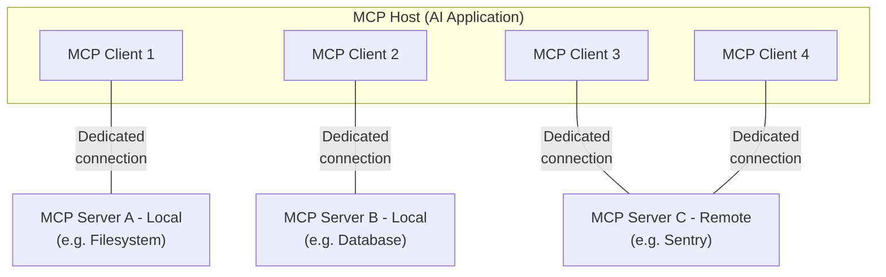

本篇概述 Model Context Protocol（MCP）的[范围](#scope)与[核心概念](#concepts-of-mcp)，并通过一个[示例](#example)逐一展示这些核心概念。

MCP SDK 已经封装了许多底层细节，因此，对大多数开发者而言，[数据层协议](#data-layer-protocol)一节可能最有帮助。这一节介绍 MCP Server 如何为 AI 应用提供上下文。

有关具体实现细节，请参阅你所用[编程语言的 SDK 文档](/docs/2026-07-28/sdk)。

## 范围

Model Context Protocol 包含以下项目：

- [MCP 规范](https://modelcontextprotocol.io/specification/latest)：定义 MCP 客户端与服务器实现要求的协议规范。
- [MCP SDK](/docs/2026-07-28/sdk)：以不同编程语言实现 MCP 的 SDK。
- **MCP 开发工具**：用于开发 MCP Server 和 Client 的工具，包括 [MCP Inspector](https://github.com/modelcontextprotocol/inspector)
- [MCP Server 参考实现](https://github.com/modelcontextprotocol/servers)：MCP Server 的参考实现。

<Note>
  MCP 只关注上下文交换协议，不规定 AI 应用如何使用 LLM，也不规定应用如何管理收到的上下文。
</Note>

## MCP 的核心概念

### 参与者

MCP 采用客户端—服务器架构。MCP Host 是一个 AI 应用，例如 [Claude Code](https://www.anthropic.com/claude-code) 或 [Claude Desktop](https://www.claude.ai/download)，它会连接一个或多个 MCP Server。为此，Host 会为每个 Server 创建一个 MCP Client。每个 Client 都与对应的 Server 保持一条专用连接。

使用 STDIO 传输方式的本地 MCP Server 通常服务于一个 MCP Client；使用 Streamable HTTP 传输方式的远程 MCP Server 则通常服务于多个 MCP Client。

MCP 架构中的主要参与者包括：

- **MCP Host**：协调并管理一个或多个 MCP Client 的 AI 应用
- **MCP Client**：与 MCP Server 保持连接，并从中获取上下文供 Host 使用的组件
- **MCP Server**：向 MCP Client 提供上下文的程序

**例如**：Visual Studio Code 充当 MCP Host。当它连接某个 MCP Server（例如 [Sentry MCP Server](https://docs.sentry.io/product/sentry-mcp/)）时，其运行时会实例化一个 MCP Client 对象，用来维护与 Sentry MCP Server 的连接。
当 Visual Studio Code 随后连接另一个 MCP Server，例如[本地文件系统服务器](https://github.com/modelcontextprotocol/servers/tree/main/src/filesystem)时，运行时会再实例化一个 MCP Client 对象来维护这条连接。



请注意，**MCP Server** 指的是提供上下文数据的程序，与它运行在哪里无关。MCP Server 既可以在本地运行，也可以远程运行。例如，Claude Desktop 启动[文件系统服务器](https://github.com/modelcontextprotocol/servers/tree/main/src/filesystem)时，由于使用 STDIO 传输方式，服务器会在同一台机器上本地运行，通常称为“本地”MCP Server。官方的 [Sentry MCP Server](https://docs.sentry.io/product/sentry-mcp/) 运行在 Sentry 平台上，使用 Streamable HTTP 传输方式，通常称为“远程”MCP Server。

### 分层

MCP 分为两层：

- **数据层**：定义基于 JSON-RPC 的客户端与服务器通信协议，包括能力与版本发现，以及工具、资源、提示模板和通知等基本原语。
- **传输层**：定义客户端与服务器交换数据所需的通信机制和通道，包括各传输方式特有的连接建立、消息分帧与授权。

从概念上看，数据层是内层，传输层是外层。

#### 数据层

数据层实现了基于 [JSON-RPC 2.0](https://www.jsonrpc.org/) 的交换协议，用于定义消息的结构和语义。
这一层包括：

- **发现**：客户端可以通过 `server/discover` 请求，查询服务器支持的协议版本、能力及身份信息
- **服务器功能**：服务器可以与客户端交互，提供用于执行 AI 操作的工具、用于上下文数据的资源，以及用于交互模板的提示模板等核心功能
- **客户端功能**：服务器可以向用户征询输入。采样功能已被[弃用](/specification/2026-07-28/deprecated)，自协议版本 `2026-07-28` 起生效。
- **实用功能**：支持实时更新通知、长时间运行操作的进度跟踪等附加能力

#### 传输层

传输层管理客户端与服务器之间的通信通道和身份验证，负责连接建立、消息分帧，以及 MCP 各参与者之间的安全通信。

MCP 支持两种传输机制：

- **Stdio 传输**：使用标准输入／输出流，在同一台机器上的本地进程之间直接通信，没有网络开销，性能高效。
- **Streamable HTTP 传输**：客户端通过 HTTP POST 向服务器发送消息，并可选用 Server-Sent Events 提供流式传输能力。这种方式支持与远程服务器通信，也支持 Bearer Token、API Key 和自定义请求头等标准 HTTP 身份验证方式。MCP 建议使用 OAuth 获取身份验证令牌。

传输层向协议层屏蔽了通信细节，使所有传输机制都能使用相同的 JSON-RPC 2.0 消息格式。

### 数据层协议

MCP 的核心工作之一，是定义 MCP Client 与 MCP Server 之间交互的 Schema 和语义。对开发者而言，数据层，尤其是其中的[基本原语](#primitives)，可能是 MCP 最值得关注的部分：它定义了如何把上下文从 MCP Server 提供给 MCP Client。

MCP 使用 [JSON-RPC 2.0](https://www.jsonrpc.org/) 作为底层 RPC 协议。客户端和服务器可以相互发送请求，并作出相应响应。不需要响应时，则可以使用通知。

#### 无状态性与发现

MCP 是一种<Tooltip tip="每个请求都包含处理该请求所需的全部信息，因此服务器不需要根据先前请求推断任何内容">无状态协议</Tooltip>。每个请求都在 `_meta` 字段中携带协议版本，以及与该请求相关的<Tooltip tip="客户端或服务器支持的功能与操作，例如工具、资源或提示模板">能力</Tooltip>，因此服务器可以独立处理每个请求。除非配置为不提供，否则客户端也应当在同一字段中标明自身身份。服务器通过必须实现的 [`server/discover`](/specification/2026-07-28/server/discover) 请求，公开其支持的版本和能力；客户端可以在任何其他请求之前发送该请求。详细信息见[规范](/specification/2026-07-28/basic/index#statelessness)；后面的[示例](#example)将展示每个请求的元数据及发现流程。

#### 基本原语

基本原语是 MCP 中最重要的概念。它们定义了客户端和服务器能够向对方提供什么，规定了可以与 AI 应用共享哪些类型的上下文信息，以及可以执行哪些操作。

MCP 定义了三种可由 _服务器_ 提供的核心原语：

- **工具**：AI 应用可以调用的可执行函数，用于执行文件操作、API 调用、数据库查询等任务
- **资源**：为 AI 应用提供上下文信息的数据源，例如文件内容、数据库记录、API 响应
- **提示模板**：可复用的模板，用于组织与语言模型的交互，例如系统提示、少样本示例

每类原语都有相应的方法，用于发现（`*/list`）、获取（`*/get`），以及在部分情况下执行（`tools/call`）。
MCP Client 使用 `*/list` 方法发现可用原语。例如，客户端可以先列出所有可用工具（`tools/list`），然后再执行工具。这种设计允许列表动态变化。

以一个提供数据库上下文的 MCP Server 为例：它可以提供查询数据库的工具、包含数据库 Schema 的资源，以及包含工具交互少样本示例的提示模板。

有关服务器原语的详细信息，请参阅[服务器概念](./server-concepts)。

MCP 也定义了可由 _客户端_ 提供的原语，使 MCP Server 的开发者能够构建更丰富的交互。

- **信息征询**：允许服务器向用户请求补充信息，适用于需要了解更多用户信息或请求用户确认某项操作的场景。服务器通过 `elicitation/create` 方法请求用户输入。

信息征询请求通过[多轮往返请求](/specification/2026-07-28/basic/patterns/mrtr)模式传递，具体见[信息征询概述](/docs/2026-07-28/learn/client-concepts#elicitation)。

**已弃用**：自协议版本 `2026-07-28` 起，以下客户端原语已被弃用。

- **采样**：允许服务器向客户端的 AI 应用请求语言模型补全。它适用于服务器开发者需要使用语言模型，同时希望保持模型无关性、避免在 MCP Server 中引入语言模型 SDK 的场景。服务器通过 `sampling/createMessage` 方法请求补全，同样使用多轮往返请求模式传递。新的实现应当直接集成 LLM 提供商的 API。
- **日志**：允许服务器向客户端发送日志消息，用于调试和监控。新的实现应当将日志写入 `stderr`（stdio 传输），或使用 OpenTelemetry。

有关客户端原语的详细信息，请参阅[客户端概念](./client-concepts)。

除服务器和客户端原语之外，协议还支持在核心协议之上构建的可选[扩展](/extensions/overview)。例如，[Tasks 扩展](/extensions/tasks/overview)允许服务器为长时间运行的请求返回一个持久句柄，让客户端之后轮询状态并获取结果。

#### 通知

协议支持实时通知，使服务器和客户端能够动态更新。例如，当服务器的可用工具发生变化（如新增功能或修改现有工具）时，服务器可以发送工具更新通知，告知已连接的客户端。这类通知以 JSON-RPC 2.0 通知消息发送，不期待响应。变更通知需要客户端主动订阅：客户端打开一条长期保持的 [`subscriptions/listen`](/specification/2026-07-28/basic/patterns/subscriptions) 流，指定希望接收的通知类型，服务器再通过该流发送匹配的通知。

## 示例

### 数据层

本节逐步演示一次 MCP 客户端与服务器交互，重点介绍数据层协议。我们将使用 JSON-RPC 2.0 消息展示发现流程、工具操作和通知。

<Steps>
<Step title="发现">

如[无状态性与发现](#statelessness-and-discovery)一节所述，每个 MCP 请求都在 `_meta` 字段中携带协议版本和客户端能力，客户端也应当在其中提供自身身份。如果客户端希望在发送其他请求前了解服务器支持哪些功能，就可以发送 `server/discover` 请求；所有服务器都必须实现这一请求。发现响应通常可以缓存和复用，因此无需为每个请求重复执行发现流程。

<CodeGroup>
  ```json Discover Request
  {
    "jsonrpc": "2.0",
    "id": 1,
    "method": "server/discover",
    "params": {
      "_meta": {
        "io.modelcontextprotocol/protocolVersion": "2026-07-28",
        "io.modelcontextprotocol/clientInfo": {
          "name": "example-client",
          "version": "1.0.0"
        },
        "io.modelcontextprotocol/clientCapabilities": {
          "elicitation": {}
        }
      }
    }
  }
  ```
  ```json Discover Response
  {
    "jsonrpc": "2.0",
    "id": 1,
    "result": {
      "resultType": "complete",
      "supportedVersions": ["2026-07-28"],
      "capabilities": {
        "tools": {
          "listChanged": true
        },
        "resources": {}
      },
      "_meta": {
        "io.modelcontextprotocol/serverInfo": {
          "name": "example-server",
          "version": "1.0.0"
        }
      },
      "ttlMs": 3600000,
      "cacheScope": "public"
    }
  }
  ```
</CodeGroup>

#### 理解发现交互

`_meta` 字段与发现响应共同承担以下职责：

1. **协议版本选择**：`io.modelcontextprotocol/protocolVersion` 字段声明客户端本次请求使用的版本，响应中的 `supportedVersions` 列出服务器接受的版本。如果服务器不支持请求的版本，就会拒绝请求，返回列明其所支持版本的 `UnsupportedProtocolVersionError`，客户端随后使用双方均支持的版本重试。

2. **能力发现**：客户端在每个请求的 `io.modelcontextprotocol/clientCapabilities` 中声明自身能力，服务器则通过 `server/discover` 返回自己的 `capabilities` 对象。这样双方就能了解对方能够处理哪些[原语](#primitives)（工具、资源、提示模板），以及是否支持变更[通知](#notifications)，从而避免尝试不受支持的操作。

3. **身份交换**：请求 `_meta` 中的 `io.modelcontextprotocol/clientInfo` 字段，以及结果 `_meta` 中的 `io.modelcontextprotocol/serverInfo` 字段，提供身份与版本信息，便于调试和兼容性处理。

本例展示了 MCP 能力的声明方式：

**客户端能力**：

- `"elicitation": {}` — 客户端声明：当服务器提出请求时，它能够向用户收集补充输入

**服务器能力**：

- `"tools": {"listChanged": true}` — 服务器支持工具原语，并能够处理 [`subscriptions/listen`](/specification/2026-07-28/basic/patterns/subscriptions) 中的 `toolsListChanged` 过滤条件。订阅该条件的客户端会在工具列表变化时收到 `notifications/tools/list_changed`。
- `"resources": {}` — 服务器也支持资源原语，能够处理 `resources/list` 和 `resources/read` 方法

调用 `server/discover` 是可选的。由于每个请求都携带相同的 `_meta` 字段，客户端可以直接发送任意请求，并在收到版本错误时进行处理。发现机制提供了一种便利方式：通过一次请求获取服务器的身份、能力和支持的版本。

#### 在 AI 应用中如何运作

AI 应用的 MCP Client 管理器会连接已配置的服务器，并保存发现的能力，供后续使用。应用据此判断哪些服务器可以提供特定功能（工具、资源、提示模板），以及它们是否支持实时更新。在 Python SDK 中，发现流程在客户端连接时执行，结果随后可以从客户端对象上获取。

```python Pseudo-code for AI application discovery
# Pseudo Code
async with Client(stdio_client(server_config)) as client:
    if client.server_capabilities.tools:
        app.register_mcp_server(client, supports_tools=True)
    app.set_server_ready(client)
```

</Step>

<Step title="工具发现（基本原语）">
客户端可以发送 `tools/list` 请求，发现可用工具。这是 MCP 工具发现机制的基础：客户端可以先了解服务器上有哪些工具，再尝试使用它们。

<CodeGroup>
  ```json Tools List Request
  {
    "jsonrpc": "2.0",
    "id": 2,
    "method": "tools/list",
    "params": {
      "_meta": {
        "io.modelcontextprotocol/protocolVersion": "2026-07-28",
        "io.modelcontextprotocol/clientInfo": {
          "name": "example-client",
          "version": "1.0.0"
        },
        "io.modelcontextprotocol/clientCapabilities": {
          "elicitation": {}
        }
      }
    }
  }
  ```
  ```json Tools List Response
  {
    "jsonrpc": "2.0",
    "id": 2,
    "result": {
      "resultType": "complete",
      "tools": [
        {
          "name": "calculator_arithmetic",
          "title": "Calculator",
          "description": "Perform mathematical calculations including basic arithmetic, trigonometric functions, and algebraic operations",
          "inputSchema": {
            "type": "object",
            "properties": {
              "expression": {
                "type": "string",
                "description": "Mathematical expression to evaluate (e.g., '2 + 3 * 4', 'sin(30)', 'sqrt(16)')"
              }
            },
            "required": ["expression"]
          }
        },
        {
          "name": "weather_current",
          "title": "Weather Information",
          "description": "Get current weather information for any location worldwide",
          "inputSchema": {
            "type": "object",
            "properties": {
              "location": {
                "type": "string",
                "description": "City name, address, or coordinates (latitude,longitude)"
              },
              "units": {
                "type": "string",
                "enum": ["metric", "imperial", "kelvin"],
                "description": "Temperature units to use in response",
                "default": "metric"
              }
            },
            "required": ["location"]
          }
        }
      ],
      "ttlMs": 300000,
      "cacheScope": "public"
    }
  }
  ```
</CodeGroup>

#### 理解工具发现请求

除每个 MCP 请求都携带的标准 `_meta` 字段外，`tools/list` 请求不要求其他参数。它还接受可选的 `cursor` 参数，用于[分页](/specification/2026-07-28/server/utilities/pagination)；上面的示例省略了这一参数。

#### 理解工具发现响应

响应包含一个 `tools` 数组，为每个可用工具提供完整的元数据。这种数组结构让服务器能够同时提供多个工具，并清晰区分不同功能。

响应中的每个工具对象都包含几个关键字段：

- **`name`**：工具在服务器命名空间中的唯一标识符，是执行工具时使用的主键，应当采用清晰的命名方式，例如 `calculator_arithmetic`，而非仅用 `calculate`
- **`title`**：便于人类阅读的工具显示名称，客户端可以将其展示给用户
- **`description`**：详细说明工具的用途及适用时机
- **`inputSchema`**：定义预期输入参数的 JSON Schema，用于类型校验，并清晰说明必填参数和可选参数

结果标记为 `"resultType": "complete"`，并携带两个缓存字段。`ttlMs` 以毫秒为单位提示新鲜度，因此这份工具列表可以缓存五分钟。`cacheScope` 指明哪些主体可以复用响应。完整规则见规范中的[缓存实用功能](/specification/2026-07-28/server/utilities/caching)。

#### 在 AI 应用中如何运作

AI 应用从所有已连接的 MCP Server 获取可用工具，并合并成语言模型可以访问的统一工具注册表。这样，LLM 就能了解自己可以执行哪些操作，并在对话中自动生成相应的工具调用。

```python Pseudo-code for AI application tool discovery
# Pseudo-code using MCP Python SDK patterns
available_tools = []
for client in app.mcp_clients():
    tools_response = await client.list_tools()
    available_tools.extend(tools_response.tools)
conversation.register_available_tools(available_tools)
```

需要汇聚多个服务器的客户端，可以采用[渐进式工具发现](/docs/2026-07-28/develop/clients/client-best-practices#progressive-tool-discovery)，而不必一开始就加载所有工具。

</Step>

<Step title="工具执行（基本原语）">
现在，客户端可以使用 `tools/call` 方法执行工具。这展示了 MCP 原语在实践中的用法：发现可用工具后，客户端便可携带合适的参数调用它们。

#### 理解工具执行请求

`tools/call` 请求使用结构化格式，确保类型安全，并让客户端和服务器清晰通信。请注意，这里使用发现响应中提供的准确工具名称（`weather_current`），而不是简化后的名称：

<CodeGroup>
  ```json Tool Call Request
  {
    "jsonrpc": "2.0",
    "id": 3,
    "method": "tools/call",
    "params": {
      "name": "weather_current",
      "arguments": {
        "location": "San Francisco",
        "units": "imperial"
      },
      "_meta": {
        "io.modelcontextprotocol/protocolVersion": "2026-07-28",
        "io.modelcontextprotocol/clientInfo": {
          "name": "example-client",
          "version": "1.0.0"
        },
        "io.modelcontextprotocol/clientCapabilities": {
          "elicitation": {}
        }
      }
    }
  }
  ```
  ```json Tool Call Response
  {
    "jsonrpc": "2.0",
    "id": 3,
    "result": {
      "resultType": "complete",
      "content": [
        {
          "type": "text",
          "text": "Current weather in San Francisco: 68°F, partly cloudy with light winds from the west at 8 mph. Humidity: 65%"
        }
      ]
    }
  }
  ```
</CodeGroup>

#### 工具执行的关键要素

请求结构包含以下重要部分：

1. **`name`**：必须与发现响应中的工具名称（`weather_current`）完全一致，确保服务器准确识别要执行的工具。

2. **`arguments`**：包含工具 `inputSchema` 所定义的输入参数。本例中：
   - `location`："San Francisco"（必填参数）
   - `units`："imperial"（可选参数，未指定时默认为 "metric"）

3. **`_meta`**：携带每个请求的标准字段：所有 MCP 请求都必须包含的协议版本和客户端能力，以及客户端身份；除非配置为不提供，否则客户端应当包含身份信息。

4. **JSON-RPC 结构**：使用标准 JSON-RPC 2.0 格式，通过唯一的 `id` 将请求与响应关联起来。

#### 理解工具执行响应

响应展示了 MCP 灵活的内容系统：

1. **`content` 数组**：工具响应返回内容对象数组，支持丰富的多格式响应，例如文本、图像和资源。

2. **内容类型**：每个内容对象都有一个 `type` 字段。本例中的 `"type": "text"` 表示纯文本内容，但 MCP 支持多种内容类型，以适应不同场景。

3. **结构化输出**：响应提供可供使用的信息，AI 应用能够将其作为与语言模型交互时的上下文。

这种执行模式让 AI 应用能够动态调用服务器功能，接收结构化响应，并将结果融入与语言模型的对话。

#### 在 AI 应用中如何运作

当语言模型决定在对话中使用工具时，AI 应用会截获工具调用，将其路由到对应的 MCP Server 执行，再把结果作为对话流程的一部分返回给 LLM。这样，LLM 就能访问实时数据，并在外部世界中执行操作。

```python
# Pseudo-code for AI application tool execution
async def handle_tool_call(conversation, tool_name, arguments):
    client = app.find_mcp_client_for_tool(tool_name)
    result = await client.call_tool(tool_name, arguments)
    conversation.add_tool_result(result.content)
```

</Step>

<Step title="实时更新（通知）">
MCP 支持实时通知，服务器可以主动告知客户端发生了哪些变化，无需客户端为此不断轮询。通知系统是保持客户端同步、及时响应变化的重要机制。

#### 订阅变更

变更通知需要主动订阅。客户端发送 [`subscriptions/listen`](/specification/2026-07-28/basic/patterns/subscriptions) 请求，在 `notifications` 过滤条件中指定所需事件类型，从而打开一条长期保持的通知流。这里，客户端订阅工具列表变更：

```json Listen Request
{
  "jsonrpc": "2.0",
  "id": 4,
  "method": "subscriptions/listen",
  "params": {
    "_meta": {
      "io.modelcontextprotocol/protocolVersion": "2026-07-28",
      "io.modelcontextprotocol/clientInfo": {
        "name": "example-client",
        "version": "1.0.0"
      },
      "io.modelcontextprotocol/clientCapabilities": {
        "elicitation": {}
      }
    },
    "notifications": {
      "toolsListChanged": true
    }
  }
}
```

每个客户端请求都在 `_meta` 中携带 `io.modelcontextprotocol/protocolVersion` 和 `io.modelcontextprotocol/clientCapabilities` 字段，通常也包括 `io.modelcontextprotocol/clientInfo`，因此服务器无需依赖连接状态即可识别客户端。

服务器通过 `notifications/subscriptions/acknowledged` 确认订阅。这是第一条在 `_meta` 中携带该订阅 ID 的消息；在此之前，服务器不会发送该订阅的其他通知。其 `notifications` 字段反映服务器同意支持的过滤条件子集，不受支持的通知类型会被省略：

```json Acknowledgment
{
  "jsonrpc": "2.0",
  "method": "notifications/subscriptions/acknowledged",
  "params": {
    "_meta": {
      "io.modelcontextprotocol/subscriptionId": 4
    },
    "notifications": {
      "toolsListChanged": true
    }
  }
}
```

#### 理解工具列表变更通知

订阅确认后，当服务器的可用工具发生变化，例如新增功能、修改现有工具，或某些工具暂时不可用时，服务器就会通过该流发送通知：

```json Notification
{
  "jsonrpc": "2.0",
  "method": "notifications/tools/list_changed",
  "params": {
    "_meta": {
      "io.modelcontextprotocol/subscriptionId": 4
    }
  }
}
```

#### MCP 通知的关键特征

1. **无需响应**：请注意，通知中没有 `id` 字段。这遵循 JSON-RPC 2.0 的通知语义：不期待响应，也不会发送响应。

2. **主动订阅**：只有在 `subscriptions/listen` 过滤条件中请求了 `"toolsListChanged": true` 的客户端才会收到此通知；而且，只有在工具能力中声明了 `"listChanged": true` 的服务器才提供这一通知，如第 1 步所示。

3. **订阅 ID 标记**：流中的每条通知都在 `_meta` 中携带 `io.modelcontextprotocol/subscriptionId`。其值是打开该流的 `subscriptions/listen` 请求的 JSON-RPC ID，本例为 `4`，客户端据此将通知与产生它的订阅关联起来。

4. **事件驱动**：服务器根据内部状态变化决定何时发送通知，让 MCP 连接能够动态、及时地响应变化。

5. **尽力而为**：协议不保证每条通知都能发送或接收，尤其是在传输连接重连时。客户端也应当依靠轮询来保持结果的新鲜度。

#### 客户端如何响应通知

收到这条通知后，客户端通常会请求更新后的工具列表。这形成了一个刷新循环，使客户端始终了解当前有哪些可用工具：

```json Request
{
  "jsonrpc": "2.0",
  "id": 5,
  "method": "tools/list",
  "params": {
    "_meta": {
      "io.modelcontextprotocol/protocolVersion": "2026-07-28",
      "io.modelcontextprotocol/clientInfo": {
        "name": "example-client",
        "version": "1.0.0"
      },
      "io.modelcontextprotocol/clientCapabilities": {
        "elicitation": {}
      }
    }
  }
}
```

#### 通知为什么重要

这一通知系统的重要性体现在多个方面：

1. **动态环境**：工具可能因服务器状态、外部依赖或用户权限变化而出现或消失
2. **效率**：客户端无需轮询变更，更新发生时会收到通知
3. **一致性**：确保客户端始终掌握准确的服务器可用能力信息
4. **实时协作**：支持能够及时响应并适应上下文变化的 AI 应用

这一通知模式不局限于工具，也适用于其他 MCP 原语，从而支持客户端与服务器之间更全面的实时同步。

#### 在 AI 应用中如何运作

AI 应用会为自己关注的变更保持通知流。当通知到达时，应用立即刷新工具注册表，并更新 LLM 的可用能力。这样，进行中的对话始终可以访问最新工具，LLM 也能在新功能出现时动态调整。

```python
# Pseudo-code for AI application notification handling
async def follow_tool_changes(client):
    async with client.listen(tools_list_changed=True) as sub:
        async for _event in sub:
            tools_response = await client.list_tools()
            app.update_available_tools(client, tools_response.tools)
            if app.conversation.is_active():
                app.conversation.notify_llm_of_new_capabilities()
```

</Step>
</Steps>
