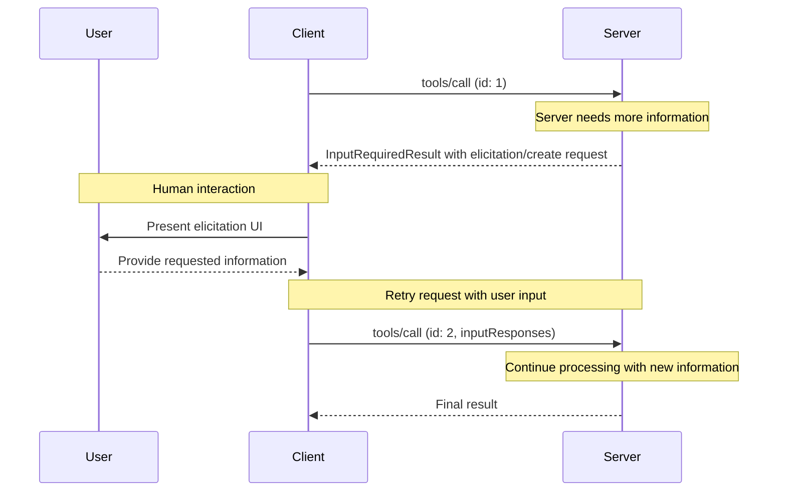
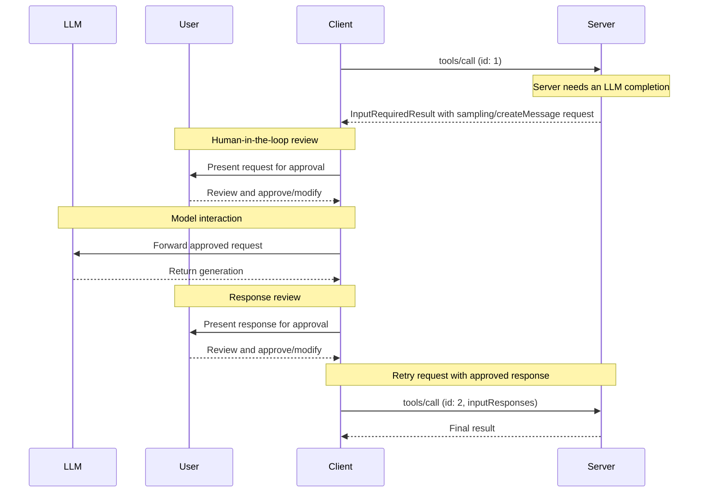

MCP Client 由宿主应用实例化，用于与特定的 MCP Server 通信。Claude.ai 或 IDE 等宿主应用管理整体用户体验，并协调多个客户端。每个客户端负责与一个服务器直接通信。

理解两者的区别很重要： _Host_ 是用户直接交互的应用，而 _Client_ 是在协议层面建立服务器连接的组件。

## 客户端的核心功能

除了使用服务器提供的上下文，客户端也可以向服务器提供若干功能，让服务器开发者构建更丰富的交互。

| 功能 | 说明 | 示例 |
| --------------- | ------------------------------------------------------------------------------------------------------------------------------------------------------------------------------------------------------------------------------------------------------------- | -------------------------------------------------------------------------------------------------------------------------------------- |
| **信息征询** | 信息征询让服务器能够在交互过程中向用户请求特定信息，为服务器按需收集信息提供结构化方式。 | 旅行预订服务器可以询问用户对飞机座位、房型的偏好，或索取完成预订所需的联系电话。 |
| **根目录** | 根目录让客户端能够指定服务器应当关注哪些目录，通过协调机制传达预期范围。根目录已被[弃用](/specification/2026-07-28/deprecated)，自协议版本 `2026-07-28` 起生效。 | 可以让旅行预订服务器访问某个特定目录，从中读取用户的日历。 |
| **采样** | 采样让服务器能够通过客户端请求 LLM 补全，从而实现智能体工作流。这种方式让客户端完全掌控用户权限和安全措施。采样自协议版本 `2026-07-28` 起已被弃用。 | 旅行预订服务器可以将航班列表发送给 LLM，请求模型为用户选择最佳航班。 |

### 信息征询

信息征询让服务器能够在交互过程中向用户请求特定信息，构建更灵活、响应更及时的工作流。

#### 概述

信息征询为服务器按需收集必要信息提供了结构化方式。服务器不必一开始就要求提供全部信息，也不必因数据缺失而失败；它可以暂停操作，请求用户提供特定输入。这让交互更加灵活，使服务器能够适应用户需求，而不必遵循僵化流程。

信息征询支持两种模式：

- **表单模式**：服务器请求客户端向用户收集结构化数据。请求中包含 Schema，客户端据此构建输入表单并校验响应。
- **URL 模式**：服务器提供一个由用户打开的 URL。交互在带外进行，数据不会经过客户端，因此适合凭据输入、第三方 OAuth 授权等敏感流程。

信息征询遵循[多轮往返请求](/specification/2026-07-28/basic/patterns/mrtr)（MRTR）模式。当服务器处理 `tools/call` 等请求时需要用户输入，就会返回 `InputRequiredResult`，在 `inputRequests` 字段中携带一个或多个 `elicitation/create` 请求。客户端收集输入后重试原请求，附上收集到的 `inputResponses`，并原样回传服务器提供的任何 `requestState`。

**信息征询流程：**



这一流程支持动态收集信息：服务器在需要时请求特定数据，用户通过合适的 UI 提供信息，服务器随后利用新增上下文完成重试后的请求。

**信息征询请求示例（通过 `InputRequiredResult.inputRequests` 传递）：**

```typescript
{
  method: "elicitation/create",
  params: {
    mode: "form",
    message: "Please confirm your Barcelona vacation booking details:",
    requestedSchema: {
      type: "object",
      properties: {
        confirmBooking: {
          type: "boolean",
          description: "Confirm the booking (Flights + Hotel = $3,000)"
        },
        seatPreference: {
          type: "string",
          enum: ["window", "aisle", "no preference"],
          description: "Preferred seat type for flights"
        },
        roomType: {
          type: "string",
          enum: ["sea view", "city view", "garden view"],
          description: "Preferred room type at hotel"
        },
        travelInsurance: {
          type: "boolean",
          default: false,
          description: "Add travel insurance ($150)"
        }
      },
      required: ["confirmBooking"]
    }
  }
}
```

#### 示例：批准假期预订

旅行预订服务器的最终确认流程，展示了信息征询的作用。用户选定心仪的巴塞罗那度假套餐后，服务器需要在继续之前收集最终批准，以及尚缺的细节。

服务器通过结构化请求征询预订确认，其中包括行程摘要（6 月 15 日至 22 日飞往巴塞罗那的航班、海滨酒店、总价 3000 美元），以及用于补充偏好的字段，例如座位选择、房型或旅行保险选项。

预订过程中，服务器还会征询完成预订所需的联系信息，例如订机票所需的旅客资料、对酒店的特殊要求，或紧急联系人信息。

#### 用户交互模型

信息征询交互应当清晰、贴合上下文，并尊重用户自主权：

**请求展示**：客户端展示信息征询请求时，应清楚说明由哪个服务器提出、为什么需要这些信息，以及信息将如何使用。请求消息解释目的，Schema 则提供结构与校验。

**响应选项**：用户可以通过适当的 UI 控件（文本框、下拉菜单、复选框）提供所需信息，也可以拒绝提供并选择说明原因，或取消整个操作。客户端将响应返回服务器前，会根据所提供的 Schema 进行校验。

**URL 处理**：对于 URL 模式，客户端展示完整 URL，并在打开前取得用户明确同意，绝不自动获取该 URL 的内容。客户端只会知道用户是否同意；实际交互始终发生在用户与目标网站之间。

**隐私考虑**：服务器不得使用表单模式请求密码、API Key、访问令牌或支付凭据等敏感信息。这些交互应当使用 URL 模式，让数据在带外传递，不经过客户端或 LLM 上下文。客户端会对可疑请求发出警告，并允许用户在发送前检查表单数据。

### 根目录

<Warning>
  根目录已被[弃用](/specification/2026-07-28/deprecated)，自协议版本 `2026-07-28` 起生效，并计划移除。新的实现应当通过工具参数、资源 URI 或服务器配置传递目录或文件。
</Warning>

根目录定义服务器操作的文件系统范围，让客户端能够指定服务器应当关注哪些目录。

#### 概述

根目录是一种客户端向服务器传达文件系统访问范围的机制。它由指向服务器可操作目录的文件 URI 组成，帮助服务器理解可用文件和文件夹的范围。根目录传达预期边界，但并不强制实施安全限制。真正的安全保护必须在操作系统层面，通过文件权限和／或沙箱实施。

**根目录结构：**

```json
{
  "uri": "file:///Users/agent/travel-planning",
  "name": "Travel Planning Workspace"
}
```

根目录只能是文件系统路径，并且始终使用 `file://` URI scheme。它帮助服务器理解项目边界、工作区组织和可访问目录。用户切换项目或文件夹时，根目录列表可以变化；服务器下次请求根目录列表时，就会获得更新后的范围。

#### 示例：旅行规划工作区

同时处理多个客户行程的旅行代理，可以利用根目录组织文件系统访问。设想一个工作区，用不同目录管理旅行规划的各个方面。

客户端向旅行规划服务器提供以下文件系统根目录：

- `file:///Users/agent/travel-planning` — 包含全部旅行文件的主工作区
- `file:///Users/agent/travel-templates` — 可复用的行程模板与资源
- `file:///Users/agent/client-documents` — 客户护照与旅行证件

代理创建巴塞罗那行程时，行为规范的服务器会遵守这些范围，在指定根目录内访问模板、保存新行程、查阅客户文件。服务器通常使用相对于根目录的路径，或使用遵守根目录范围的文件搜索工具，来访问其中的文件。

如果代理打开 `file:///Users/agent/archive/2023-trips` 这样的归档文件夹，客户端会将它加入根目录列表，服务器在下一次 `roots/list` 请求时便会看到新增范围。

有关遵守根目录范围的完整服务器实现，请参阅官方服务器仓库中的[文件系统服务器](https://github.com/modelcontextprotocol/servers/tree/main/src/filesystem)。

#### 设计理念

根目录用于客户端与服务器之间的协调，并不是安全边界。规范要求服务器“应当尊重根目录边界”，而非“必须强制实施这些边界”，因为服务器运行的是客户端无法控制的代码。

当服务器可信或经过审查、用户理解根目录仅具建议性质，而且目标是避免意外而非阻止恶意行为时，根目录最为有效。它尤其适合限定上下文范围（告诉服务器关注哪里）、预防意外（帮助行为规范的服务器保持在范围内），以及组织工作流（例如自动管理项目边界）。

#### 用户交互模型

根目录通常由宿主应用根据用户操作自动管理，不过一些应用也会提供手动管理功能：

**自动检测根目录**：用户打开文件夹时，客户端自动将其作为根目录提供。打开旅行工作区后，客户端便可提供该目录，帮助服务器理解哪些行程和文档属于当前工作的范围。

**手动配置根目录**：高级用户可以通过配置指定根目录，例如加入存放可复用资源的 `/travel-templates`，同时排除包含财务记录的目录。

### 采样

<Warning>
  采样已被[弃用](/specification/2026-07-28/deprecated)，自协议版本 `2026-07-28` 起生效，并计划移除。新的实现应当直接集成 LLM 提供商的 API。
</Warning>

采样允许服务器通过客户端请求语言模型补全，在保持安全与用户控制的同时，实现智能体行为。

#### 概述

采样让服务器不必直接集成 AI 模型或为其付费，也能执行依赖 AI 的任务。服务器可以请求已经具备 AI 模型访问能力的客户端，代为处理这些任务。这种方式让客户端完全掌控用户权限和安全措施。采样请求发生在其他操作的上下文中，例如工具分析数据的过程，但作为独立的模型调用处理，因此能够清晰区分不同上下文，更高效地利用上下文窗口。

采样遵循[信息征询](#elicitation)一节介绍的[多轮往返请求](/specification/2026-07-28/basic/patterns/mrtr)流程，由 `InputRequiredResult` 携带 `sampling/createMessage` 请求。

服务器也可以在采样期间请求使用工具：在请求中包含 `tools` 数组及可选的 `toolChoice` 字段即可。工具定义仅适用于该次采样请求，不必对应服务器自身提供的工具。客户端通过 `sampling.tools` 能力声明支持；服务器不得向未声明该能力的客户端发送启用工具的采样请求。详情见规范中的[采样](/specification/2026-07-28/client/sampling#tools-in-sampling)一节。

**采样流程：**



这一流程通过多个由人参与的检查点保障安全。客户端使用生成结果重试原请求之前，用户可以审查并修改初始请求和生成的响应。

**请求参数示例：**

```typescript
{
  messages: [
    {
      role: "user",
      content: {
        type: "text",
        text: "Analyze these flight options and recommend the best choice:\n" +
              "[47 flights with prices, times, airlines, and layovers]\n" +
              "User preferences: morning departure, max 1 layover"
      }
    }
  ],
  modelPreferences: {
    hints: [{
      name: "claude-sonnet-4-20250514"  // Suggested model
    }],
    costPriority: 0.3,      // Less concerned about API cost
    speedPriority: 0.2,     // Can wait for thorough analysis
    intelligencePriority: 0.9  // Need complex trade-off evaluation
  },
  systemPrompt: "You are a travel expert helping users find the best flights based on their preferences",
  maxTokens: 1500
}
```

#### 示例：航班分析工具

设想一个旅行预订服务器，提供名为 `findBestFlight` 的工具，使用采样分析可用航班并推荐最佳选择。用户提出“帮我预订下个月去巴塞罗那的最佳航班”时，工具需要 AI 协助评估复杂的取舍。

工具查询航空公司 API，收集了 47 个航班选项，然后请求 AI 分析：“分析这些航班选项并推荐最佳选择：[47 个航班的价格、时间、航空公司和中转信息]。用户偏好：上午出发，最多中转 1 次。”

客户端发起采样请求，让 AI 评估各种取舍，例如更便宜的红眼航班与时间方便的上午航班之间的权衡。工具利用分析结果，展示前三个推荐选项。

#### 用户交互模型

虽然并非强制要求，采样的设计允许人参与控制。用户可以通过多种机制保持监督：

**批准控制**：采样请求可能需要用户明确同意。客户端可以展示服务器想分析什么以及原因；用户可以批准、拒绝或修改请求。

**透明性功能**：客户端可以显示准确的提示内容、模型选择和 token 限制，让用户在 AI 响应返回服务器之前进行审查。

**配置选项**：用户可以设置模型偏好、为可信操作配置自动批准，或要求所有操作都经过批准。客户端也可以提供敏感信息脱敏选项。

**安全考虑**：客户端与服务器都必须在采样期间妥善处理敏感数据。客户端应当实施速率限制，并校验全部消息内容。有人参与的设计确保服务器发起的 AI 交互，无法在没有用户明确同意的情况下损害安全或访问敏感数据。
