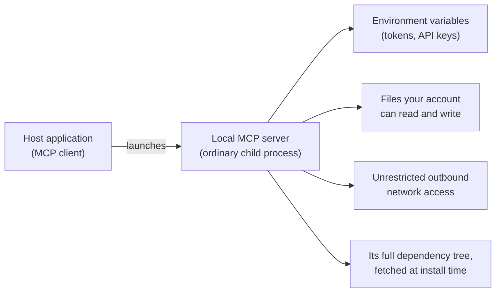

大多数 MCP 安全文档讨论的是协议威胁模型，例如 OAuth 流程、令牌处理、会话劫持和混淆代理攻击。相关内容请参阅[授权](/docs/2026-07-28/tutorials/security/authorization)与[安全最佳实践](/docs/2026-07-28/tutorials/security/security_best_practices)。

本指南讨论另一种威胁模型：**你的机器**。在本地运行 MCP Server，意味着从互联网下载代码，并以自己用户账号的子进程运行。该进程会继承环境变量，能够读取你的账号可以读取的任何内容——SSH 密钥、云凭据、浏览器配置和主目录——也能够向任意地址发起出站网络连接。这些行为都不由协议控制，而取决于你如何运行该进程。

<Note>
  **适用范围**：本指南针对运行在你或组织用户所控制机器上的服务器，例如笔记本电脑或工作站，通常通过 stdio 启动。远程或托管服务器的部署与加固是另一个主题，所需的控制措施也不同。
</Note>

<Tip>
  **如果读完后只做一件事**：打开客户端的 MCP 配置，移除不再使用的服务器，并确认你了解每个剩余服务器的来源，且已固定其版本。本指南中的其他措施，都以清楚知道自己实际运行了什么为前提。
</Tip>

## 本地服务器能够访问什么

本地 MCP Server 不是运行在协议所提供沙箱中的插件，而是由宿主应用启动的普通操作系统进程，拥有这种运行方式所带来的全部访问能力：

提供一键安装功能的客户端，必须在运行前向你展示准确的命令（[SEP-1024](/seps/1024-mcp-client-security-requirements-for-local-server-)）。但只有当你知道该检查什么时，许可对话框才有帮助。本指南的其余部分正是为此而写。

### stdio 信任模型

大多数本地服务器使用 stdio 传输：客户端将服务器作为子进程启动，双方通过 stdin 和 stdout 通信。这种设计包含一个重要假设：**客户端与 stdio 服务器共享同一个信任域。** 它们以相同权限并行运行，协议和 SDK 都不会保护其中一方免受另一方影响。服务器一旦启动，就已经能够在你的机器上执行代码，因此两个进程之间并不存在可由传输层强制执行的安全边界。这是有意的设计：SDK 假设 stdio 对等端之间完全互信；围绕本地服务器建立隔离或安全防护，是宿主应用与机器操作者的责任。

这带来两个实际结论：

- 真正的安全决策发生在**启动之前**：安装什么（来源），以及如何运行（隔离）。Stdio 传输并不是沙箱。
- 如果你以较低权限运行服务器，就必须自行落实这条边界，例如使用下文介绍的容器、沙箱或虚拟机。

信任域还会不断累积。你配置的所有服务器共享同一份模型上下文，因此恶意服务器可以影响智能体如何使用其他所有服务器的工具。每安装一个服务器，都会扩大其余服务器所暴露的攻击面。

### 本指南应对的威胁

1. **恶意服务器。** 使用近似包名的拼写仿冒、外观相似的仓库，或被新发布者接管的废弃项目。这样的“服务器”一边正常提供宣称的功能，一边窃取环境信息或文件。
2. **过度收集的服务器。** 合法服务器收集了超出自身任务所需的数据，例如无关的环境变量、文件或网络流量。不可信内容中的提示注入，也可能利用已授予的访问权限，诱导原本诚实的服务器越界。
3. **遭入侵的依赖。** 服务器作者本身可信，但依赖树中的某个包在供应链攻击中遭到入侵。
4. **被投毒的工具目录。** 工具名称和描述是模型会读取的指令。服务器可以在其中隐藏指令，在恶意工具根本没有被调用时，就影响智能体的行为，包括如何使用 _其他_ 服务器的工具。这通常称为工具投毒；当它针对其他服务器的工具时，也称为工具遮蔽。工具定义在安装后也并非固定不变：服务器可以在你批准后悄悄修改它们，即所谓的 rug pull。因此，一次性许可对话框和固定包版本，无法覆盖这一攻击面。
5. **存在漏洞的服务器或桥接组件。** 合法、未经修改的组件仍可能成为入侵入口。将 stdio 客户端连接到远程服务器的本地桥接组件，曾出现仅连接恶意端点就能触发的严重漏洞；监听本地端口的开发工具，也曾被网页直接利用。

不在本指南范围内的威胁包括：能够物理接触机器的攻击者、有针对性的国家级攻击，以及协议层攻击；协议层攻击请参阅上文链接的文档。

介绍缓解措施之前，先明确一个影响所有措施的事实：**没有任何检查能够证明服务器实际会做什么。** 协议不能保证服务器身份真实，也不能保证它只执行承诺的行为。可阅读的代码仓库、签名、SBOM 或经过筛选的目录等来源信号，只能告诉你正在信任谁，不能证明这种信任合理。除非自行审计并构建每个发布版本，否则无法提前验证其行为。

因此，下文的缓解措施遵循同一原则：**将第三方本地服务器视为不可信代码，它拥有你授予的全部权限；而你应当尽可能少地授予权限。** 审查降低错误信任决策的概率，隔离则决定错误决策的代价。各节都会给出基本做法、可选的“进一步加强”措施，以及不确定时可采用的默认选择。

## 先判断是否必须在本地运行

缩小影响范围最省力的方法，就是一开始不产生这种风险。在将服务器安装为本地进程之前，先问清它究竟需要从机器上获得什么。读取工作树、驱动本地工具或访问硬件，是本地运行的合理理由；封装远程 API 则不是。只与互联网服务通信的服务器，在笔记本电脑上运行并无额外收益，却会让你无谓地承担本指南讨论的全部风险。

- **存在远程版本时，优先选择远程版本。** 通过 [Streamable HTTP](/specification/2026-07-28/basic/transports/streamable-http) 提供服务的服务器不会在你的机器上执行代码，使用协议授权流程，而不是在本地配置文件中存放令牌，并且可以在一处统一修补漏洞。它适用的是上文链接的协议威胁模型，而非本指南的模型。
- **将不必要的本地安装视为一个信号。** 如果第三方服务器不需要访问本地资源，却只提供 stdio 进程形式，应当追问原因。这可能只是作者选择了最省事的实现方式，但也正是恶意或过度收集的服务器进入你机器的方式。
- **保留确有必要的例外。** 有些能力只能由本地进程提供。对于这些服务器，本指南的其余措施都应完整落实。

**不确定时**：如果服务器不需要访问你的文件、本地工具或本地网络，就使用远程版本，完全跳过本地安装。

## 安装前检查来源

注册表中的收录并不等于背书。Docker Hub、ghcr.io、npm、PyPI 和 NuGet 几乎允许托管任何内容；包的流行程度或看起来合适的名称，都不能保证其安全，也不能保证它仍在更新。即使经过筛选的 MCP 目录，也将其审查描述为尽力而为：筛选能够降低风险，但不会替你承担运行软件的责任。

安装服务器之前：

- **确认发布者身份。** 能否将包对应到源码仓库，以及真实的维护者或组织？仓库近期是否存在合理的活动？
- **核对准确的包名。** 拼写仿冒是成本最低的攻击方式。确认安装的是文档所指的包，而不是名称相近的仿冒品。
- **固定版本。** 安装具体版本，而不是 `latest`，避免未来遭入侵的版本通过自动更新进入机器。同时必须养成主动更新的习惯：一旦固定的版本出现安全公告，固定版本本身也会使你继续处于易受攻击的状态。
- **了解版本固定覆盖什么。** 使用 `npx` 或 `uvx` 等启动器固定包版本，只固定了顶层包；传递依赖通常会在安装时重新解析，而遭入侵的依赖正是在这一环节进入。使用摘要固定容器镜像（`image@sha256:...`），才能冻结整个依赖树。
- **优先选择附带来源元数据的产物。** 签名产物、构建证明和 SBOM（软件物料清单），可以帮助验证产物由谁构建、包含什么内容，也包括它使用的 MCP SDK 及版本；当某个 SDK 版本披露漏洞时，这一点尤为重要。

**进一步加强**：真正验证签名和证明，而不只是注意到它们存在，例如使用 Sigstore 工具或注册表提供的证明验证功能。还可以使用 Syft 或 Trivy 等工具，根据产物自行生成 SBOM，而不是完全信任发布者提供的清单。有些注册表和运行时支持在启动时验证签名，而不局限于安装阶段，从而将来源验证从一次性检查变为持续控制。

**不确定时**：只安装能够阅读源码、确认发布者身份的服务器，并固定准确版本。

## 将工具定义视为不可信输入

安装服务器并不是最后一次信任决策。运行时，服务器会向客户端发送工具名称和描述，模型将把它们当作指令读取。这是安装前审查无法覆盖的注入入口。

- **依赖服务器之前先阅读工具列表。** 大多数客户端可以显示各工具的描述，[MCP Inspector](/docs/2026-07-28/tools/inspector) 也能够在不引入模型的情况下列出服务器提供的全部工具。如果描述中包含与工具用途无关的指令，应移除该服务器。
- **优先选择能够固定工具定义的客户端。** 有些客户端会在首次批准服务器时记录工具定义，并在定义变更时再次征求许可。协议并未要求这一行为，因此选择客户端时值得关注这种能力。
- **保持服务器数量精简。** 所有已配置服务器共享模型上下文，因此每增加一个服务器，都会扩大其他服务器暴露的攻击面。

**不确定时**：只安装少量服务器，至少浏览一次各工具的描述，并优先使用在工具定义变化时会再次征求许可的客户端。

## 在隔离环境中运行服务器

进程隔离是本指南中最有效的缓解措施。它把“这个服务器可以读取我的 SSH 密钥”变成“这个服务器只能读取一个空目录”。即使来源检查失效，隔离仍能同时应对上文列出的全部威胁。

- **基本做法**：在 Docker 或 Podman 等容器中运行第三方服务器，仅挂载服务器真正需要的目录。Stdio 传输无需修改：客户端与容器的 stdin、stdout 通信，就像与裸进程通信一样。
- **其他选择**：为开发工作准备轻量虚拟机，或使用操作系统的进程沙箱机制。有些面向 MCP 的运行时和客户端集成，会自动将服务器包装在容器中；关键是隔离模式，而非具体工具。

容器并非不可突破的边界，但它消除了对环境变量、文件和密钥链的默认访问，而常见攻击正是依赖这些访问能力。

**进一步加强**：加固容器本身。Seccomp 配置可以限制系统调用，AppArmor 或 SELinux 等 Linux 安全模块则限制进程能够访问的资源；很多时候，只需启用发行版的默认设置就能生效。还可以在 microVM 或独立用户账号下运行服务器，并结合下文的网络控制措施，防止沙箱将其可见的少量数据外传。

**不确定时**：将所有第三方服务器放在容器中运行，只挂载它实际要处理的目录。

## 隔离凭据

本地启动的服务器可能继承启动它的进程所拥有的环境变量。如果你在 shell 配置中全局导出云凭据和 API Token，每个服务器都可能读取全部这些内容。

- **按服务器传入密钥，不要全局共享。** 使用客户端配置文件中各服务器独立的环境变量配置，而不是在 shell 配置中导出密钥，让每个服务器只能看到自己的凭据。
- **严格限制令牌范围。** 为每个服务器签发独立令牌，使用能够满足任务的最小范围，例如只允许访问一个仓库的细粒度访问令牌，而不是账号范围的令牌，使泄露影响可控，并便于撤销。
- **不要将长期密钥保存在明文配置中。** 客户端配置文件在磁盘上的位置已知且可预测。如果客户端支持引用操作系统的密钥存储，应优先使用，例如 macOS Keychain、Windows Credential Manager 或 Linux 上的 freedesktop Secret Service。
- **不要忽略文件中的凭据。** `~/.ssh`、`~/.aws` 等目录本身就保存着磁盘凭据。真正阻止服务器访问它们的是前文介绍的进程隔离。

**进一步加强**：在启动时通过密钥管理器或代理签发短期凭据，取代静态令牌。决定移除服务器后，应轮换它曾持有的全部凭据。

**不确定时**：通过每个服务器独立的配置，为其提供最小权限的专用令牌；绝不要在多个服务器之间复用权限宽泛的个人令牌。

## 限制文件系统访问

许多实用服务器确实需要访问文件，问题在于需要多大的范围。

- **授予能够满足任务的最小根目录。** 对面向文件系统的服务器，应通过配置或工具参数，明确传入特定项目目录，绝不要授予整个主目录。
- **优先只读。** 如果服务器的工作是读取代码或文档，就以只读方式挂载或授权该目录。
- **警惕过大的访问范围。** 为完成局部任务却要求访问宽泛根目录的服务器，已经超出了合理需求。应授予更小的目录，或选择其他服务器。

<Warning>
  配置层面的允许列表是**依赖自觉遵守的边界**：行为良好的服务器会尊重它，但协议无法阻止恶意或遭入侵的服务器读取该进程能够访问的任何内容。它们只是为诚实服务器设置的护栏。真正的强制执行来自上文的隔离层，例如让沙箱或容器中的文件系统只包含获准的目录。
</Warning>

**进一步加强**：将允许列表与隔离结合，让服务器能够看到的文件系统，仅限于你选择的挂载目录。

**不确定时**：只授予一个项目目录的只读访问权限。

## 控制出站网络访问

数据外传需要出口。本地进程通常具有不受限制的出站访问能力，这会将任何过度收集或入侵转化为数据泄露。

- **了解服务器应与哪些地址通信。** 封装单个 API 的服务器，其目标地址应当少而明确。访问任何其他地址的流量，都值得调查。
- **不需要网络时就禁用网络。** 只处理本地文件或工具的服务器，根本不需要联网；使用容器时，一个参数即可实现（`--network=none`）。
- **过滤必要的网络访问。** 对确实需要出站连接的服务器，使用出站过滤防火墙或带域名允许列表的出口代理，将访问限制到预期目标，并记录超出范围的尝试。

<Note>
  出站流量并非唯一的网络风险。监听端口的本地 MCP 基础设施，例如远程服务器桥接组件、开发工具和本地 HTTP 服务器，也可以被其他本地进程访问，网页还可能通过浏览器访问它们。绑定到 127.0.0.1 并不构成身份验证边界：这些组件需要真正的身份验证与来源校验，并在安全公告发布后及时更新。
</Note>

**进一步加强**：通过代理，为每个服务器设置独立的出站允许列表，并对访问列表以外目标的行为发出告警。意外的出站连接，往往是本页所述风险实际发生时最先可观察到的信号。

**不确定时**：默认禁止服务器访问网络，除非能够证明它确实需要；对于确实需要联网的服务器，要清楚其预期目标地址。

## 在组织中管理本地服务器

如果你是 IT、安全或平台管理员，上述措施是基础，但你面对的问题有所不同：设备多、用户多，而且用户会在你未参与的情况下安装服务器。以下两个事实决定了整体做法：

1. **本地 MCP Server 是用户安装的普通软件。** 协议不能对其无法管理的机器上的进程进行盘点、修补或隔离。这属于终端与软件治理，是你原有职责中新增加的一种软件包类型。
2. **用户不会先来征求你的意见。** 应当假定用户安装服务器，就像安装编辑器扩展一样自然。

一个可行的初始方案包括：

- **定义获准的来源。** 发布一份简短的、经过审查且固定版本的服务器允许列表，并明确新服务器加入列表所需满足的条件：可识别的发布者、可阅读的源码、来源元数据和 SBOM。让获准的使用方式比未获准的方式更方便。
- **设定默认运行方式。** 确定并记录服务器在受管设备上的运行方式，例如“第三方服务器必须运行在不挂载主目录的容器中”，而不是将隔离完全交给各用户自行决定。
- **无需本地访问时集中部署。** 本指南开头的问题同样适用于整个设备群：只封装 SaaS API 的服务器，不需要在每台笔记本电脑上运行。集中管理的远程部署，只需修补、审计和控制一个实例，而不是数百个。
- **持续盘点。** 各平台上的客户端配置文件都保存在已知位置。终端管理工具可以收集这些文件，让你实时掌握“谁在运行什么、版本是什么、来源在哪里”。
- **保留审计记录。** 在工具支持的情况下，记录受管设备上的 MCP 活动，包括哪个服务器、哪个工具、什么时间。这样，事件复盘就能重建遭入侵或越权服务器实际执行过的操作，而不是仅根据权限猜测。
- **为设备群范围内的事件做好准备。** 当广泛使用的本地服务器或其内部 SDK 被发现存在漏洞时，你需要找到每个实例（依靠上述盘点），在响应期间通过代理或防火墙阻止其出站访问，轮换这些配置传入的全部凭据，并通过获准渠道推送修复后且固定版本的软件。SBOM 能让你在几分钟而非几天内回答“哪些机器运行着基于受影响 SDK 版本构建的软件”。
- **关注适用法规。** 软件供应链法规，例如欧盟《网络韧性法案》，正日益要求落实这些做法，包括 SBOM、更新流程和漏洞处理，因此上述工作通常还能同时满足合规需要。

**不确定时**：先盘点整个设备群中的客户端配置，并建立简短的获准服务器列表。对于不在配置盘点和允许列表覆盖范围内的软件，应当像其他未经批准的软件一样处理。

## 检查清单

对于你自己的机器：

- 我了解客户端配置中的每个服务器，并已移除不再使用的服务器。
- 不需要访问我机器上任何资源的服务器，采用远程运行，而非本地进程。
- 每个服务器都来自可识别的发布者，并且已经固定版本。
- 第三方服务器运行在容器、沙箱或虚拟机等隔离环境中，而非裸进程。
- 每个服务器只通过自身配置获得权限范围有限的专用凭据，不继承 shell 中的密钥，也不复用其他凭据。
- 文件系统访问仅限于特定目录，并在可行时使用只读权限。
- 不需要联网的服务器已禁用出站连接，其余服务器有明确的目标地址列表。
- 我已浏览每个服务器的工具描述，并且客户端会在工具定义变化时再次征求许可。

对于设备群：

- 我们维护一份获准服务器列表，并公开其准入标准。
- 我们持续盘点受管设备上的 MCP Client 配置。
- 我们为本地服务器制定了有文档记录的默认隔离方式。
- 我们保留受管设备上 MCP 活动的审计日志。
- 我们能够在整个设备群中阻止某个服务器的出站连接，并轮换其凭据。

## 后续步骤

<CardGroup cols={2}>
  <Card
    title="安全最佳实践"
    icon="shield"
    href="/docs/2026-07-28/tutorials/security/security_best_practices"
  >
    协议威胁模型：混淆代理、令牌透传和会话劫持
  </Card>
  <Card
    title="授权"
    icon="key"
    href="/docs/2026-07-28/tutorials/security/authorization"
  >
    了解远程 MCP Server 中基于 OAuth 的授权机制
  </Card>
  <Card
    title="SEP-1024"
    icon="file-shield"
    href="/seps/1024-mcp-client-security-requirements-for-local-server-"
  >
    本地服务器安装许可的客户端安全要求
  </Card>
  <Card
    title="连接本地服务器"
    icon="plug"
    href="/docs/2026-07-28/develop/connect-local-servers"
  >
    在客户端中配置本地服务器，也就是本指南要保护的工作流
  </Card>
</CardGroup>
