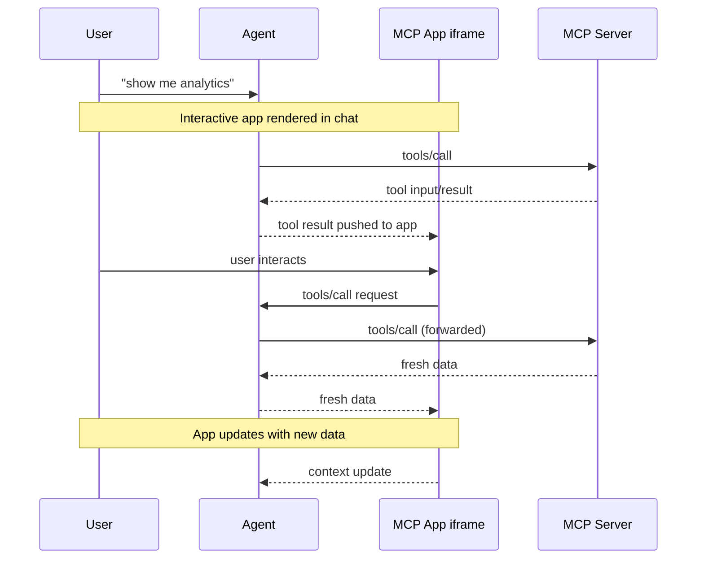

<Tip>

完整 API 文档、进阶模式和完整规范，请参阅 [MCP Apps 官方文档](https://apps.extensions.modelcontextprotocol.io)。

</Tip>

纯文本响应的表达能力有限。有时用户需要与数据交互，而不只是阅读说明。MCP Apps 允许服务器返回可直接在聊天中呈现的交互式 HTML 界面，例如数据可视化、表单和仪表盘。

<Frame caption="在 Claude 中运行的 Excalidraw MCP App">
  
</Frame>

## 为什么不直接构建 Web 应用？

你完全可以构建独立 Web 应用，再向用户发送链接。但 MCP Apps 具有独立页面难以比拟的几项优势：

- **保留上下文。** 应用就在对话中。用户无需切换标签页、重新寻找阅读位置，也不必回忆仪表盘出现在哪个聊天中。界面始终与产生它的讨论相伴。
- **双向数据流。** 应用可以调用 MCP Server 上的任意工具，宿主也可以向应用推送新结果。独立 Web 应用需要自行实现 API、身份验证和状态管理，而 MCP Apps 可以通过现有 MCP 模式获得这些能力。
- **与宿主能力集成**。应用可以将操作委托给宿主，由宿主在获得用户同意后，调用用户已经连接的能力和工具。这样，每个应用无需各自实现并维护直接集成（如邮件提供商）；应用只需请求一个结果，例如“安排这次会议”，再由宿主利用用户现有的连接能力完成。
- **安全保障。** MCP Apps 在宿主控制的沙箱 iframe 中运行，无法访问父页面、窃取 Cookie，或逃离其容器。因此，宿主无需完全信任服务器作者，也能安全地呈现第三方应用。

如果你的使用场景不需要这些特性，普通 Web 应用可能更简单。但如果需要与基于 LLM 的对话紧密集成，MCP Apps 会更合适。

## MCP Apps 的工作原理

传统 MCP 工具返回文本、图像、资源或结构化数据，由宿主作为对话的一部分展示。MCP Apps 在此基础上扩展：工具可以在描述中声明一个交互式界面引用，由宿主直接在对话中呈现。

其核心模式结合了两种 MCP 原语：工具在描述中声明界面资源，而界面资源将数据呈现为交互式 HTML 界面。

当大语言模型（LLM）决定调用支持 MCP Apps 的工具时，会发生以下过程：

1. **预加载界面**：工具描述中的 `_meta.ui.resourceUri` 字段指向一个 `ui://` 资源。宿主甚至可以在调用工具前预加载该资源，从而支持将工具输入流式传递给应用等功能。

2. **获取资源**：宿主从服务器获取界面资源。资源中包含 HTML 页面；为了简化部署，通常会将 JavaScript 和 CSS 一同打包。应用也可以从 `_meta.ui.csp` 指定的源加载外部脚本和资源。

3. **沙箱渲染**：Web 宿主通常在对话中的沙箱 [iframe](https://developer.mozilla.org/en-US/docs/Web/HTML/Element/iframe) 内渲染 HTML。沙箱限制应用对父页面的访问，以保证安全。资源的 `_meta.ui` 对象可以包含 `permissions`，用于请求麦克风、摄像头等额外能力；也可以包含 `csp`，控制允许从哪些外部源加载资源。

4. **双向通信**：应用与宿主通过基于 JSON-RPC 的 MCP 专用变体通信。有些请求和通知与 MCP 核心协议共用，例如 `tools/call`；有些只是相似，例如 `ui/initialize`；大多数则是以 `ui/` 为方法名前缀的新消息。应用可以请求工具调用、发送消息、更新模型上下文，并接收宿主的数据。

应用与宿主保持隔离，但仍能通过安全的 postMessage 通道调用 MCP 工具。

## 何时使用 MCP Apps

以下使用场景适合 MCP Apps：

**探索复杂数据。** 用户要求“按地区展示销售额”。文本响应可以列出数字，而 MCP App 可以呈现交互式地图，让用户点击地区深入查看、悬停获取详情、切换指标，全程无需追加提示。

**配置大量选项。** 配置一次部署可能涉及几十个相互依赖的选择。MCP App 可以在一张表单中展示全部选项，并提供校验与默认值，而无需反复对话询问“哪个地区？”“多大实例？”“要启用自动扩缩容吗？”。

**查看丰富媒体。** 用户想审阅 PDF、查看 3D 模型或预览生成的图像时，文本描述并不足够。MCP App 可以将真实的查看器直接嵌入对话，支持平移、缩放和旋转。

**实时监控。** 展示实时指标、日志或系统状态的仪表盘，需要持续更新。MCP App 可以保持持久连接，在数据变化时更新界面，无需用户不断询问“现在状态怎么样？”。

**多步骤工作流。** 审批报销、审查代码变更或对问题分类处理，都需要逐项检查。MCP App 可以提供导航控件、操作按钮，以及在多次交互之间保留的状态。

## 安全模型

MCP Apps 在沙箱 [iframe](https://developer.mozilla.org/docs/Web/HTML/Element/iframe) 中运行，与宿主应用形成强隔离。沙箱阻止应用访问父窗口的 [DOM](https://developer.mozilla.org/docs/Web/API/Document_Object_Model)、读取宿主的 Cookie 或本地存储、导航父页面，或在父页面上下文中执行脚本。

应用与宿主之间的所有通信都通过 [postMessage API](https://developer.mozilla.org/docs/Web/API/Window/postMessage)。宿主决定应用能够访问哪些能力，例如限制应用可以调用的工具，或禁用 `sendOpenLink` 能力。

沙箱的设计目标，是阻止应用逃逸并访问宿主或用户数据。

## 框架支持

与核心协议一样，MCP Apps 使用基于 JSON-RPC 的 MCP 专用变体。有些消息与常规 MCP 共用，例如 `tools/call`；有些则为应用专用，例如 `ui/initialize`。它使用 [postMessage](https://developer.mozilla.org/docs/Web/API/Window/postMessage) 传输，而非 stdio 或 HTTP。由于这些都是标准 Web 基础能力，你可以使用任意框架，也可以完全不使用框架。

`@modelcontextprotocol/ext-apps` 中的 `App` 类只是便捷封装，并非必需。如果希望避免依赖或更精细地控制行为，也可以直接实现 [postMessage 协议](https://github.com/modelcontextprotocol/ext-apps/blob/main/specification/2026-01-26/apps.mdx)。

[示例目录](https://github.com/modelcontextprotocol/ext-apps/tree/main/examples)包含 React、Vue、Svelte、Preact、Solid 和原生 JavaScript 的入门模板。它们展示各框架中的推荐模式，但只是示例，并非强制要求。你可以选择最适合自己场景的方案。

## 客户端支持

<Note>

MCP Apps 是 [MCP 核心规范](/specification/latest)的扩展，宿主是否支持取决于具体客户端。

</Note>

目前支持 MCP Apps 的客户端包括 [Claude](https://claude.ai)、[Claude Desktop](https://claude.ai/download)、[VS Code GitHub Copilot](https://code.visualstudio.com/)、[Microsoft 365 Copilot](https://www.microsoft.com/microsoft-365-copilot)、[Goose](https://block.github.io/goose/)、[Postman](https://postman.com)、[MCPJam](https://www.mcpjam.com/) 和 [Archestra.AI](https://www.archestra.ai/)。各客户端对扩展的完整支持情况见[客户端支持矩阵](/extensions/client-matrix)。

如果你正在构建 MCP Client，并希望支持 MCP Apps，有两种选择：

1. **使用框架**：[`@mcp-ui/client`](https://github.com/MCP-UI-Org/mcp-ui) 包提供 React 组件，用于在宿主应用中渲染 MCP Apps 视图并与其交互。用法详见 [MCP-UI 文档](https://mcpui.dev/)。

2. **基于 AppBridge 构建**：SDK 包含 [**App Bridge**](https://apps.extensions.modelcontextprotocol.io/api/modules/app-bridge.html) 模块，负责在沙箱 iframe 中渲染应用、传递消息、代理工具调用，以及执行安全策略。[basic-host 示例](https://github.com/modelcontextprotocol/ext-apps/tree/main/examples/basic-host)展示了集成方式。

实现细节见 [API 文档](https://apps.extensions.modelcontextprotocol.io/api/)。

## 示例

[ext-apps 仓库](https://github.com/modelcontextprotocol/ext-apps/tree/main/examples)提供可直接运行的示例，展示不同使用场景：

- **3D 与可视化**：
  [map-server](https://github.com/modelcontextprotocol/ext-apps/tree/main/examples/map-server)
  （CesiumJS 地球）、
  [threejs-server](https://github.com/modelcontextprotocol/ext-apps/tree/main/examples/threejs-server)
  （Three.js 场景）、
  [shadertoy-server](https://github.com/modelcontextprotocol/ext-apps/tree/main/examples/shadertoy-server)
  （着色器效果）
- **数据探索**：
  [cohort-heatmap-server](https://github.com/modelcontextprotocol/ext-apps/tree/main/examples/cohort-heatmap-server)、
  [customer-segmentation-server](https://github.com/modelcontextprotocol/ext-apps/tree/main/examples/customer-segmentation-server)、
  [wiki-explorer-server](https://github.com/modelcontextprotocol/ext-apps/tree/main/examples/wiki-explorer-server)
- **业务应用**：
  [scenario-modeler-server](https://github.com/modelcontextprotocol/ext-apps/tree/main/examples/scenario-modeler-server)、
  [budget-allocator-server](https://github.com/modelcontextprotocol/ext-apps/tree/main/examples/budget-allocator-server)
- **媒体**：
  [pdf-server](https://github.com/modelcontextprotocol/ext-apps/tree/main/examples/pdf-server)、
  [video-resource-server](https://github.com/modelcontextprotocol/ext-apps/tree/main/examples/video-resource-server)、
  [sheet-music-server](https://github.com/modelcontextprotocol/ext-apps/tree/main/examples/sheet-music-server)、
  [say-server](https://github.com/modelcontextprotocol/ext-apps/tree/main/examples/say-server)
  （文本转语音）
- **实用工具**：
  [qr-server](https://github.com/modelcontextprotocol/ext-apps/tree/main/examples/qr-server)、
  [system-monitor-server](https://github.com/modelcontextprotocol/ext-apps/tree/main/examples/system-monitor-server)、
  [transcript-server](https://github.com/modelcontextprotocol/ext-apps/tree/main/examples/transcript-server)
  （语音转文本）
- **入门模板**：
  [React](https://github.com/modelcontextprotocol/ext-apps/tree/main/examples/basic-server-react)、
  [Vue](https://github.com/modelcontextprotocol/ext-apps/tree/main/examples/basic-server-vue)、
  [Svelte](https://github.com/modelcontextprotocol/ext-apps/tree/main/examples/basic-server-svelte)、
  [Preact](https://github.com/modelcontextprotocol/ext-apps/tree/main/examples/basic-server-preact)、
  [Solid](https://github.com/modelcontextprotocol/ext-apps/tree/main/examples/basic-server-solid)、
  [原生 JavaScript](https://github.com/modelcontextprotocol/ext-apps/tree/main/examples/basic-server-vanillajs)

要开始构建自己的 MCP App，请参阅[构建指南](/extensions/apps/build)。
