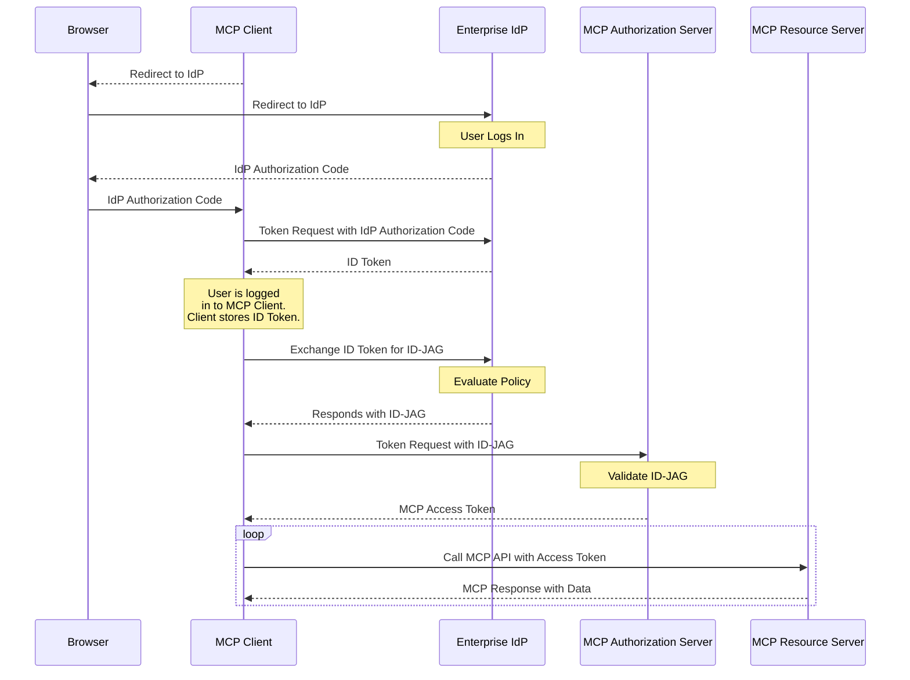

企业管理的授权扩展（`io.modelcontextprotocol/enterprise-managed-authorization`），使组织能够通过已有的身份提供商（IdP），集中控制对 MCP Server 的访问。员工无需再逐一授权每台 MCP Server，组织的 IT 或安全团队可以在同一处统一管理访问策略。

<Card
  title="规范"
  icon="file-lines"
  href="https://github.com/modelcontextprotocol/ext-auth/blob/main/specification/stable/enterprise-managed-authorization.mdx"
>
  企业管理的授权扩展的完整技术规范。
</Card>

## 扩展是什么

在标准 MCP 部署中，每个用户会独立授权某个 MCP Client 访问各台 MCP Server。对于面向个人用户的应用，这种用户主导的模式很理想：个人可以控制谁能访问自己的数据。

但在企业环境中，这种模式会增加使用阻力，并产生安全缺口：

- 员工不应被要求理解组织使用的每台 MCP Server 的授权细节
- 如果每位用户独立授权，安全团队就无法强制实施一致的访问策略
- 新员工入职时，需要手动授权数十项服务
- 员工离职时，需要逐个服务撤销访问权限

企业管理的授权通过引入组织的 IdP 作为权威决策方来解决这一问题。IdP，例如 Okta、Azure AD 或企业 SSO 系统，决定员工能够访问哪些 MCP Server，以及需要满足什么条件。员工使用企业身份完成身份验证，凭据与登录邮箱、Slack 等办公工具时相同；IdP 再依据组织策略，允许或拒绝访问 MCP Server。

## 适用场景

以下场景适合使用企业管理的授权：

- **在企业环境中部署 MCP**：IT 团队负责管理所有业务应用的访问权限
- **强制执行组织访问策略**：需要确保只有获准员工才能访问指定的 MCP Server
- **集中实施访问控制**：希望通过同一个管理控制台添加或撤销 MCP Server 访问权限
- **满足合规要求**：组织需要对所有 MCP Server 访问保留可审计的授权记录
- **简化员工体验**：员工应当能够使用已有企业 SSO 凭据访问 MCP 工具，而无需逐项服务完成授权流程

## 工作原理

该扩展建立了一种委托授权流程，由企业 IdP 充当 MCP Client 与 MCP Server 之间的中间方。MCP Client 向企业 IdP 请求一种特殊令牌，称为 Identity Assertion JWT Authorization Grant（身份断言 JWT 授权许可），简称 ID-JAG。随后，MCP Client 使用 ID-JAG 向 MCP Server 的授权服务器交换访问令牌：



流程的关键点包括：

1. **集中式策略**：企业 IdP 维护已批准 MCP Server 的登记表及各服务器的访问策略。管理员通过现有身份管理工具进行配置。

2. **单点登录**：员工只需使用企业凭据验证一次身份。IdP 签发令牌，允许访问获准的 MCP Server，无需再显示逐服务器授权提示。

3. **策略执行**：IdP 在签发令牌前评估访问策略，包括用户组成员身份、角色分配和条件访问规则。未获授权的员工会收到相应错误；对于未获准的服务器，MCP Client 根本不会获得令牌。

4. **集中撤销**：员工对 MCP Server 的访问权限在 IdP 层面撤销，并立即对所有 MCP Client 生效，无需逐客户端、逐服务器撤销。

## 实现指南

### MCP Client

要支持企业管理的授权，客户端必须：

1. 在逐请求能力中**声明支持**：

```jsonc
{
  "jsonrpc": "2.0",
  "id": 1,
  "method": "...",
  "params": {
    // Other fields...
    "_meta": {
      // Other fields...
      "io.modelcontextprotocol/clientCapabilities": {
        "extensions": {
          "io.modelcontextprotocol/enterprise-managed-authorization": {},
        },
      },
    },
  },
}
```

2. **支持 SSO**：用户应通过企业 IdP 登录 MCP Client。保存登录时签发的身份断言，即 OpenID ID Token 或 SAML 断言，供后续使用。

3. **处理 ID-JAG**：服务器表明需要企业管理的授权时，使用先前获取的身份断言，向企业 IdP 的授权端点请求 ID-JAG 令牌。再使用 ID-JAG 向 MCP 授权服务器交换访问令牌。不要将用户重定向到 MCP 授权服务器的授权端点。

4. **支持组织配置**：允许管理员配置企业 IdP 的端点，通常通过组织级设置，而非逐用户设置进行配置。

5. **遵循令牌权限范围**：企业 IdP 签发的令牌，其权限范围限制可能不同于标准 MCP 授权。应妥善处理权限范围错误。

### MCP Server

要要求使用企业管理的授权：

1. 在服务器的授权元数据中**声明此扩展**，表明客户端必须采用企业管理的流程。

2. **集成 IdP 管理 API**（可选）：发布服务器的资源描述符，使企业管理员能够在 IdP 管理控制台中配置访问策略。

### MCP 授权服务器

1. **校验 ID-JAG**：校验企业 IdP 签发的 ID-JAG。通常需要根据 IdP 的 JWKS 端点校验 JWT 签名，并检查令牌的受众、签发者和过期时间。

2. **将 IdP 声明映射为权限**：ID-JAG 令牌携带权限范围和资源信息等声明，服务器据此判断员工身份及其可以访问的内容。应基于这些声明定义授权逻辑。

3. **处理账号关联**：ID-JAG 令牌始终包含 subject 声明，还可能包含 email 声明，后者可用于将企业身份关联到系统中的现有账号。应使用 subject 声明作为用户的主要稳定标识符；对于启用企业管理的授权之前创建的现有账号，则回退到 email 声明进行匹配。

## 客户端支持

<Note>

各客户端对本扩展的支持情况不同。扩展需要主动启用，绝不会默认激活。

</Note>

各 MCP Client 的当前实现状态见[客户端支持矩阵](/extensions/client-matrix)。企业管理的授权通常不仅需要 MCP 客户端应用支持，也需要组织 IT 团队在客户端层面提供支持。

## 相关资源

<CardGroup cols={2}>
  <Card
    title="ext-auth 仓库"
    icon="github"
    href="https://github.com/modelcontextprotocol/ext-auth"
  >
    源码与参考实现
  </Card>
  <Card
    title="完整规范"
    icon="file-lines"
    href="https://github.com/modelcontextprotocol/ext-auth/blob/main/specification/stable/enterprise-managed-authorization.mdx"
  >
    包含规范性要求的技术规范
  </Card>
  <Card
    title="SEP-990"
    icon="file-lines"
    href="/seps/990-enable-enterprise-idp-policy-controls-during-mcp-o"
  >
    原始提案：启用企业 IdP 策略控制
  </Card>
  <Card
    title="MCP 授权"
    icon="lock"
    href="/specification/latest/basic/authorization"
  >
    MCP 核心授权规范
  </Card>
</CardGroup>
