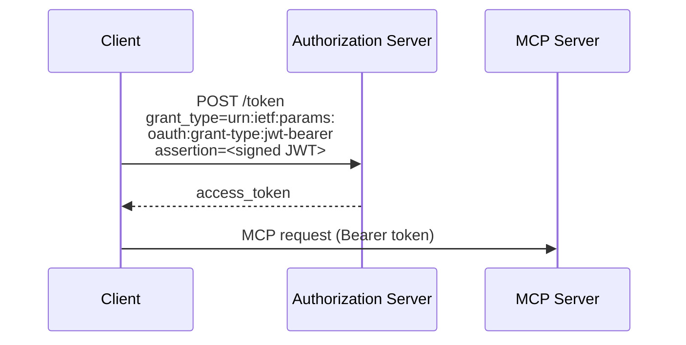
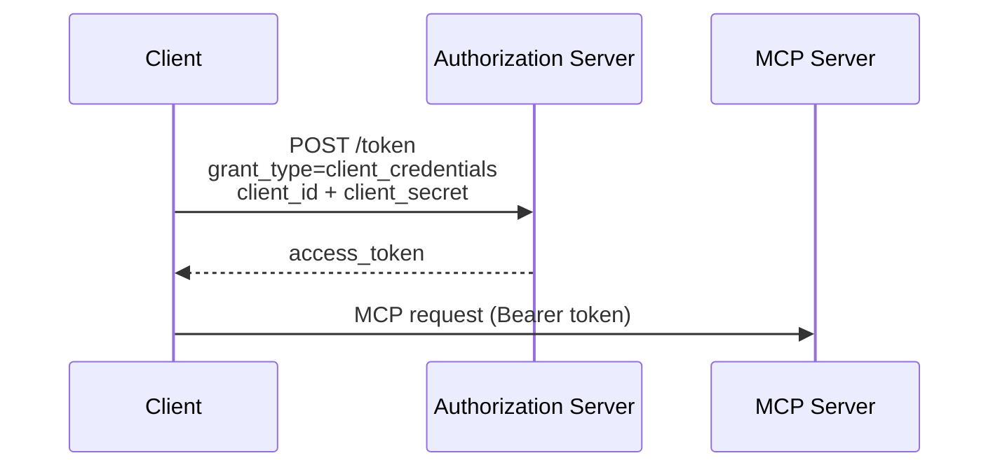

OAuth 客户端凭据扩展（`io.modelcontextprotocol/oauth-client-credentials`）为 MCP 增加 [OAuth 2.0 客户端凭据流程](https://datatracker.ietf.org/doc/html/rfc6749#section-4.4)支持，使自动化系统能够在无需交互式用户授权的情况下连接 MCP Server。

<Card
  title="规范"
  icon="file-lines"
  href="https://github.com/modelcontextprotocol/ext-auth/blob/main/specification/draft/oauth-client-credentials.mdx"
>
  OAuth 客户端凭据扩展的完整技术规范。
</Card>

## 它是什么

标准 MCP 授权流程要求用户通过交互方式批准访问：打开浏览器，用户登录，然后授予权限。这对真人用户很合适，但在没有用户参与时就无法奏效。

OAuth 客户端凭据扩展允许客户端使用应用级凭据（客户端 ID 与密钥，或签名的 JWT 断言）进行身份验证，而不依赖用户委托的凭据。客户端直接向授权服务器证明身份，授权服务器随后签发访问令牌，无需浏览器重定向或用户交互。

## 适用场景

以下情况适合使用 OAuth 客户端凭据：

- **后台服务**需要定时调用 MCP 工具，或在事件发生时调用工具，且没有用户参与
- **CI/CD 流水线**在自动构建、测试或部署工作流中调用 MCP Server
- **服务器间集成**连接两个后端系统，不涉及最终用户
- **守护进程**或长时间运行的工作进程需要持续访问 MCP 资源

如果集成中有需要显式授权访问的真人用户，应使用标准 MCP 授权流程。

## 工作原理

该扩展支持两种凭据格式：

### JWT Bearer 断言（推荐）

[RFC 7523](https://datatracker.ietf.org/doc/html/rfc7523) 定义的 JWT Bearer 断言，允许客户端使用自身私钥签署令牌，并将其作为身份证明。授权服务器使用客户端已注册的公钥验证签名。



JWT 断言通常包含：

- `iss`：客户端 ID，即签发者
- `sub`：客户端 ID，即接受身份验证的主体
- `aud`：授权服务器的令牌端点 URL
- `exp`：过期时间
- `iat`：签发时间

### 客户端密钥

对于较简单的部署，该扩展也支持使用 `client_id` 和 `client_secret` 的标准客户端凭据流程。客户端直接向授权服务器的令牌端点发送凭据，换取访问令牌。



<Warning>

客户端密钥是无需用户交互即可授予访问权限的**长期凭据**。密钥一旦泄露，攻击者便可在密钥轮换前持续静默冒充你的应用。为降低风险：

- 将密钥保存在机密管理系统中，绝不要写入源代码，或提交到版本控制的环境文件。
- 定期轮换密钥；一旦怀疑泄露，立即轮换。
- 将凭据权限限制为实际需要的最小范围。
- 尽可能优先使用 JWT 断言：断言有效期短，也无需传输签名私钥。

</Warning>

## 实现指南

### 对于 MCP Client

要使用 OAuth 客户端凭据扩展，客户端必须：

<Steps>
<Step title="声明支持">

在每个请求携带的能力中加入该扩展：

```jsonc
{
  "jsonrpc": "2.0",
  "id": 1,
  "method": "...",
  "params": {
    // Other fields...
    "_meta": {
      // Other fields...
      "io.modelcontextprotocol/clientCapabilities": {
        "extensions": {
          "io.modelcontextprotocol/oauth-client-credentials": {},
        },
      },
    },
  },
}
```

</Step>
<Step title="获取访问令牌">

在连接 MCP Server 前，通过客户端凭据授权向授权服务器请求令牌。

</Step>
<Step title="携带令牌">

向 MCP Server 发送 HTTP 请求时，在 `Authorization` 请求头中传入令牌：

```
Authorization: Bearer <access_token>
```

</Step>
<Step title="处理令牌刷新">

客户端凭据令牌的有效期通常比用户委托令牌更短。应实现令牌刷新逻辑，在到期前获取新令牌。

</Step>
</Steps>

### 对于 MCP Server

要接受客户端凭据令牌，服务器必须：

<Steps>
<Step title="验证令牌">

在每个请求中，根据授权服务器的公钥验证 JWT 签名和声明；通常通过 JWKS 端点获取公钥。

</Step>
<Step title="检查权限范围">

确认令牌包含所请求操作需要的权限范围。

</Step>
<Step title="公开支持情况">

也可以在 `server/discover` 响应中加入该扩展。这是可选的，但建议这样做，以便客户端发现支持情况：

```jsonc
{
  "jsonrpc": "2.0",
  "id": 1,
  "result": {
    // Other fields...
    "capabilities": {
      "extensions": {
        "io.modelcontextprotocol/oauth-client-credentials": {},
      },
    },
  },
}
```

</Step>
</Steps>

## SDK 示例

官方 MCP SDK 内置客户端凭据身份验证支持，下面两种 SDK 都会自动处理令牌获取和刷新。

<Steps>
<Step title="安装 SDK">

<Tabs>
<Tab title="TypeScript">

```bash
npm install @modelcontextprotocol/client
```

</Tab>
<Tab title="Python">

```bash
pip install mcp
```

</Tab>
</Tabs>

</Step>
<Step title="创建提供方并连接">

选择与你的环境相符的凭据格式：

#### 使用客户端密钥

<Tabs>
<Tab title="TypeScript">

```typescript
import {
  Client,
  ClientCredentialsProvider,
  StreamableHTTPClientTransport,
} from "@modelcontextprotocol/client";

const provider = new ClientCredentialsProvider({
  clientId: "my-service",
  clientSecret: "s3cr3t",
});

const client = new Client(
  { name: "my-service", version: "1.0.0" },
  { capabilities: {} },
);

const transport = new StreamableHTTPClientTransport(
  new URL("https://mcp.example.com/mcp"),
  { authProvider: provider },
);

await client.connect(transport);

// Use the client
const tools = await client.listTools();
console.log(
  "Available tools:",
  tools.tools.map((t) => t.name),
);

await transport.close();
```

</Tab>
<Tab title="Python">

```python
import asyncio

import httpx2

from mcp import Client
from mcp.client.auth.extensions.client_credentials import (
    ClientCredentialsOAuthProvider,
)
from mcp.client.streamable_http import streamable_http_client
from mcp.shared.auth import OAuthClientInformationFull, OAuthToken


class InMemoryTokenStorage:
    def __init__(self) -> None:
        self.tokens: OAuthToken | None = None
        self.client_info: OAuthClientInformationFull | None = None

    async def get_tokens(self) -> OAuthToken | None:
        return self.tokens

    async def set_tokens(self, tokens: OAuthToken) -> None:
        self.tokens = tokens

    async def get_client_info(self) -> OAuthClientInformationFull | None:
        return self.client_info

    async def set_client_info(self, client_info: OAuthClientInformationFull) -> None:
        self.client_info = client_info


provider = ClientCredentialsOAuthProvider(
    server_url="https://mcp.example.com/mcp",
    storage=InMemoryTokenStorage(),
    client_id="my-service",
    client_secret="s3cr3t",
    scopes="read write",
)


async def main() -> None:
    async with httpx2.AsyncClient(auth=provider) as http_client:
        transport = streamable_http_client(
            "https://mcp.example.com/mcp",
            http_client=http_client,
        )
        async with Client(transport) as client:
            # Use the client
            tools = await client.list_tools()
            print("Available tools:", [t.name for t in tools.tools])


if __name__ == "__main__":
    asyncio.run(main())
```

</Tab>
</Tabs>

#### 使用 JWT 私钥

<Tabs>
<Tab title="TypeScript">

```typescript
import {
  Client,
  PrivateKeyJwtProvider,
  StreamableHTTPClientTransport,
} from "@modelcontextprotocol/client";

const provider = new PrivateKeyJwtProvider({
  clientId: "my-service",
  privateKey: process.env.CLIENT_PRIVATE_KEY_PEM,
  algorithm: "RS256",
});

const client = new Client(
  { name: "my-service", version: "1.0.0" },
  { capabilities: {} },
);

const transport = new StreamableHTTPClientTransport(
  new URL("https://mcp.example.com/mcp"),
  { authProvider: provider },
);

await client.connect(transport);

// Use the client
const tools = await client.listTools();
console.log(
  "Available tools:",
  tools.tools.map((t) => t.name),
);

await transport.close();
```

</Tab>
<Tab title="Python">

```python
import asyncio
from pathlib import Path

import httpx2

from mcp import Client
from mcp.client.auth.extensions.client_credentials import (
    PrivateKeyJWTOAuthProvider,
    SignedJWTParameters,
)
from mcp.client.streamable_http import streamable_http_client
from mcp.shared.auth import OAuthClientInformationFull, OAuthToken


class InMemoryTokenStorage:
    def __init__(self) -> None:
        self.tokens: OAuthToken | None = None
        self.client_info: OAuthClientInformationFull | None = None

    async def get_tokens(self) -> OAuthToken | None:
        return self.tokens

    async def set_tokens(self, tokens: OAuthToken) -> None:
        self.tokens = tokens

    async def get_client_info(self) -> OAuthClientInformationFull | None:
        return self.client_info

    async def set_client_info(self, client_info: OAuthClientInformationFull) -> None:
        self.client_info = client_info


# Create a signed JWT assertion provider from key parameters
jwt_params = SignedJWTParameters(
    issuer="my-service",
    subject="my-service",
    signing_key=Path("private_key.pem").read_text(),
    signing_algorithm="RS256",
    lifetime_seconds=300,
)

provider = PrivateKeyJWTOAuthProvider(
    server_url="https://mcp.example.com/mcp",
    storage=InMemoryTokenStorage(),
    client_id="my-service",
    assertion_provider=jwt_params.create_assertion_provider(),
    scopes="read write",
)


async def main() -> None:
    async with httpx2.AsyncClient(auth=provider) as http_client:
        transport = streamable_http_client(
            "https://mcp.example.com/mcp",
            http_client=http_client,
        )
        async with Client(transport) as client:
            # Use the client
            tools = await client.list_tools()
            print("Available tools:", [t.name for t in tools.tools])


if __name__ == "__main__":
    asyncio.run(main())
```

</Tab>
</Tabs>

</Step>
</Steps>

## 客户端支持

<Note>

各客户端的扩展支持情况有所不同。扩展需要主动选择启用，绝不会默认生效。

</Note>

请查看[客户端支持矩阵](/extensions/client-matrix)，了解各 MCP Client 当前的实现状态。

## 相关资源

<CardGroup cols={2}>
  <Card
    title="ext-auth 仓库"
    icon="github"
    href="https://github.com/modelcontextprotocol/ext-auth"
  >
    源码与参考实现
  </Card>
  <Card
    title="完整规范"
    icon="file-lines"
    href="https://github.com/modelcontextprotocol/ext-auth/blob/main/specification/draft/oauth-client-credentials.mdx"
  >
    包含规范性要求的技术规范
  </Card>
  <Card
    title="RFC 6749 — 客户端凭据授权"
    icon="link"
    href="https://datatracker.ietf.org/doc/html/rfc6749#section-4.4"
  >
    所依循的 OAuth 2.0 规范
  </Card>
  <Card
    title="RFC 7523 — JWT Bearer 断言"
    icon="link"
    href="https://datatracker.ietf.org/doc/html/rfc7523"
  >
    JWT 断言格式规范
  </Card>
</CardGroup>
