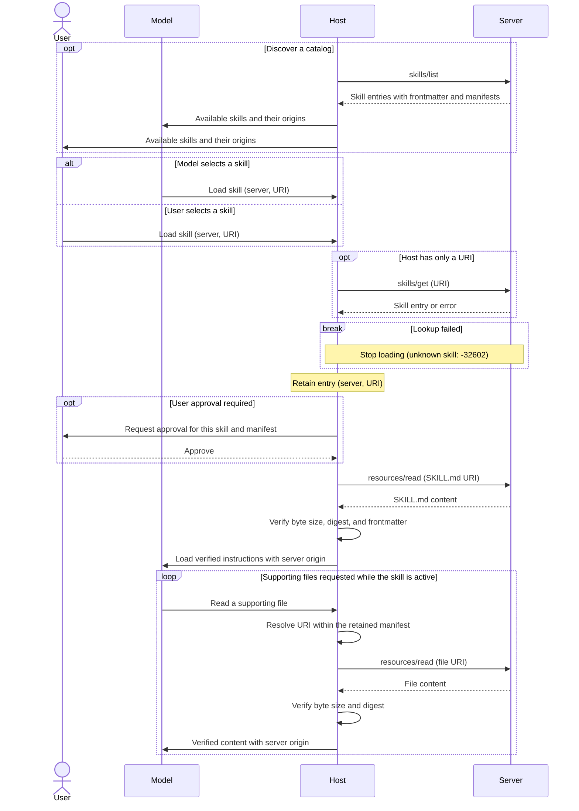

[ext-skills 仓库](https://github.com/modelcontextprotocol/ext-skills)包含官方 Skills 扩展（`io.modelcontextprotocol/skills`）已发布的规范。[SEP-2640](/seps/2640-skills-extension) 已进入 Final 状态。

该扩展由 [Skills Over MCP 工作组](/community/working-groups/skills-over-mcp)维护。SDK 与宿主支持仍在实现中；当前覆盖情况见[客户端支持矩阵](/extensions/client-matrix)和[实现列表](https://github.com/modelcontextprotocol/ext-skills/blob/main/docs/implementations.md)。

<Card
  title="modelcontextprotocol/ext-skills"
  icon="github"
  href="https://github.com/modelcontextprotocol/ext-skills"
>
  通过 MCP 提供技能的规范与文档。
</Card>

Skills 扩展允许 MCP Server 向客户端提供工作流指令和支持文件。客户端可以发现可用技能、获取其元数据，并利用现有的资源原语读取内容。

技能是一个目录，包含 `SKILL.md` 文件及可选的支持文件，遵循 [Agent Skills 规范](https://agentskills.io/specification)。本扩展定义了通过 MCP 发现和获取技能的方式。

技能适用于组合多个工具或需要参考资料的可复用工作流，例如代码审查或文档处理。通过 MCP 提供技能，可以将指令与它们所描述的服务放在一起。客户端根据元数据发现可用工作流，并只在需要时加载指令和支持文件。

## 用户交互模型

宿主应用决定如何向模型和用户提供技能。模型可以根据技能名称和描述选择技能，用户也可以明确选择。该扩展不强制要求特定用户交互模型。

通过 `resources/read` 读取 `SKILL.md`，本身并不会激活技能。要加载技能，宿主必须将这次读取交由自身的技能加载流程处理，验证内容，并在将其加载到模型上下文前应用所需的用户批准流程。

## 能力

支持 Skills 的服务器**必须**在 [`server/discover`](/specification/draft/server/discover) 中同时声明 `resources` 能力和 `io.modelcontextprotocol/skills` 扩展：

```json
{
  "capabilities": {
    "resources": {},
    "extensions": {
      "io.modelcontextprotocol/skills": {
        "directoryRead": true
      }
    }
  }
}
```

声明该扩展的服务器**必须**实现 `skills/list` 和 `skills/get`。技能文件通过 `resources/read` 提供。

可选的 `directoryRead` 设置表示支持 `resources/directory/read`，默认为 `false`。空的扩展对象表示支持技能，但不支持目录读取。客户端只有在看到服务器的声明后，才会发出 `skills/list` 和 `skills/get`。

<Note>
  以下示例采用协议修订版 `2026-07-28` 或更高版本。为简洁起见，请求示例省略了 `_meta`。每个请求都**必须**包含必需的[请求元数据](/specification/draft/basic/index#_meta)。
</Note>

## 协议消息

### 列出技能

客户端发送 `skills/list` 请求，发现可用技能。此操作支持[分页](/specification/draft/server/utilities/pagination)与[缓存](/specification/draft/server/utilities/caching)。

**请求：**

```json
{
  "jsonrpc": "2.0",
  "id": 1,
  "method": "skills/list",
  "params": {}
}
```

**响应：**

```json
{
  "jsonrpc": "2.0",
  "id": 1,
  "result": {
    "resultType": "complete",
    "skills": [
      {
        "uri": "skill://code-review/SKILL.md",
        "frontmatter": {
          "name": "code-review",
          "description": "Review code using the team's checklist."
        },
        "resources": [
          {
            "uri": "skill://code-review/SKILL.md",
            "digest": "sha256:d2489d6c182e8df9c178563ff9f2eac7998a0c1bb1278c52a7fd5306e4259160",
            "size": 149
          },
          {
            "uri": "skill://code-review/references/checklist.md",
            "digest": "sha256:dbab2de7bf7db9cc95cb6ce681c3690b26184db39f75b958a0287ca6d9e24e20",
            "size": 65
          }
        ]
      }
    ],
    "ttlMs": 300000,
    "cacheScope": "public"
  }
}
```

每个条目包含：

| 字段 | 含义 |
| ------------- | --------------------------------------------------------------------------- |
| `uri` | 技能 `SKILL.md` 的资源 URI。 |
| `frontmatter` | 原样保留的全部 YAML Frontmatter 字段，包括 `name` 和 `description`。 |
| `resources` | 完整文件清单；生成型内容则为 `"dynamic"`。 |

清单**必须**包含 `SKILL.md` 及每个支持文件，并提供各文件的 URI、SHA-256 摘要和字节大小。`skills/list` 返回的每个条目都是完整的，客户端无需为获取额外元数据再调用 `skills/get`。

响应包含 `nextCursor` 时，客户端将其作为 `params.cursor` 传入，以获取下一页。列表和获取结果都**必须**包含 `resultType: "complete"`、`ttlMs` 和 `cacheScope`。缓存字段描述新鲜度与共享范围，并不保证内容完整性。

技能身份由来源服务器的身份与技能 URI 共同构成。名称只是标签，不保证唯一。宿主**必须**在注册表、批准记录和缓存中，同时保留服务器身份和 URI。服务器**应当**使用 `skill://` 方案，但也**可以**采用其他方案。宿主**不得**仅凭 URI 方案就将资源识别为技能。

### 获取技能

客户端发送 `skills/get` 请求，按 URI 获取技能条目。URI 可以由用户、其他技能或服务器指令提供。

**请求：**

```json
{
  "jsonrpc": "2.0",
  "id": 2,
  "method": "skills/get",
  "params": {
    "uri": "skill://code-review/SKILL.md"
  }
}
```

响应在 `result.skill` 下包含技能条目，其结构与 `skills/list` 中的条目相同，并包含 `resultType: "complete"`、`ttlMs` 和 `cacheScope`。客户端也可以使用此方法刷新现有条目。

服务器**可以**返回空或不完整的列表，但对于其提供的每项技能，都**必须**响应 `skills/get`。宿主**必须**支持按 URI 加载，包括未出现在列表中的技能。

### 读取技能内容

客户端发送 [`resources/read`](/specification/draft/server/resources#reading-resources) 请求，获取技能指令或支持文件。以下示例读取上述列表中的 `SKILL.md`。

**请求：**

```json
{
  "jsonrpc": "2.0",
  "id": 3,
  "method": "resources/read",
  "params": {
    "uri": "skill://code-review/SKILL.md"
  }
}
```

**响应：**

```json
{
  "jsonrpc": "2.0",
  "id": 3,
  "result": {
    "resultType": "complete",
    "contents": [
      {
        "uri": "skill://code-review/SKILL.md",
        "mimeType": "text/markdown",
        "text": "---\nname: code-review\ndescription: Review code using the team's checklist.\n---\n\n# Code review\n\nRead `references/checklist.md`, then review the diff.\n"
      }
    ],
    "ttlMs": 300000,
    "cacheScope": "public"
  }
}
```

`SKILL.md` 文件**必须**以包含 `name` 和 `description` 的 YAML Frontmatter 开头，其父目录路径的最后一段**必须**与 `name` 相同。

客户端以技能根目录为基准解析相对引用。在本例中，`references/checklist.md` 解析为 `skill://code-review/references/checklist.md`。该支持文件通过同一服务器的 `resources/read` 获取，其内容如下：

```markdown
# Review checklist

Check correctness, tests, and compatibility.
```

两个示例文件都以换行结尾，其摘要和大小与清单匹配。宿主**不得**在需要之前提前获取文件，包括连接、列举或批准时。批准与清单绑定，无需先获取文件。

### 读取目录

客户端发送 `resources/directory/read` 请求，列出目录的直接子项。此方法是可选的；除非服务器声明 `directoryRead: true`，客户端**不得**调用。

**请求：**

```json
{
  "jsonrpc": "2.0",
  "id": 4,
  "method": "resources/directory/read",
  "params": {
    "uri": "skill://code-review/references"
  }
}
```

**响应：**

```json
{
  "jsonrpc": "2.0",
  "id": 4,
  "result": {
    "resultType": "complete",
    "resources": [
      {
        "uri": "skill://code-review/references/checklist.md",
        "name": "checklist.md",
        "mimeType": "text/markdown"
      }
    ]
  }
}
```

目录 URI 不带末尾斜杠。子目录使用 `mimeType: "inode/directory"`。客户端通过对子目录另发请求继续向下遍历。结果支持 `cursor` / `nextCursor` 分页，且仅包含直接子项。

对于具有清单的技能，宿主**可以**根据清单回答目录查询。目录读取也支持动态技能及其他资源树。宿主**不得**将实时目录结果视为对已保留清单的扩充，也不得将新列出的文件作为技能的一部分提供。访问这些文件前，需要刷新条目，并取得所需的用户批准。

## 消息流程

以下示例展示在发现服务器能力后，如何加载具有文件清单的技能。协议请求由宿主的 MCP Client 发送；技能选择与用户批准则属于宿主交互。



已知 URI 可以直接加载，无需先列举。可以复用 `skills/list` 返回的条目；否则宿主调用 `skills/get`。未列出的技能仍可能存在，但未知 URI 会返回 `-32602`（Invalid params），并停止加载。所有技能读取都使用来源服务器。

如果查找失败、批准被拒绝或验证失败，宿主不会加载或使用内容。清单变化后恢复使用，需要刷新条目并重新取得所需批准，具体如下所述。

## 完整性与验证

使用技能期间，宿主保留加载该技能所用的条目。保留期至少持续到技能的 `SKILL.md` 离开模型上下文为止。对于具有清单的技能，宿主**必须**：

1. 将文件读取限制在已保留清单中的 URI 范围内。
2. 使用每个文件前，验证其原始字节大小与 SHA-256 摘要。
3. 解析 `SKILL.md` 的 Frontmatter，并与条目中的 `frontmatter` 逐字段比较。

宿主**不得**使用验证失败的内容。为处理过期元数据，宿主使用 `skills/get` 刷新条目。持久化批准**必须**绑定到完整的文件 URI 与摘要集合。任何文件被更改、添加或移除，都会使该批准失效；宿主在加载或执行前，**必须**再次取得批准。

宿主**应当**按需缓存已验证内容。磁盘缓存**必须**采取以下两种方式之一：阻止模型、模型工具或其他用户修改内容并保持文件不可变，或在每次访问时验证缓存字节。宿主**必须**将缓存文件排除在文件系统技能的发现路径之外，并保留其 MCP 来源信息，包括重启之后。

<Note>
  摘要只能证明内容与服务器清单一致，不能证明内容可信。对于没有稳定摘要的生成型内容，条目使用 `"resources": "dynamic"`。宿主**可以**拒绝这些技能。如果接受，仍**必须**验证 Frontmatter，也**不得**将持久化批准视为覆盖未来任意内容。
</Note>

## 实现要求

### 服务器

服务器**必须**：

- 提供有效的 Agent Skills，并实现所声明的方法，包括基础资源支持。
- 保留全部 Frontmatter 字段，并根据实际提供的字节发布完整清单，除非技能的资源声明为 `"dynamic"`。
- 独立于列表功能支持直接查找。每个技能条目都是原子的，其清单**不得**跨页面拆分。
- 声明 `directoryRead: true` 时，支持所提供技能命名空间中的每个目录。

每项技能包含 `SKILL.md` 在内，服务器**不应当**超过**512 个文件或 16 MiB**。宿主**必须**支持不超过这些限制的技能，也**可以**支持更大的技能。

### 安全注意事项

宿主**必须**：

- 防止同名技能相互静默替换。
- 为已加载内容标记来源服务器，并使用宿主分配的标签将资源读取绑定到该服务器。跨服务器读取要求逐次调用明确批准，并指明双方服务器。
- 将技能内容视为不可信输入。在宿主端执行代码，以及授予 `allowed-tools` 等权限，都需要用户针对每项技能明确批准。
- 激活嵌套技能前重新取得用户同意。将其 `SKILL.md` 作为支持内容读取，并不会激活该技能或其 Frontmatter。

完整的批准、来源与缓存规则，见[安全要求](https://github.com/modelcontextprotocol/ext-skills/blob/main/specification/stable/skills.mdx#security-considerations)。

## 错误处理

| 情况 | 处理方式 |
| ----------------------------------------------- | --------------------------------------------- |
| 未知技能／文件，或目录 URI 无效 | JSON-RPC `-32602`（Invalid params）。 |
| 服务器内部故障 | JSON-RPC `-32603`（Internal error）。 |
| 摘要、大小、Frontmatter 或清单不匹配 | 宿主拒绝内容，并刷新条目。 |

验证失败属于宿主端情况，并非协议错误。处理方式见[完整性与验证](#integrity-and-verification)。

## 客户端支持

Skills 的支持情况及实现文档链接，见[客户端支持矩阵](/extensions/client-matrix)。

## 规范

完整规范位于 [ext-skills 仓库](https://github.com/modelcontextprotocol/ext-skills/blob/main/specification/stable/skills.mdx)。开发工作由 [Skills Over MCP 工作组](/community/working-groups/skills-over-mcp)协调。
