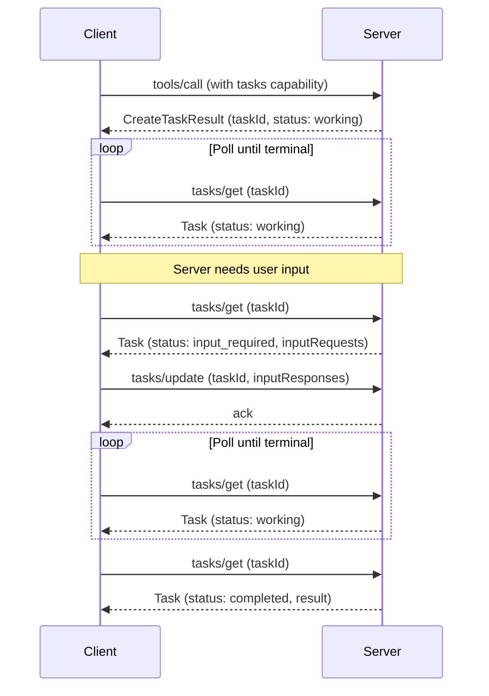

[ext-tasks 仓库](https://github.com/modelcontextprotocol/ext-tasks)包含 MCP Tasks 的完整规范和文档。

<Card
  title="modelcontextprotocol/ext-tasks"
  icon="github"
  href="https://github.com/modelcontextprotocol/ext-tasks"
>
  MCP Tasks 的完整规范和文档。
</Card>

并非每次工具调用都能立即返回。有些操作，例如 CI 流水线、批处理和人工审批，需要几秒、几分钟，甚至更长时间。MCP Tasks 让服务器能够返回持久句柄，而非一直阻塞，使客户端可以轮询进度、按需提供输入，并在重新连接后获取最终结果。

## 为什么不直接阻塞？

你可以保持连接，直到工作完成。任务能够解决阻塞方式无法解决的问题：

- **无需长期连接。** 阻塞会在整个操作期间占用连接。许多客户端和传输中间设备都有超时限制，使这种方式在超过几秒后就难以实用。
- **抵御崩溃。** 任务 ID 是持久句柄。客户端断开或重启后，可以使用同一 ID 恢复轮询。
- **进度可见。** 任务携带状态元数据（`working`、`input_required`、`completed`、`failed`、`cancelled`）及可选状态消息，让客户端能够了解进度。
- **执行中的交互。** 任务需要输入时，例如通过信息征询请求用户确认，会进入 `input_required` 状态并呈现请求。客户端通过 `tasks/update` 响应，无需第二条连接，也无需服务器主动向客户端发送未经请求的消息。
- **由服务器决定。** 服务器按请求决定是否创建任务。客户端通过扩展能力声明一次参与支持，再处理实际收到的结果类型。无需针对每个工具预先准备，也无需在每个请求中设置标志。

## 任务如何运作

任务扩展了标准请求流程。服务器判断某个请求需要长时间运行时，会返回任务句柄，而非最终结果。客户端随后轮询完成情况。

1. **能力协商。** 客户端在逐请求能力中包含 `io.modelcontextprotocol/tasks`。服务器则在自己的 `server/discover` 能力中声明相同扩展。

2. **创建任务。** 响应支持该机制的请求时，服务器返回 `CreateTaskResult`，以 `resultType: "task"` 标识，其中包含 `taskId`、初始状态、TTL 和建议轮询间隔。响应发送前，任务就已持久创建。

3. **轮询。** 客户端使用 `taskId` 调用 `tasks/get`。响应携带当前状态；对于终态，还包含最终结果或错误。

4. **执行中的输入。** 任务进入 `input_required` 时，`tasks/get` 响应会包含 `inputRequests` 映射，其中是信息征询或其他服务器请求。客户端通过 `tasks/update` 满足这些请求。

5. **完成。** 状态达到 `completed` 时，`result` 字段包含原请求同步执行时本应返回的内容。状态为 `failed` 时，`error` 字段包含 JSON-RPC 错误。

6. **取消。** 客户端可以随时发送 `tasks/cancel`。取消是协作式的：服务器会确认取消意图，但不一定必须停止工作。



## 何时使用任务

当使用场景涉及以下情况时，任务十分合适：

**长时间运行的操作。** 需要几分钟或几小时的 CI 流水线、批量数据处理或模型训练作业。

**人类参与的工作流。** 审批关卡、审核步骤，或任何暂停等待用户确认的操作。任务进入 `input_required`，客户端展示相应请求。

**外部作业系统。** 如果服务器封装的 API 本来就使用作业 ID，例如云部署、异步 API 或排队作业，可以在创建作业时返回任务，并在作业完成时给出结果。

**不可靠的连接。** 移动客户端、间歇性网络，或容易断线的环境。连接中断不会使任务 ID 失效。

**批处理。** 处理大量项目的操作，例如批量导入或大规模更新，局部进度本身就有意义。状态消息可以报告进度。

## 任务生命周期

| 状态 | 含义 |
| ---------------- | -------------------------------------------------------------------------- |
| `working` | 操作正在进行。 |
| `input_required` | 服务器需要客户端输入才能继续，见 `inputRequests`。 |
| `completed` | 操作已完成，`result` 字段包含最终输出。 |
| `failed` | 执行期间发生 JSON-RPC 错误，详情在 `error` 字段中。 |
| `cancelled` | 操作已取消，但取消请求并不总会被执行。 |

`completed`、`failed` 和 `cancelled` 都是终态，一旦到达，任务状态便不再变化。

## 通知

服务器可以通过 `notifications/tasks` 推送状态更新。客户端通过 `subscriptions/listen` 机制选择接收。每条通知都携带完整任务状态，无需再额外执行一次 `tasks/get` 往返。

默认采用轮询。如果服务器支持通知，客户端可以依靠通知取代轮询。

## 实现指南

### 面向 MCP Client

要处理带任务能力的响应，客户端必须：

<Steps>
<Step title="声明支持">

在逐请求能力中包含该扩展：

```jsonc
{
  "jsonrpc": "2.0",
  "id": 1,
  "method": "...",
  "params": {
    // Other fields...
    "_meta": {
      // Other fields...
      "io.modelcontextprotocol/clientCapabilities": {
        "extensions": {
          "io.modelcontextprotocol/tasks": {},
        },
      },
    },
  },
}
```

</Step>
<Step title="处理多态结果">

发出支持该机制的请求，例如 `tools/call` 时，需要能够接收标准结果，或 `resultType: "task"` 的 `CreateTaskResult`。

</Step>
<Step title="轮询直至完成">

使用返回的 `taskId` 调用 `tasks/get`，遵守 `pollIntervalMs` 的值。持续轮询，直到任务达到 `completed`、`failed` 或 `cancelled` 终态。

</Step>
<Step title="处理输入请求">

任务状态为 `input_required` 时，读取 `inputRequests` 映射，向用户或模型呈现请求，并通过 `tasks/update` 提交响应。

</Step>
<Step title="持久保存任务 ID">

持久化保存任务 ID，以便客户端崩溃或重启后恢复轮询。

</Step>
</Steps>

### 面向 MCP Server

要从服务器返回任务：

<Steps>
<Step title="声明支持">

在 `server/discover` 能力中包含该扩展：

```jsonc
{
  "jsonrpc": "2.0",
  "id": 1,
  "result": {
    // Other fields...
    "capabilities": {
      "extensions": {
        "io.modelcontextprotocol/tasks": {},
      },
    },
  },
}
```

</Step>
<Step title="检查客户端能力">

返回 `CreateTaskResult` 前，验证客户端的逐请求能力中是否包含该扩展。绝不能向未声明支持的客户端返回任务。

</Step>
<Step title="返回 CreateTaskResult">

请求需要长时间运行时，以 `resultType: "task"` 响应，并提供包含唯一 `taskId`、初始状态、`ttlMs` 和 `pollIntervalMs` 的 `Task` 对象。发送响应前，必须持久创建任务。

</Step>
<Step title="处理 tasks/get">

每次轮询时返回当前任务状态。对于终态，包含 `result`（`completed` 时）或 `error`（`failed` 时）字段。

</Step>
<Step title="处理 tasks/update">

接受 `inputResponses`，其键对应尚待处理的 `inputRequests`。以空结果确认。忽略未知键或已满足请求对应的响应。

</Step>
<Step title="处理 tasks/cancel">

以空结果确认取消请求，并在可能时执行取消。但取消是协作式的，任务仍可能到达非 `cancelled` 的终态。

</Step>
</Steps>

## 客户端支持

<Note>

MCP Tasks 是[核心 MCP 规范](/specification/latest)的扩展。不同客户端的宿主支持情况各不相同。

</Note>

有关各客户端的扩展支持情况，请参阅[客户端支持矩阵](/extensions/client-matrix)。任务支持要求客户端与服务器双方都明确选择启用。

## 规范

Tasks 扩展的规范位于 [ext-tasks 仓库](https://github.com/modelcontextprotocol/ext-tasks)。它采用标准 MCP [扩展协商](/extensions/overview#negotiation)机制：客户端在每个请求 `_meta` 所携带的 `io.modelcontextprotocol/clientCapabilities` 的 `extensions` 字段中声明支持，服务器则在 [`server/discover`](/specification/draft/server/discover) 返回的能力中声明自身支持。
