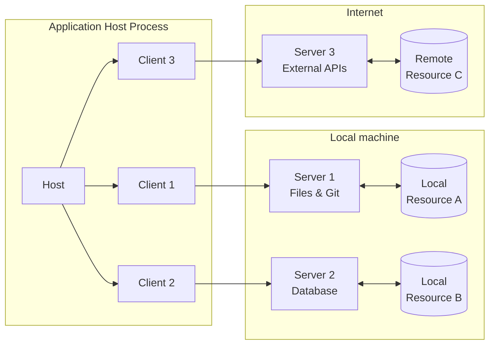
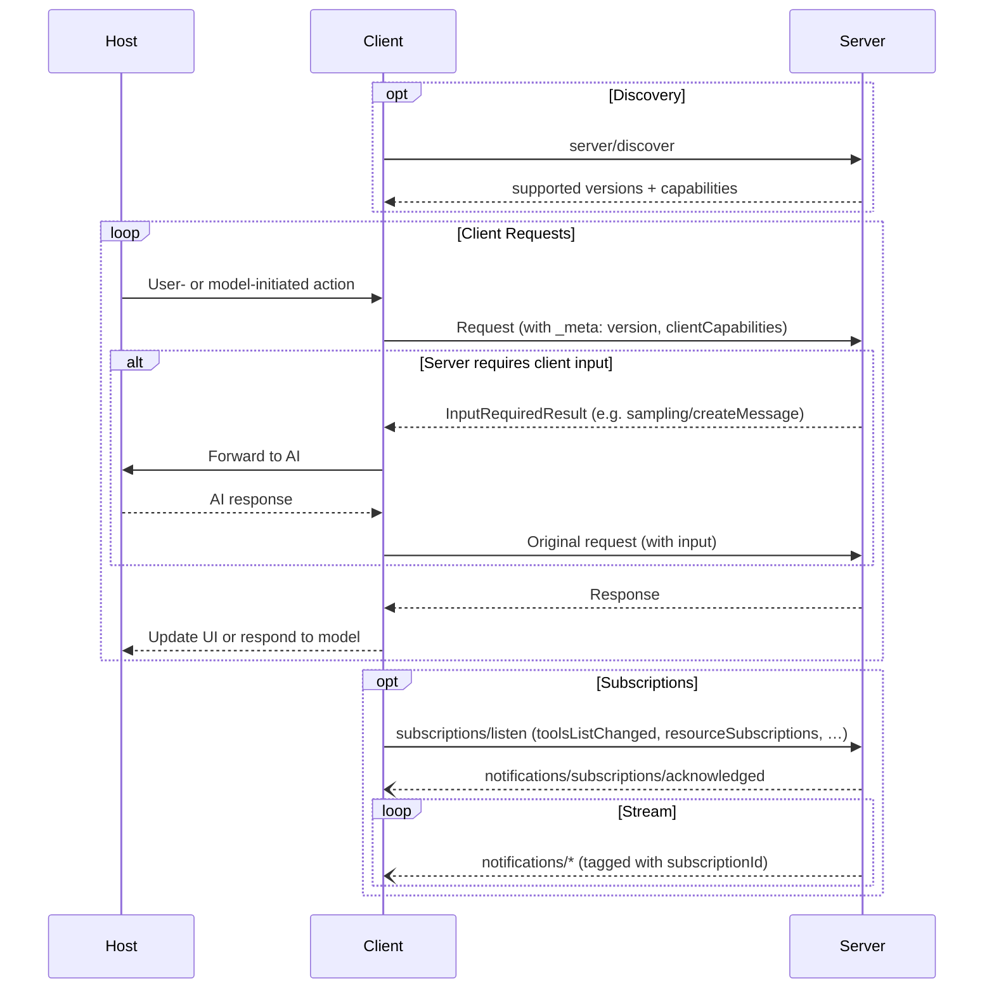

Model Context Protocol（MCP）采用 Client—Host—Server 架构，每个 Host 可以运行多个 Client 实例。MCP 是一种无状态协议：每个请求都自包含，并携带自身的协议版本和能力。
这种架构让用户能够跨应用集成 AI 能力，同时维持清晰的安全边界并隔离不同职责。MCP 构建于 JSON-RPC 之上，专注于客户端与服务器之间的上下文交换和采样协调。

## 核心组件

### Host

Host 进程充当容器与协调者：

- 创建并管理多个 Client 实例
- 控制客户端连接权限与生命周期
- 执行安全策略与用户同意要求
- 处理用户的授权决定
- 协调 AI／LLM 集成与采样
- 管理来自各客户端的上下文聚合

### Client

每个 Client 由 Host 创建，并且只与一个 Server 通信：

- 仅与一个 Server 通信
- 为每个请求附加协议版本和能力
- 双向路由协议消息
- 管理订阅和通知
- 维持服务器之间的安全边界

宿主应用创建并管理多个客户端，每个客户端与某个特定服务器之间形成一对一关系。

### Server

Server 提供专门的上下文与能力：

- 通过 MCP 基本原语提供资源、工具和提示模板
- 独立运行，专注于明确的职责
- 在响应中通过 `InputRequiredResult` 请求客户端输入，包括采样、信息征询和根目录
- 必须遵守安全约束
- 既可以是本地进程，也可以是远程服务

## 设计原则

MCP 的架构与实现遵循以下关键设计原则：

1. **服务器应当极易构建**
   - 复杂的编排工作由宿主应用承担
   - 服务器专注于具体、定义清晰的能力
   - 简单的接口尽量降低实现开销
   - 清晰的职责分离使代码更易维护

2. **服务器应当具有高度可组合性**
   - 每个服务器独立提供聚焦的功能
   - 多个服务器可以无缝组合
   - 共享协议确保互操作性
   - 模块化设计支持扩展

3. **服务器不应能够读取完整对话，也不应“窥视”其他服务器**
   - 服务器仅接收必要的上下文信息
   - 完整对话历史保留在 Host 中
   - 各服务器保持隔离
   - 跨服务器交互由 Host 控制
   - Host 进程执行安全边界约束

4. **服务器和客户端可以逐步增加功能**
   - 核心协议提供最低限度的必需功能
   - 额外能力可以按需协商
   - 服务器与客户端独立演进
   - 协议设计为未来扩展留出空间
   - 保持向后兼容

## 能力协商

Model Context Protocol 采用基于能力的协商体系，客户端和服务器在每个请求中声明所支持的功能。客户端在每个请求的 `_meta.io.modelcontextprotocol/clientCapabilities` 中包含自身能力。服务器通过 [`server/discover`](/specification/2026-07-28/server/discover) 的响应公开能力；客户端可以在任何其他请求之前调用该方法，提前发现可用能力。

- 服务器声明工具支持、资源订阅、提示模板等能力
- 客户端声明采样支持、信息征询处理等能力
- 双方在整个交互过程中都必须遵守已声明的能力
- 额外能力可以通过协议扩展进行协商

各项能力分别为每个请求启用特定协议功能。例如：

- 已实现的[服务器功能](/specification/2026-07-28/server)必须在服务器能力中声明
- 要接收资源更新通知，需要打开一个 [`subscriptions/listen`](/specification/2026-07-28/basic/patterns/subscriptions) 流，指定希望订阅的资源 URI
- 调用[工具](/specification/2026-07-28/server/tools)要求服务器声明工具能力

这一协商机制使客户端和服务器清楚了解受支持的功能，同时保持协议的可扩展性。
