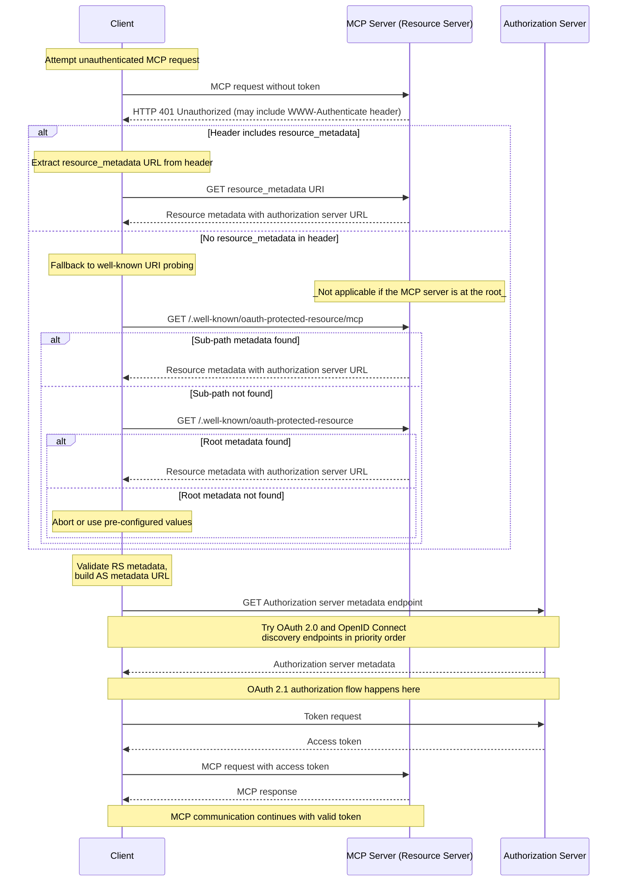

本文说明 MCP Server 如何向 MCP Client 公布其关联的授权服务器，以及 MCP Client 如何通过发现流程确定授权服务器的端点和受支持能力。

## 授权服务器位置

MCP Server **必须**实现 OAuth 2.0 受保护资源元数据规范（[RFC9728](https://datatracker.ietf.org/doc/html/rfc9728)），以指明授权服务器的位置。MCP Server 返回的受保护资源元数据文档**必须**包含 `authorization_servers` 字段，其中至少列出一个授权服务器。

`authorization_servers` 的具体用法不属于本规范的范围；实现者应当参阅 OAuth 2.0 受保护资源元数据规范（[RFC9728](https://datatracker.ietf.org/doc/html/rfc9728)），了解实现细节。

实现者应注意，受保护资源元数据文档可以定义多个授权服务器。选择哪个授权服务器由 MCP Client 负责，并应遵循 [RFC9728 第 7.6 节“Authorization Servers”](https://datatracker.ietf.org/doc/html/rfc9728#name-authorization-servers)中的指导。

`authorization_servers` 列出的多个服务器各自都是独立的 OAuth 2.0 授权服务器。根据 [RFC 6749 第 2.2 节](https://datatracker.ietf.org/doc/html/rfc6749#section-2.2)，客户端标识符只在签发它的授权服务器范围内唯一。客户端**必须**为每个授权服务器分别维护注册状态，包括客户端凭据和令牌，并且**不得**假定某个授权服务器接受的凭据也会被其他服务器接受。将客户端凭据与签发它的授权服务器关联的具体要求，见[授权服务器绑定](/specification/2026-07-28/basic/authorization/client-registration#authorization-server-binding)。

## 受保护资源元数据的发现要求

MCP Server **必须**实现以下发现机制之一，向 MCP Client 提供授权服务器的位置信息：

1. **WWW-Authenticate 响应头**：根据 [RFC9728 第 5.1 节](https://datatracker.ietf.org/doc/html/rfc9728#name-www-authenticate-response)，返回 `401 Unauthorized` 响应时，在 HTTP `WWW-Authenticate` 响应头的 `resource_metadata` 参数中包含资源元数据 URL。

2. **Well-Known URI**：按照 [RFC9728](https://datatracker.ietf.org/doc/html/rfc9728)，在 well-known URI 上提供元数据。可以位于以下任一位置：
   - 对应服务器 MCP 端点的路径：例如，`https://example.com/public/mcp` 可以在 `https://example.com/.well-known/oauth-protected-resource/public/mcp` 提供元数据
   - 根路径：`https://example.com/.well-known/oauth-protected-resource`

MCP Client **必须**支持这两种发现机制。如果解析出的 `WWW-Authenticate` 响应头包含资源元数据 URL，就必须使用该 URL；否则，客户端**必须**按照上述顺序构造并请求 well-known URI。

MCP Client **必须**能够解析 `WWW-Authenticate` 响应头，并正确处理 MCP Server 返回的 `HTTP 401 Unauthorized` 响应。

服务器还可以在 `WWW-Authenticate` 质询中包含 `scope` 参数，指出访问资源所需的权限范围；其语义及相应的客户端行为，定义见[权限范围选择策略](/specification/2026-07-28/basic/authorization#scope-selection-strategy)一节。

## 授权服务器元数据发现

MCP 使用 [RFC 8414 第 3.1 节](https://datatracker.ietf.org/doc/html/rfc8414#section-3.1)定义的默认 well-known URI 后缀 `oauth-authorization-server`，发现授权服务器元数据。MCP 不定义应用专用的 well-known URI 后缀。

为适应不同格式的签发者 URL，并同时与 OAuth 2.0 授权服务器元数据和 OpenID Connect Discovery 1.0 规范互操作，MCP Client 发现授权服务器元数据时，**必须**尝试多个 well-known 端点。

发现方法以 [RFC 8414 第 3.1 节“Authorization Server Metadata Request”](https://datatracker.ietf.org/doc/html/rfc8414#section-3.1)为依据，执行 OAuth 2.0 授权服务器元数据发现；并遵循 [RFC 8414 第 5 节“Compatibility Notes”](https://datatracker.ietf.org/doc/html/rfc8414#section-5)，实现与 OpenID Connect Discovery 1.0 的互操作。

对于包含路径部分的签发者 URL，例如 `https://auth.example.com/tenant1`，客户端**必须**按照以下优先顺序尝试端点：

1. 在路径前插入 OAuth 2.0 授权服务器元数据的 well-known 路径：
   `https://auth.example.com/.well-known/oauth-authorization-server/tenant1`
2. 在路径前插入 OpenID Connect Discovery 1.0 的 well-known 路径：
   `https://auth.example.com/.well-known/openid-configuration/tenant1`
3. 在路径后附加 OpenID Connect Discovery 1.0 的 well-known 路径：
   `https://auth.example.com/tenant1/.well-known/openid-configuration`

对于不包含路径部分的签发者 URL，例如 `https://auth.example.com`，客户端**必须**依次尝试：

1. OAuth 2.0 授权服务器元数据：
   `https://auth.example.com/.well-known/oauth-authorization-server`
2. OpenID Connect Discovery 1.0：
   `https://auth.example.com/.well-known/openid-configuration`

获取元数据文档后，MCP Client **必须**按照 [RFC8414 第 3.3 节](https://datatracker.ietf.org/doc/html/rfc8414#section-3.3)或 [OpenID Connect Discovery 第 4.3 节](https://openid.net/specs/openid-connect-discovery-1_0.html#ProviderConfigurationValidation)校验文档：其中的 `issuer` 值**必须**与构造 well-known URL 时使用的签发者标识符完全一致。如果不一致，客户端**不得**使用该元数据。例如，从 `https://attacker.example/.well-known/oauth-authorization-server` 获取、却包含 `"issuer": "https://honest.example"` 的文档，**必须**被拒绝。

## 时序图

下图展示了一个示例流程：

