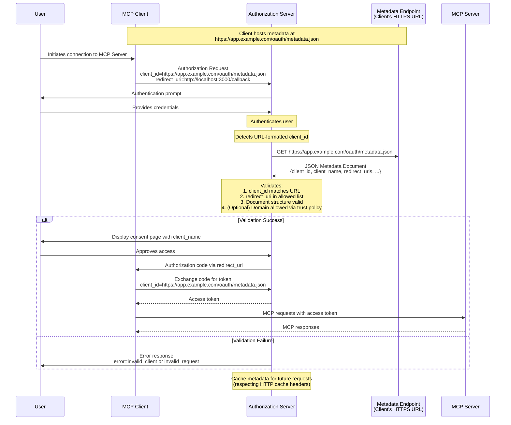

<div id="enable-section-numbers" />

MCP 支持三种客户端注册机制，应当根据实际场景选择：

- **[客户端 ID 元数据文档](#client-id-metadata-documents)**：客户端与服务器事先没有关联时使用，这是最常见的情况
- **[预注册](#pre-registration)**：客户端与服务器已经建立关联时使用
- **[动态客户端注册](#dynamic-client-registration)**：用于向后兼容或满足特定要求

支持全部选项的客户端**应当**遵循以下优先顺序：

1. 如果已有该服务器的预注册客户端信息，就使用该信息
2. 如果授权服务器通过 OAuth 授权服务器元数据中的 `client_id_metadata_document_supported` 表示支持客户端 ID 元数据文档，就使用该机制
3. 如果授权服务器通过 OAuth 授权服务器元数据中的 `registration_endpoint` 表示支持动态客户端注册，就将其作为回退选项
4. 如果其他方式均不可用，则提示用户输入客户端信息

## 客户端 ID 元数据文档

MCP Client 和授权服务器**应当**支持 [OAuth Client ID Metadata Document](https://datatracker.ietf.org/doc/html/draft-ietf-oauth-client-id-metadata-document-00) 定义的 OAuth 客户端 ID 元数据文档，用于客户端注册。

这种机制允许客户端使用 HTTPS URL 作为客户端标识符，URL 指向包含客户端元数据的 JSON 文档。它解决了 MCP 中常见的场景：服务器与客户端此前没有建立关联。

### 实现要求

支持客户端 ID 元数据文档的 MCP 实现，**必须**遵循 [OAuth Client ID Metadata Document](https://datatracker.ietf.org/doc/html/draft-ietf-oauth-client-id-metadata-document-00) 中的要求。主要要求如下：

**对于 MCP Client：**

- 客户端**必须**按照 RFC 要求，将元数据文档托管在 HTTPS URL 上
- `client_id` URL **必须**使用 "https" scheme，并包含路径部分，例如 `https://example.com/client.json`
- 元数据文档**必须**至少包含以下属性：`client_id`、`client_name`、`redirect_uris`
- 客户端**必须**确保元数据中的 `client_id` 值与文档 URL 完全一致
- 客户端**可以**按照[客户端 ID 元数据文档第 6.2 节](https://www.ietf.org/archive/id/draft-ietf-oauth-client-id-metadata-document-00.html#section-6.2)的说明，配置适当的 JWKS，使用 `private_key_jwt` 进行客户端身份验证，例如向令牌端点发起请求时

**对于授权服务器：**

- 遇到 URL 形式的 client_id 时，**应当**获取对应的元数据文档
- **必须**验证获取到的文档中，`client_id` 与该 URL 完全一致
- **应当**遵循 HTTP 缓存响应头缓存元数据
- **必须**根据元数据文档中的重定向 URI，校验授权请求提供的重定向 URI
- **必须**验证文档结构为有效 JSON，且包含必填字段
- **应当**遵循[客户端 ID 元数据文档第 6 节](https://www.ietf.org/archive/id/draft-ietf-oauth-client-id-metadata-document-00.html#section-6)及[客户端 ID 元数据文档安全](/specification/2026-07-28/basic/authorization/security-considerations#client-id-metadata-document-security)中的安全注意事项

### 元数据文档示例

```json
{
  "client_id": "https://app.example.com/oauth/client-metadata.json",
  "client_name": "Example MCP Client",
  "client_uri": "https://app.example.com",
  "logo_uri": "https://app.example.com/logo.png",
  "redirect_uris": [
    "http://127.0.0.1:3000/callback",
    "http://localhost:3000/callback"
  ],
  "grant_types": ["authorization_code"],
  "response_types": ["code"],
  "token_endpoint_auth_method": "none"
}
```

### 客户端 ID 元数据文档流程

下图展示使用客户端 ID 元数据文档时的完整流程：



### 声明 CIMD 支持

授权服务器在其 OAuth 授权服务器元数据中包含以下属性，声明支持使用客户端 ID 元数据文档的客户端：

```json
{
  "client_id_metadata_document_supported": true
}
```

MCP Client **应当**检查此能力；如果不可用，**可以**回退到[动态客户端注册](#dynamic-client-registration)或[预注册](#pre-registration)。

## 预注册

MCP Client **应当**支持使用静态客户端凭据的选项，例如预注册流程提供的凭据。实现方式可以是：

1. 硬编码一个客户端 ID，以及适用时的客户端凭据，专供该 MCP Client 与对应授权服务器交互时使用，或者
2. 提供用户界面，让用户自行注册 OAuth 客户端后，输入这些信息，例如通过服务器托管的配置界面进行注册。

## 动态客户端注册

<Warning>
  动态客户端注册已被弃用。新的实现应当改用[客户端 ID 元数据文档](#client-id-metadata-documents)。此选项仍保留，以便与不支持客户端 ID 元数据文档的授权服务器保持向后兼容。
</Warning>

MCP Client 和授权服务器**可以**支持 OAuth 2.0 动态客户端注册协议 [RFC7591](https://datatracker.ietf.org/doc/html/rfc7591)，让 MCP Client 无需用户交互就能获取 OAuth 客户端 ID。保留此选项是为了与早期 MCP 授权规范保持向后兼容。

### 应用类型与重定向 URI 约束

授权服务器同时支持 OpenID Connect（OIDC）和动态客户端注册时，可能根据 `application_type` 参数，对重定向 URI 施加额外限制，具体定义见 [OpenID Connect Dynamic Client Registration 1.0](https://openid.net/specs/openid-connect-registration-1_0.html)。

MCP Client 在动态客户端注册时**必须**指定适当的 `application_type`。根据 OIDC，省略时默认为 `"web"`，这可能与原生应用形式的重定向 URI 冲突；非 OIDC 服务器会安全地忽略该参数。

- **原生应用**，包括桌面应用、移动应用、CLI 工具，以及通过 `localhost` 访问的本地托管 Web 应用，**应当**使用 `application_type: "native"`
- **Web 应用**，即由非本地主机提供服务的远程浏览器应用，**应当**使用 `application_type: "web"`

授权服务器实现 OIDC 时，MCP Client **必须**能够处理由重定向 URI 限制造成的注册失败。注册请求被拒绝后，客户端**应当**向用户或开发者展示有意义的错误。客户端**可以**调整 `application_type` 后重试注册，或使用符合授权服务器对该应用类型要求的重定向 URI 重试。

## 授权服务器绑定

使用预注册凭据，或持久化保存通过动态客户端注册获取的凭据时，客户端**必须**将这些凭据与签发它们的特定授权服务器关联，并以授权服务器的 `issuer` 标识符为键。当授权服务器发生变化时，可通过更新后的[受保护资源元数据](/specification/2026-07-28/basic/authorization/authorization-server-discovery#authorization-server-location)检测；客户端**不得**复用其他授权服务器的客户端凭据，并且**必须**向新的授权服务器重新注册。

预注册凭据本身就只适用于某个特定授权服务器。如果受保护资源元数据指示的授权服务器，与凭据注册时的服务器不再匹配，客户端**应当**报告错误，而不是静默尝试使用不匹配的凭据。

基于客户端 ID 元数据文档的客户端 ID 可以跨授权服务器使用，因为它们是由客户端自行托管的 HTTPS URL，由授权服务器按需解析。授权服务器变化时无需重新注册。
