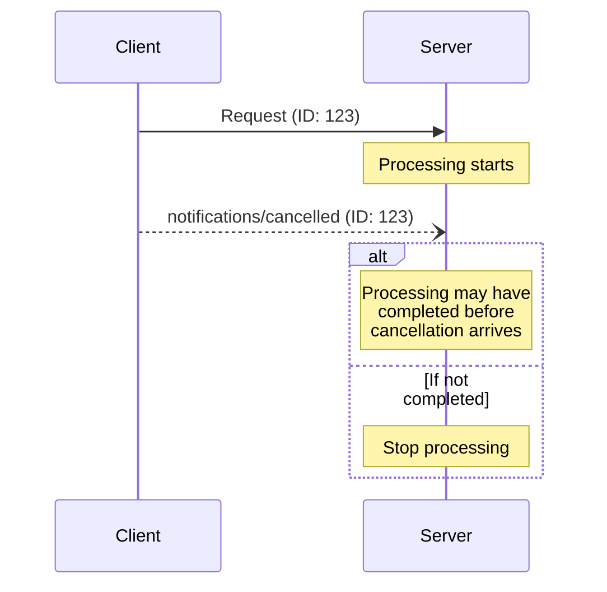

<div id="enable-section-numbers" />

Model Context Protocol（MCP）支持通过通知消息，可选地取消正在执行的请求。客户端**应当**发送取消通知，表明它先前发出的某个请求应当终止。

服务器主动关闭某条订阅流时，**必须**发送 `notifications/cancelled`，引用对应的 `subscriptions/listen` 请求 ID（见[订阅][subscriptions]）。服务器**不得**将 `notifications/cancelled` 用于任何其他目的。

## 取消流程

客户端希望取消正在执行的请求时，会发送 `notifications/cancelled` 通知，其中包含：

- 要取消的请求 ID
- 可选的原因字符串，用于记录日志或展示

```json
{
  "jsonrpc": "2.0",
  "method": "notifications/cancelled",
  "params": {
    "requestId": "123",
    "reason": "User requested cancellation"
  }
}
```

## 各传输方式的取消机制

客户端如何发出取消信号，取决于传输方式：

- **Streamable HTTP**：关闭 SSE 响应流就是取消信号。服务器**必须**将客户端断开连接视为取消该请求。不需要、也不期待收到 `notifications/cancelled` 消息。
- **stdio**：没有可单独关闭的逐请求流。客户端**必须**发送引用该请求 ID 的 `notifications/cancelled` 通知。

## 超时

实现**应当**为所有发出的请求设置超时，防止连接挂起和资源耗尽。在超时时间内未收到成功或错误响应时，发送方**应当**取消请求，并停止等待响应。如[各传输方式的取消机制](#transport-specific-cancellation)所述，这意味着：

- **Streamable HTTP**：关闭该请求的响应流，即构成取消。
- **stdio**：发送引用该请求 ID 的 `notifications/cancelled` 通知。

SDK 和其他中间件**应当**允许按请求配置这些超时时间。

实现**可以**在收到该请求对应的[进度通知](/specification/2026-07-28/basic/patterns/progress)时重置超时计时，因为这表明工作确实仍在进行。不过，实现**应当**始终强制执行最大超时时间，不受进度通知影响，以限制行为异常的客户端或服务器造成的影响。

## 行为要求

1. 取消通知**必须**仅引用满足以下条件的请求：
   - 先前由客户端发出
   - 仍被认为正在执行
1. 服务器发送的取消通知**必须**引用一个 `subscriptions/listen` 请求，用于终止该订阅流
1. 服务器收到取消通知后，**应当**：
   - 停止处理已取消的请求
   - 释放相关资源
   - 不再为已取消的请求发送响应
1. 满足以下情况时，服务器**可以**忽略取消通知：
   - 所引用的请求未知
   - 处理已经完成
   - 请求无法取消
1. 客户端**应当**忽略此后到达的、针对已取消请求的任何响应

## 时序注意事项

由于网络延迟，取消通知可能在请求处理完成之后才到达，甚至可能晚于响应的发送。

双方都**必须**妥善处理这些竞态条件：



## 实现说明

- 双方都**应当**记录取消原因，方便调试
- 应用界面**应当**在用户请求取消时给出提示

## 错误处理

无效的取消通知**应当**被忽略：

- 请求 ID 未知
- 请求已经完成
- 通知格式错误

这样既能保持通知“发出即不再等待”的特性，也能容纳异步通信中的竞态条件。

[subscriptions]: /specification/2026-07-28/basic/patterns/subscriptions
