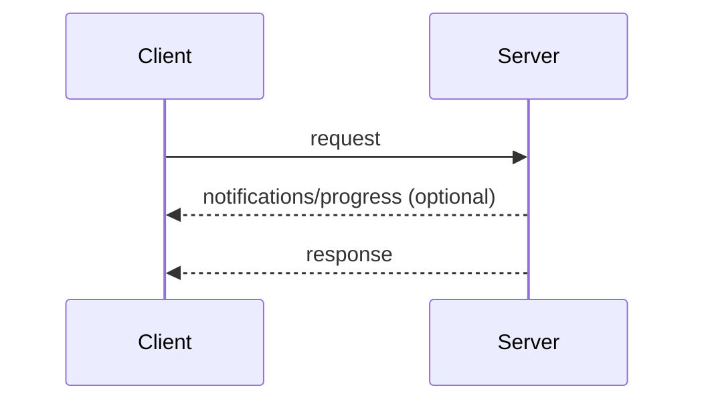
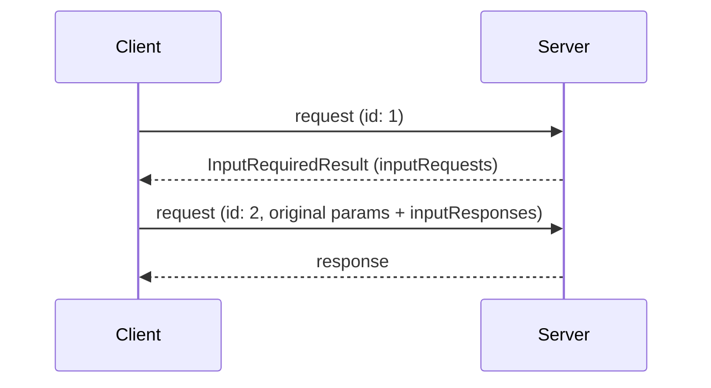
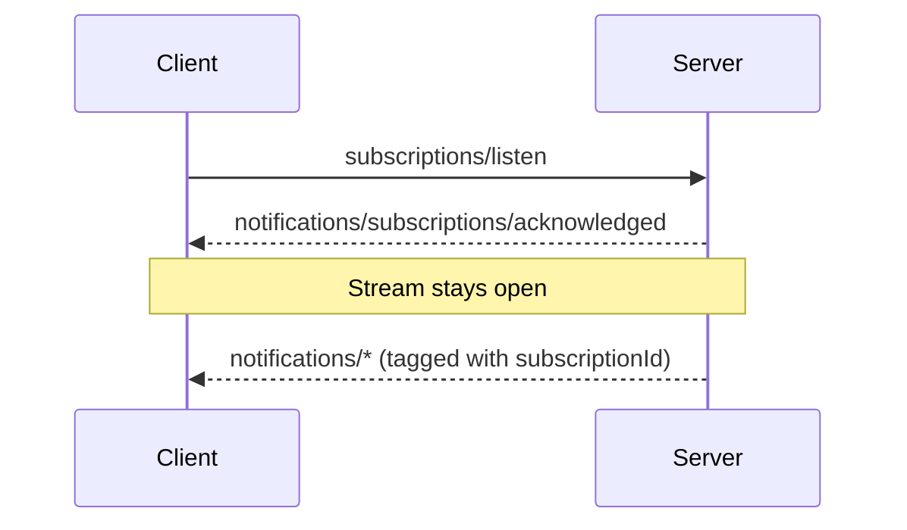

本页定义核心协议的消息模式，也就是客户端与服务器如何将 JSON-RPC [请求、响应和通知](/specification/2026-07-28/basic/index#messages)组合成交互。每种[传输方式](/specification/2026-07-28/basic/transports)都承载这里的全部模式；不同传输方式的区别仅在于消息如何分帧和传递。

每次交互都由客户端发起：

- **客户端**发送 JSON-RPC _请求_ 和 _通知_。
- **服务器**为每个请求返回 JSON-RPC _响应_（结果或错误），并且可以在响应之前发送作用于该请求的 _通知_。

服务器**不得**主动发起 JSON-RPC 请求，客户端也不发送 JSON-RPC 响应。

## 请求与响应

客户端发送请求，服务器返回结果或错误。在请求尚未完成期间，服务器**可以**发送作用于该请求的通知，例如 [`notifications/progress`](/specification/2026-07-28/basic/patterns/progress) 和 [`notifications/message`](/specification/2026-07-28/server/utilities/logging)。

## 多轮往返请求

服务器需要客户端输入（采样、信息征询或根目录）才能完成请求时，会返回 [`InputRequiredResult`](/specification/2026-07-28/basic/patterns/mrtr#inputrequiredresult)，客户端随后携带相应的 `inputResponses` 重试请求。详见[多轮往返请求](/specification/2026-07-28/basic/patterns/mrtr)。

## 订阅与通知

为了接收变更通知（列表变化、资源更新），客户端发送 [`subscriptions/listen`](/specification/2026-07-28/basic/patterns/subscriptions) 请求，服务器通过一条长期保持的流，返回所请求类型的通知。流的状态限定于该请求：如果底层通道丢失，客户端会重新发送请求。

## 添加模式

核心协议的所有功能都基于这些模式构建。如果某次协议修订新增模式，就会在本页定义。传输层无需修改即可承载新模式，因为模式完全通过请求、响应和通知来表达。
