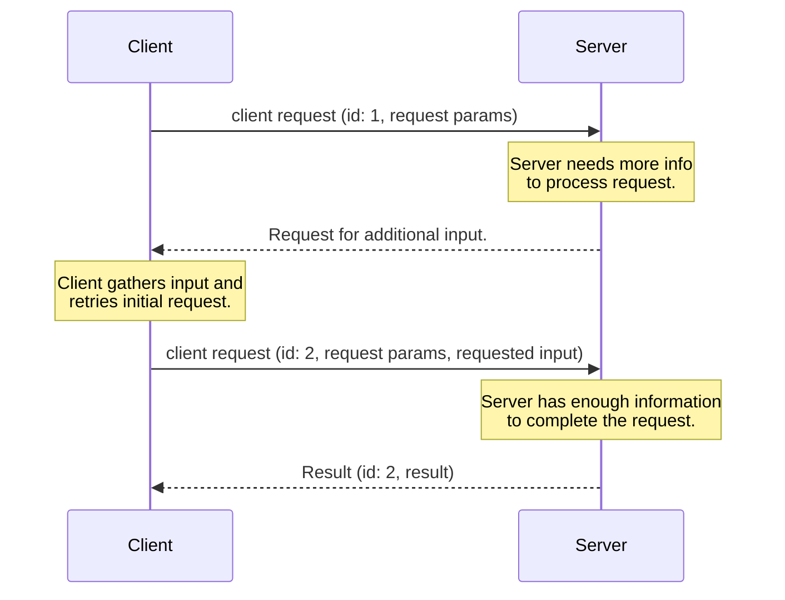
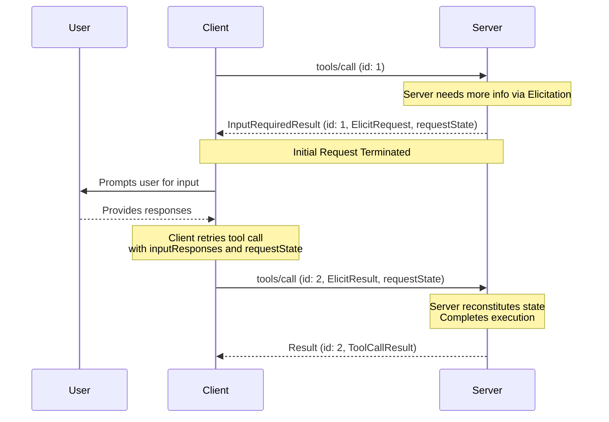

<div id="enable-section-numbers" />

<Note>
  多轮往返请求（Multi Round-Trip Requests，MRTR）在本版 MCP 规范中引入，取代了先前由服务器主动发起请求的方式。服务器**必须**通过 MRTR 模式传递服务器到客户端的请求，例如 `roots/list`、`sampling/createMessage` 或 `elicitation/create`。先前由服务器主动发起请求的模式不再受支持。这是一项破坏性变更。
</Note>

<Note>
  为简洁起见，本页请求示例省略了 `_meta` 请求元数据，包括 `io.modelcontextprotocol/protocolVersion`、`io.modelcontextprotocol/clientInfo` 和 `io.modelcontextprotocol/clientCapabilities`。每个请求都**必须**包含必需的 `_meta` 字段；详见 [`_meta`](/specification/2026-07-28/basic/index#meta)。
</Note>

## 多轮往返请求

Model Context Protocol（MCP）定义了多种方式，让服务器在处理客户端请求期间，向用户请求补充信息，例如 `roots/list`、`sampling/createMessage` 或 `elicitation/create`。**多轮往返请求**模式提供了一种标准化方式来处理这类服务器请求，无需在不同服务器实例之间共享存储层，也无需使用有状态负载均衡。

整体流程如下：

1. 客户端向服务器发送初始请求，携带执行操作所需的参数。
1. 服务器判断还需要补充信息才能完成请求，于是在响应中请求更多信息。
1. 客户端向用户或其他来源收集所需信息，然后携带这些补充信息重试原始请求。
1. 服务器判断信息已经充分，完成操作并返回最终结果。



### 核心类型

MCP 使用以下类型实现这一流程。

#### InputRequests

[`InputRequests`](/specification/2026-07-28/schema#inputrequests) 对象是一个服务器到客户端请求的映射。键是由服务器分配的字符串标识符；值则为请求对象，例如 [`ElicitRequest`](/specification/2026-07-28/schema#elicitrequest)、[`CreateMessageRequest`](/specification/2026-07-28/schema#createmessagerequest) 或 [`ListRootsRequest`](/specification/2026-07-28/schema#listrootsrequest)。

```json
{
  "github_login": {
    "method": "elicitation/create",
    "params": {
      "mode": "form",
      "message": "Please provide your GitHub username",
      "requestedSchema": {
        "type": "object",
        "properties": {
          "name": { "type": "string" }
        },
        "required": ["name"]
      }
    }
  },
  "capital_of_france": {
    "method": "sampling/createMessage",
    "params": {
      "messages": [
        {
          "role": "user",
          "content": {
            "type": "text",
            "text": "What is the capital of France?"
          }
        }
      ],
      "systemPrompt": "You are a helpful assistant.",
      "maxTokens": 100
    }
  }
}
```

#### InputResponses

[`InputResponses`](/specification/2026-07-28/schema#inputresponses) 对象将服务器请求映射到客户端响应。键与 `InputRequests` 映射中的键对应；值是客户端对各请求的处理结果，例如 [`ElicitResult`](/specification/2026-07-28/schema#elicitresult)、[`CreateMessageResult`](/specification/2026-07-28/schema#createmessageresult) 或 [`ListRootsResult`](/specification/2026-07-28/schema#listrootsresult)。

```json
{
  "github_login": {
    "action": "accept",
    "content": {
      "name": "octocat"
    }
  },
  "capital_of_france": {
    "role": "assistant",
    "content": {
      "type": "text",
      "text": "The capital of France is Paris."
    },
    "model": "claude-3-sonnet-20240307",
    "stopReason": "endTurn"
  }
}
```

#### InputRequiredResult

[`InputRequiredResult`](/specification/2026-07-28/schema#inputrequiredresult) 是一种 [`Result`](/specification/2026-07-28/basic#responses)，表示在完成请求之前还需要额外输入。

- `inputRequests` _（可选）_：一个 [`InputRequests`](/specification/2026-07-28/schema#inputrequests) 映射，包含由服务器发起、需要客户端满足的请求。
- `requestState` _（可选）_：一个仅对服务器有意义的不透明字符串。客户端**不得**检查、解析、修改其内容，也不得对内容作出任何假设。

```json
{
  "jsonrpc": "2.0",
  "id": 1,
  "result": {
    "resultType": "input_required",
    "inputRequests": {
      // Elicitation request.
      "github_login": {
        "method": "elicitation/create",
        "params": {
          "mode": "form",
          "message": "Please provide your GitHub username",
          "requestedSchema": {
            "type": "object",
            "properties": {
              "name": { "type": "string" }
            },
            "required": ["name"]
          }
        }
      },
      // Sampling request.
      "capital_of_france": {
        "method": "sampling/createMessage",
        "params": {
          "messages": [
            {
              "role": "user",
              "content": {
                "type": "text",
                "text": "What is the capital of France?"
              }
            }
          ],
          "modelPreferences": {
            "hints": [{ "name": "claude-3-sonnet" }],
            "intelligencePriority": 0.8,
            "speedPriority": 0.5
          },
          "systemPrompt": "You are a helpful assistant.",
          "maxTokens": 100
        }
      }
    },
    "requestState": "AEAD-protected blob"
  }
}
```

### 支持的请求

服务器**可以**为以下客户端请求返回 `InputRequiredResult` 响应：

| 客户端请求 | 是否支持 InputRequiredResult |
| -------------------------------------------------------------------------------- | ---------------------------- |
| [`prompts/get`](/specification/2026-07-28/server/prompts#getting-a-prompt) | 是 |
| [`resources/read`](/specification/2026-07-28/server/resources#reading-resources) | 是 |
| [`tools/call`](/specification/2026-07-28/server/tools#calling-tools) | 是 |

服务器**不得**为其他任何客户端请求返回 `InputRequiredResult` 响应。

### 基本工作流

基本工作流描述服务器如何在一次客户端—服务器请求中，向客户端请求额外输入。本例使用 `tools/call` 作为客户端请求，但同一模式适用于上面列出的任何受支持请求。

其重要特点是：服务器无需维护任何服务器端状态，就能请求补充信息。服务器将所需上下文编码进 `requestState` 字段，客户端在重试时将其原样返回。



请注意，每一步的请求都是完全独立的：处理重试的服务器，只需要重试请求中直接提供的信息，不需要任何其他信息。

#### 服务器要求（基本工作流）

1. 服务器**可以**使用 `InputRequiredResult` 响应任何[受支持的客户端请求](#supported-requests)。
1. `InputRequiredResult` **可以**包含 `inputRequests` 字段。
   - `inputRequests` 的键是由服务器分配的标识符，在请求的作用域内**必须**唯一。
   - `inputRequests` 的值是请求对象，**必须**为 [`ElicitRequest`](/specification/2026-07-28/schema#elicitrequest)、[`CreateMessageRequest`](/specification/2026-07-28/schema#createmessagerequest) 或 [`ListRootsRequest`](/specification/2026-07-28/schema#listrootsrequest) 之一

1. `InputRequiredResult` **可以**包含 `requestState` 字段。如果指定，该字段是仅对服务器有意义的不透明字符串。服务器可以自由选择状态编码格式，例如 Base64 编码的 JSON、加密的 JWT 或序列化的二进制数据。
1. 如果客户端请求包含 `requestState` 字段，服务器**必须**将 `requestState` 视为攻击者可控制的输入。如果 `requestState` 会影响授权、资源访问或业务逻辑，服务器**必须**保护其完整性，例如使用 HMAC 或 AEAD，并且**必须**拒绝未通过验证的状态。只有当篡改最多只能导致请求失败时，才**可以**省略完整性保护。
1. 为防止重放，服务器**应当**在受完整性保护的 `requestState` 载荷中包含以下内容，并在接收时逐项验证：
   - 已通过身份验证的主体；如果状态由其他主体提交，则拒绝。
   - 较短的有效期（TTL）；状态过期后提交，则拒绝；
   - 原始请求的标识，例如方法名称以及关键参数的摘要；如果提交该状态的请求与原始请求不匹配，则拒绝。
     <Warning>
       请注意，这些措施可以限定重放的时间窗口，并防止跨用户、跨请求复用，但本身不能保证状态仅使用一次。对于某个 `requestState` 最多只能被消费一次的服务器，例如一次性兑换场景，**必须**在服务器端强制保证这一约束。
     </Warning>

1. 服务器**必须**在每个 `InputRequiredResult` 响应中，至少包含 `inputRequests` 或 `requestState` 之一。
1. 服务器**不得**发送包含客户端尚未在能力中声明支持的请求的 `inputRequests`。例如，客户端未声明支持 `elicitation` 时，服务器**不得**在 `inputRequests` 字段中包含任何 `elicitation/create` 请求。
1. 服务器**不得**假定客户端会满足 `inputRequests` 或重试原始请求。服务器**可以**在同一个请求的多次尝试中反复返回 `InputRequiredResult`，以便持续提示用户补充信息，直到获得完成请求所需的内容。

#### 客户端要求（基本工作流）

1. 如果收到的 `InputRequiredResult` 包含 `inputRequests` 字段，客户端**必须**先构造所请求的输入，再重试原始请求。如果 `InputRequiredResult` _不_ 包含 `inputRequests` 字段，客户端**可以**立即重试原始请求。
1. 如果 `InputRequiredResult` 包含 `requestState` 字段，客户端重试原始请求时，**必须**原样返回该字段的准确值。客户端**不得**检查、解析、修改 `requestState` 的内容，也不得对其作出任何假设。如果 `InputRequiredResult` 没有 `requestState` 字段，客户端重试时**不得**自行添加。
1. 初始请求和重试中的 JSON-RPC `id` **必须**不同，因为它们是相互独立的请求。
1. `inputRequests` 和 `requestState` 字段都只影响客户端对原始请求的重试，**不得**用于客户端可能并行发送的其他任何请求。

### 错误处理

服务器**应当**验证客户端提供的数据是否为有效的 `InputResponses` 对象，以及内部信息是否能够正确解析。协议错误，例如 JSON 格式错误、Schema 无效或服务器内部错误，**应当**返回包含适当错误码和消息的 JSON-RPC 错误响应。

如果 `InputResponses` 对象提供了额外的、预期之外的参数，服务器**应当**忽略它不认识或不需要的信息。

如果客户端没有发送先前 `InputRequests` 请求的全部信息，而缺失信息是服务器处理请求所必需的，服务器**应当**返回新的 `InputRequiredResult`，再次请求补充缺失信息，而不是返回错误。

### 安全注意事项

由于 `requestState` 会经过客户端，恶意或已被攻陷的客户端可能尝试修改它，以改变服务器行为、绕过授权检查或破坏服务器逻辑。服务器**必须**按照上述[服务器要求](#server-requirements-basic-workflow)验证请求状态。
