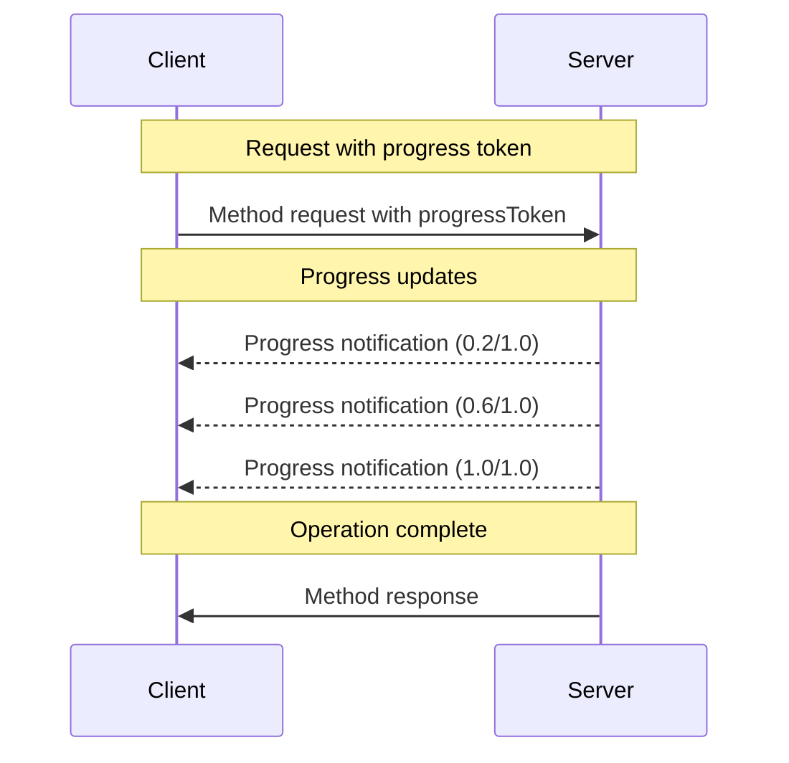

<div id="enable-section-numbers" />

Model Context Protocol（MCP）支持通过通知消息，为长时间运行的操作提供可选的进度跟踪。服务器**可以**发送进度通知，报告客户端所发请求的执行状态。

## 进度流程

客户端希望 _接收_ 某个请求的进度更新时，会在请求元数据中加入 `progressToken`。

- 进度令牌**必须**是字符串或整数
- 客户端可以通过任意方式选择进度令牌，但它在所有活动请求之间**必须**唯一。

```json
{
  "jsonrpc": "2.0",
  "id": 1,
  "method": "some_method",
  "params": {
    "_meta": {
      "progressToken": "abc123"
    }
  }
}
```

随后，服务器**可以**发送包含以下内容的进度通知：

- 原始进度令牌
- 截至当前的进度值
- 可选的 "total" 值
- 可选的 "message" 值

```json
{
  "jsonrpc": "2.0",
  "method": "notifications/progress",
  "params": {
    "progressToken": "abc123",
    "progress": 50,
    "total": 100,
    "message": "Reticulating splines..."
  }
}
```

- 每次通知中的 `progress` 值都**必须**递增，即使总量未知也不例外。
- `progress` 和 `total` 值**可以**使用浮点数。
- `message` 字段**应当**提供与当前进度有关、便于人类阅读的信息。

## 行为要求

1. 进度通知**必须**仅引用满足以下条件的令牌：
   - 由活动请求提供
   - 关联一个正在执行的操作

2. 服务器收到携带进度令牌的请求后，**可以**：
   - 选择不发送任何进度通知
   - 按其认为合适的任意频率发送通知
   - 总量未知时省略该值



## 实现说明

- 客户端与服务器**应当**跟踪活动的进度令牌
- 双方都**应当**实施速率限制，防止通知泛滥
- 操作完成后，进度通知**必须**停止
