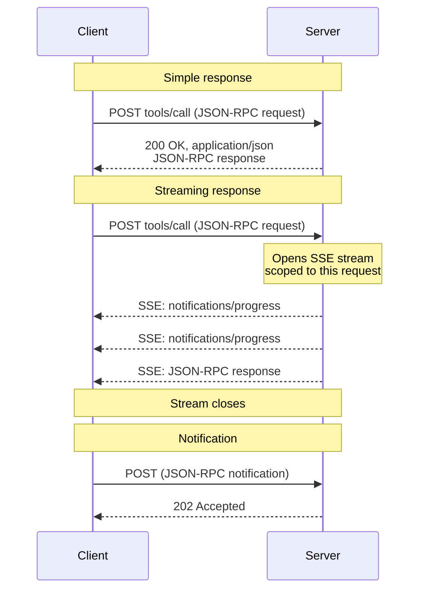
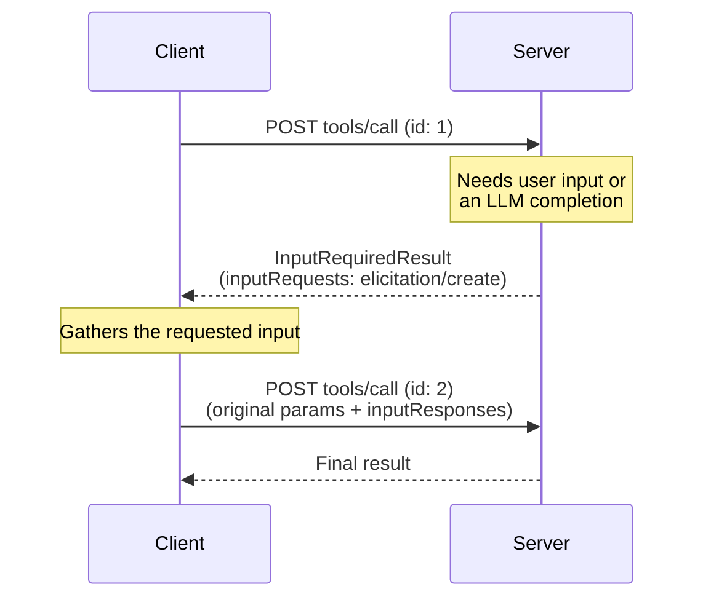
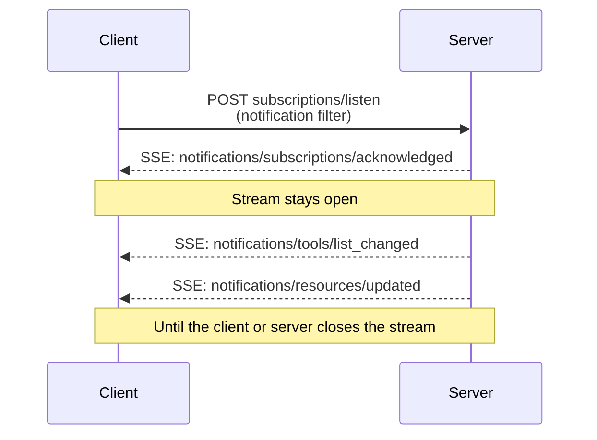

<div id="enable-section-numbers" />

<Info>

Streamable HTTP 在协议版本 2025-03-26 中引入，用于取代协议版本 2024-11-05 中的 [HTTP+SSE 传输][http-sse]。

</Info>

<Info>

2026-07-28 修订版调整了 Streamable HTTP 的行为。客户端必须确保正确处理向后兼容。变更包括：

- 移除 GET 流端点。
- 移除协议级会话。

详见[变更记录](/specification/2026-07-28/changelog)及下文的[向后兼容](#backward-compatibility)。

</Info>

在 **Streamable HTTP** 传输中，服务器作为独立进程运行，能够处理多个客户端连接。其基本特征如下：

- 服务器公开一个接受 POST 的 HTTP 端点，即 **MCP 端点**。
- 客户端将每条 JSON-RPC 请求或通知，分别作为独立的 HTTP POST 发送。
- 服务器为每个请求返回单个 JSON 对象，或限定于该请求的 [Server-Sent Events][sse]（SSE）流；流中先传递与请求有关的通知，再返回最终响应。
- 服务器到客户端的交互（采样、信息征询、根目录）按照[多轮往返请求（MRTR）][mrtr]（[SEP-2322][sep-2322]）模式，以输入请求的形式嵌入结果中。
- 长期持续的变更通知，例如列表变化和资源更新，通过 [`subscriptions/listen`][subscriptions-listen] 请求的响应流交付。

这些交互的时序图见[消息流](#message-flow)。

服务器**必须**提供一个支持 POST 的 HTTP 端点路径，以下称为 **MCP 端点**。例如，可以使用 `https://example.com/mcp` 这样的 URL。

[http-sse]: /specification/2024-11-05/basic/transports#http-with-sse
[sse]: https://en.wikipedia.org/wiki/Server-sent_events

## 安全与端点

实现 Streamable HTTP 传输时：

1. 服务器**必须**校验所有入站连接的 `Origin` 请求头，防止 DNS 重绑定攻击。
   - 如果存在 `Origin` 请求头且其值无效，服务器**必须**返回 HTTP 403 Forbidden。HTTP 响应体**可以**包含一条没有 `id` 的 JSON-RPC _错误响应_。
2. 本地运行时，服务器**应当**仅绑定 localhost（127.0.0.1），而非所有网络接口（0.0.0.0）。
3. 服务器**应当**为所有连接实现适当的身份验证。

缺少这些保护时，攻击者可能利用 DNS 重绑定，从远程网站与本地 MCP Server 交互。

## 发送消息

客户端发送的每条 JSON-RPC 消息，都**必须**是发往 MCP 端点的一次新的 HTTP POST 请求。

1. 客户端**必须**使用 HTTP POST 发送 JSON-RPC 消息。
2. 客户端**必须**包含 `Accept` 请求头，同时列出 `application/json` 和 `text/event-stream`，表明支持这两种内容类型。
3. 客户端**必须**在每个 POST 请求中包含[请求元数据头](#request-metadata)。
4. HTTP POST 的消息体**必须**是单条 JSON-RPC _请求_ 或 _通知_。客户端**不得**发送 JSON-RPC _响应_。
5. 如果消息体是 JSON-RPC _通知_：
   - 如果服务器接受该通知，**必须**返回 HTTP 状态码 `202 Accepted`，且不包含响应体。
   - 如果服务器无法接受，**必须**返回 HTTP 错误状态码，例如 `400 Bad Request`。HTTP 响应体**可以**包含一条没有 `id` 的 JSON-RPC _错误响应_。
6. 如果消息体是 JSON-RPC _请求_，服务器**必须**返回 `Content-Type: application/json`（单个 JSON 对象）或 `Content-Type: text/event-stream`（SSE 响应流）。客户端**必须**同时支持这两种形式。

<Note>

本修订版的核心协议没有定义通过 Streamable HTTP 从客户端发往服务器的 _通知_。核心协议中唯一由客户端发送的通知 `notifications/cancelled`，仅用于 [stdio](/specification/2026-07-28/basic/transports/stdio) 传输；在 Streamable HTTP 中，关闭 SSE 响应流本身就是取消信号，不期待收到 `notifications/cancelled` 消息，详见[取消][cancellation]。上述通知规则描述的是发送通知 POST 时的传输机制；本修订版并未定义通知 POST 的请求头要求。

</Note>

## 接收消息

服务器返回 SSE 响应流（`Content-Type: text/event-stream`）时：

- 服务器**可以**在最终响应之前发送 JSON-RPC _通知_，例如 [`notifications/progress`][notifications-progress] 或 [`notifications/message`][notifications-message]。这些通知**必须**与发起交互的客户端请求有关。
- 服务器**不得**在该流上发送独立的 JSON-RPC _请求_。服务器到客户端的交互（采样、信息征询、列出根目录）按照 [MRTR][mrtr]（[SEP-2322][sep-2322]）模式，以输入请求的形式嵌入 [`InputRequiredResult`][input-required-result]，而不是作为独立请求通过这条流或其他任何流交付。这与协议版本 `2025-03-26` 至 `2025-11-25` 中的 Streamable HTTP 不同；在那些版本中，服务器可以通过 SSE 流发送此类请求。
- 最终的 JSON-RPC _响应_ **应当**终止该流。

长期持续的通知流通过发送 [`subscriptions/listen`][subscriptions-listen] 请求获取。服务器的响应本身就是一条持续打开的 SSE 流，用于交付客户端主动订阅的变更通知，例如 `notifications/tools/list_changed` 或 `notifications/resources/updated`。限定于单个请求的通知，例如 `notifications/progress` 和 `notifications/message`，**不会**通过监听流交付；它们只会通过所属请求的响应流传递。

启动 SSE 流时，服务器**应当**在 HTTP 响应中包含 `X-Accel-Buffering: no` 响应头。这会指示 nginx 等反向代理禁用响应缓冲，确保 SSE 事件立即交付给客户端，而不是暂存在缓冲区中。缺少该响应头时，代理可能积攒多条消息后再一并发送，引入不必要的延迟，甚至破坏 SSE 通信的实时性。

<Note>

对于长期保持的流，尤其是 [`subscriptions/listen`][subscriptions-listen] 响应流，建议服务器定期发送 SSE 注释行作为保活信号，例如以冒号开头的 `:\r\n`。在没有通知流动的安静时段，这可以避免连接因中间组件或客户端的空闲超时而关闭。根据 [SSE 规范][sse]，任何以冒号开头的行都是不携带事件数据的注释；客户端必须忽略这些行，不得将其视为格式错误的输入。

</Note>

不支持通过 `Last-Event-ID` 恢复 SSE 流。

[notifications-progress]: /specification/2026-07-28/basic/patterns/progress
[notifications-message]: /specification/2026-07-28/server/utilities/logging
[input-required-result]: /specification/2026-07-28/schema#inputrequiredresult
[mrtr]: /specification/2026-07-28/basic/patterns/mrtr
[sep-2322]: /seps/2322-MRTR
[subscriptions-listen]: /specification/2026-07-28/basic/patterns/subscriptions

## 消息流

下图展示单个 MCP 端点上的消息流。

**请求与响应。** 每个请求都使用独立的 POST；服务器针对每个请求决定返回单个 JSON 对象，还是 SSE 流：



**服务器到客户端的交互（MRTR）。** 服务器需要客户端提供输入，例如采样、信息征询或根目录时，不会自行发送 JSON-RPC 请求，而是返回包含 `inputRequests` 的 [`InputRequiredResult`][input-required-result]，客户端再携带对应的 `inputResponses` 重试原始请求，详见[多轮往返请求][mrtr]：



**变更通知。** 希望接收服务器主动发送的变更通知的客户端，通过 [`subscriptions/listen`][subscriptions-listen] 打开一条长期保持的流；响应流持续打开，并且只携带客户端主动订阅的通知类型：



## 取消

服务器**必须**将 SSE 响应流关闭视为取消该请求。由于每个请求都有自己的响应流，传输层断开的含义并无歧义。服务器**应当**在实际可行时尽快停止已取消请求的工作，并且**不得**再为其发送任何消息。完整规则见[取消][cancellation]。

[cancellation]: /specification/2026-07-28/basic/patterns/cancellation

## 请求元数据

Streamable HTTP 传输会将选定的 JSON-RPC 消息体字段映射到 HTTP 请求头中，使负载均衡器、网关和可观测性工具等中间组件，无需解析消息体即可路由和检查请求。

### 协议版本请求头

发往 MCP 端点的每个 POST 请求都**必须**包含 `MCP-Protocol-Version` 请求头。

例如：`MCP-Protocol-Version: 2026-07-28`

请求头的值**必须**与请求体 `_meta` 中的 `io.modelcontextprotocol/protocolVersion` 字段一致。如果不一致，服务器**必须**以 `400 Bad Request` 和 `HeaderMismatch` JSON-RPC 错误拒绝请求，详见[服务器校验](#server-validation)。

如果服务器未实现请求所指定的协议版本，无论是因为不了解该版本，还是了解但选择不支持，都**必须**返回 `400 Bad Request` 和 [`UnsupportedProtocolVersionError`][unsupported-version]，列出其支持的版本。协商流程见[版本管理：协议版本协商][lifecycle-version]。

如果服务器未实现请求指定的 RPC 方法，**必须**返回 `404 Not Found`，以及错误码为 `-32601`（`Method not found`）的 JSON-RPC 错误。JSON-RPC 错误体使客户端能够区分这种情况，以及未提供现代 MCP 端点的旧版 [HTTP+SSE][http-sse] 服务器返回的 `404`，详见[向后兼容](#backward-compatibility)。

如果服务器需要支持早于 `2025-06-18` 的协议版本客户端，这些版本尚未定义 `MCP-Protocol-Version` 请求头，那么服务器**可以**将省略该请求头的请求按协议版本 `2025-03-26` 处理。不支持此类客户端的服务器，则**必须**按照[服务器校验](#server-validation)规则，拒绝缺少该请求头的请求。

[unsupported-version]: /specification/2026-07-28/schema#unsupportedprotocolversionerror
[lifecycle-version]: /specification/2026-07-28/basic/versioning#protocol-version-negotiation

### 标准请求头

| 请求头名称 | 来源字段 | 适用的必填请求 |
| ------------ | ----------------------------- | ------------------------------------------------------ |
| `Mcp-Method` | `method` | 所有请求 |
| `Mcp-Name` | `params.name` 或 `params.uri` | `tools/call`、`resources/read`、`prompts/get` 请求 |

要符合规范，这些请求头是**必需的**。

如果 `Mcp-Name` 的来源值无法安全表示为普通 ASCII 请求头值，客户端**必须**按照[值编码](#value-encoding)一节描述的 Base64 哨兵格式进行编码。

**`tools/call` 请求：**

```http
POST /mcp HTTP/1.1
Content-Type: application/json
MCP-Protocol-Version: 2026-07-28
Mcp-Method: tools/call
Mcp-Name: get_weather

{
  "jsonrpc": "2.0",
  "id": 1,
  "method": "tools/call",
  "params": {
    "name": "get_weather",
    "arguments": {
      "location": "Seattle, WA"
    },
    "_meta": {
      "io.modelcontextprotocol/protocolVersion": "2026-07-28",
      "io.modelcontextprotocol/clientInfo": {
        "name": "ExampleClient",
        "version": "1.0.0"
      },
      "io.modelcontextprotocol/clientCapabilities": {}
    }
  }
}
```

**`resources/read` 请求：**

```http
POST /mcp HTTP/1.1
Content-Type: application/json
MCP-Protocol-Version: 2026-07-28
Mcp-Method: resources/read
Mcp-Name: file:///projects/myapp/config.json

{
  "jsonrpc": "2.0",
  "id": 2,
  "method": "resources/read",
  "params": {
    "uri": "file:///projects/myapp/config.json",
    "_meta": {
      "io.modelcontextprotocol/protocolVersion": "2026-07-28",
      "io.modelcontextprotocol/clientInfo": {
        "name": "ExampleClient",
        "version": "1.0.0"
      },
      "io.modelcontextprotocol/clientCapabilities": {}
    }
  }
}
```

### 从工具参数生成自定义请求头

MCP Server **可以**在工具 `inputSchema` 内的参数 Schema 中，使用 `x-mcp-header` 扩展属性，指定将哪些工具参数映射到 HTTP 请求头。参数标注方式详见[工具定义][tool-definitions]。

虽然服务器可以选择是否使用 `x-mcp-header`，但客户端**必须**支持这一功能。工具定义包含 `x-mcp-header` 标注时，合规客户端**必须**将指定参数的值映射到 HTTP 请求头。

[tool-definitions]: /specification/2026-07-28/server/tools#x-mcp-header

#### Schema 扩展

`x-mcp-header` 属性指定用于构造请求头名称 `Mcp-Param-{name}` 的名称部分。

**`x-mcp-header` 值的约束**：

- **不得**为空
- **必须**符合 HTTP 字段名称的 token 语法，即 `1*tchar`，详见 [RFC 9110 第 5.1 节](https://datatracker.ietf.org/doc/html/rfc9110#section-5.1)
- **不得**包含控制字符，包括回车（CR，`\r`）或换行（LF，`\n`）
- 在同一个 `inputSchema` 中，所有 `x-mcp-header` 值在不区分大小写的比较下**必须**唯一
- **必须**仅用于基本类型参数，即整数、字符串和布尔值；不允许用于 `number` 类型参数。整数值**必须**位于 JavaScript 安全整数范围内，即 −2<sup>53</sup>+1 至 2<sup>53</sup>−1
- **必须**仅用于从 Schema 根节点 _静态可达_ 的属性：访问路径只能由一连串 `properties` 键构成。这条路径**不得**经过 `items` 或其他任何数组关键字、组合关键字（`oneOf`、`anyOf`、`allOf`、`not`）、条件关键字（`if`/`then`/`else`）或 `$ref`。允许嵌套对象属性，但路径中的每一步都必须是 `properties` 键。出现在其他任何位置的 `x-mcp-header` 标注都会使该标注无效，进而使整个工具定义无效。

请求头提取是指：在被标注属性的准确属性路径上，读取实例值；该路径就是通往该属性的一串 `properties` 键。如果调用参数在该路径上不存在值，则省略该请求头。

使用 Streamable HTTP 传输的客户端，**必须**拒绝包含任何违反上述约束的 `x-mcp-header` 值的工具定义。拒绝意味着客户端**必须**从 `tools/list` 结果中排除无效工具。拒绝工具定义时，客户端**应当**记录警告，包含工具名称和拒绝原因。这样，一个格式错误的工具定义不会妨碍使用其他有效工具。使用 stdio 等其他传输方式的客户端，**可以**完全忽略 `x-mcp-header` 标注。

**工具定义示例：**

```json
{
  "name": "execute_sql",
  "description": "Execute SQL on Google Cloud Spanner",
  "inputSchema": {
    "type": "object",
    "properties": {
      "region": {
        "type": "string",
        "description": "The region to execute the query in",
        "x-mcp-header": "Region"
      },
      "query": {
        "type": "string",
        "description": "The SQL query to execute"
      }
    },
    "required": ["region", "query"]
  }
}
```

**生成的 HTTP 请求：**

```http
POST /mcp HTTP/1.1
Content-Type: application/json
MCP-Protocol-Version: 2026-07-28
Mcp-Method: tools/call
Mcp-Name: execute_sql
Mcp-Param-Region: us-west1

{
  "jsonrpc": "2.0",
  "id": 1,
  "method": "tools/call",
  "params": {
    "_meta": {
      "io.modelcontextprotocol/protocolVersion": "2026-07-28",
      "io.modelcontextprotocol/clientInfo": {
        "name": "ExampleClient",
        "version": "1.0.0"
      },
      "io.modelcontextprotocol/clientCapabilities": {}
    },
    "name": "execute_sql",
    "arguments": {
      "region": "us-west1",
      "query": "SELECT * FROM users"
    }
  }
}
```

#### 值编码

客户端将参数值放入 HTTP 请求头之前，**必须**先进行编码，确保安全传输并防止注入攻击。

**类型转换**：将参数值转换为字符串表示：

- `string`：原样使用该值
- `integer`：转换为十进制字符串，例如 `42`、`-7`
- `boolean`：转换为小写的 `"true"` 或 `"false"`

根据 [RFC 9110][rfc9110-values]，HTTP 请求头字段值必须由可见 ASCII 字符（0x21–0x7E）、空格（0x20）和水平制表符（0x09）组成。如果某个值不能安全地表示为普通 ASCII 请求头值，例如包含非 ASCII 字符、控制字符，或前后带有空白，客户端**必须**将其 UTF-8 表示进行 Base64 编码，格式如下：

```text
Mcp-Param-{Name}: =?base64?{Base64EncodedValue}?=
```

同样的编码规则也适用于 `Mcp-Name` 请求头值。工具和提示模板名称只受到**应当**使用请求头安全字符的约束，因此超出安全字符集合的名称或资源 URI，应以如下形式传递：

```text
Mcp-Name: =?base64?{Base64EncodedValue}?=
```

前缀 `=?base64?` 和后缀 `?=` 表明该值经过 Base64 编码。这些标记区分大小写，且**必须**与所示形式完全一致，使用小写字母。需要检查这些值的服务器和中间组件，**必须**相应地进行解码。尤其在[服务器校验](#server-validation)过程中，服务器**必须**先解码经过编码的 `Mcp-Name` 或 `Mcp-Param-{Name}` 值，再将其与对应的请求体值比较。

为避免歧义，即使某个值完全由普通 ASCII 字符组成，只要它匹配哨兵模式，即以 `=?base64?` 开头且以 `?=` 结尾，客户端也**必须**对其进行 Base64 编码。

**编码示例：**

| 原始值 | 原因 | 编码后的请求头值 |
| ---------------------- | ------------------------ | ----------------------------------------------------- |
| `"us-west1"` | 普通 ASCII | `Mcp-Param-Region: us-west1` |
| `"Hello, 世界"` | 包含非 ASCII 字符 | `Mcp-Param-Greeting: =?base64?SGVsbG8sIOS4lueVjA==?=` |
| `" padded "` | 前后带有空格 | `Mcp-Param-Text: =?base64?IHBhZGRlZCA=?=` |
| `"line1\nline2"` | 包含换行符 | `Mcp-Param-Text: =?base64?bGluZTEKbGluZTI=?=` |
| `"=?base64?literal?="` | 匹配哨兵模式 | `Mcp-Param-Val: =?base64?PT9iYXNlNjQ/bGl0ZXJhbD89?=` |

[rfc9110-values]: https://datatracker.ietf.org/doc/html/rfc9110#name-field-values

#### 客户端行为

通过 HTTP 传输构造 `tools/call` 请求时，客户端**必须**：

1. 从请求体中提取所有标准请求头的值，例如 `method`、`params.name`、`params.uri`。
2. 向请求添加 `Mcp-Method` 请求头，并在适用时添加 `Mcp-Name` 请求头。
3. 检查工具 `inputSchema` 中以 `x-mcp-header` 标注的属性，沿每个标注属性的准确属性路径提取值；没有值时省略该请求头，详见 [Schema 扩展](#schema-extension)。
4. 按照[值编码](#value-encoding)规则对值进行编码。
5. 向请求添加 `Mcp-Param-{Name}: {Value}` 请求头。

如果服务器因必需的 `Mcp-Param-*` 请求头缺失，或其值与消息体不匹配，而以 [`HeaderMismatch`](#server-validation) 错误拒绝请求，客户端**应当**调用 `tools/list`，检查工具的 `inputSchema` 是否变化，然后为原始请求添加适当请求头并重试。

#### 自定义请求头的服务器行为

不认识某个 `Mcp-Param-{Name}` 请求头的中间服务器，**必须**按照 [HTTP 语义 RFC][http-semantics] 的要求转发该请求头，并除此之外忽略它。

对于已识别的 `Mcp-Param-{Name}` 请求头，如果其中包含无效字符，服务器**必须**拒绝请求，详见[值编码](#value-encoding)。

任何处理消息体的服务器，都**必须**验证请求头值是否与对应的请求体值一致；如果请求头值经过 Base64 编码，比较前先进行解码。任一校验失败时，服务器**必须**以 HTTP 状态 `400 Bad Request` 和 JSON-RPC 错误码 `-32020`（`HeaderMismatch`）拒绝请求。

| 场景 | 客户端行为 | 服务器行为 |
| ---------------------------------------- | ------------------------------ | ---------------------------------------- |
| 提供了参数值 | 客户端必须包含该请求头 | 服务器必须校验请求头与消息体一致 |
| 参数值为 `null` | 客户端必须省略该请求头 | 服务器不得期待该请求头 |
| 调用参数中不存在该参数 | 客户端必须省略该请求头 | 服务器不得期待该请求头 |
| 消息体中有值，但客户端省略了请求头 | 客户端不符合规范 | 服务器必须拒绝请求 |

[http-semantics]: https://www.rfc-editor.org/rfc/rfc9110.html#name-field-names

### 大小写敏感性

请求头名称，在 [RFC 9110][rfc9110-names] 中称为“字段名称”，不区分大小写。客户端与服务器**必须**在比较请求头名称时忽略大小写。请求头 _值_，例如方法名称，则区分大小写。

[rfc9110-names]: https://datatracker.ietf.org/doc/html/rfc9110#name-field-names

### 服务器校验

处理请求体的服务器，**必须**拒绝请求头值与对应请求体值不一致的请求。这样可以避免网络中的不同组件依赖不同权威来源而引发安全漏洞，例如负载均衡器根据请求头值路由，MCP Server 却根据消息体值执行操作。

<Note>

校验整数参数值时，服务器**应当**按数值而非字符串比较请求头值与消息体值，例如将 `42.0` 和 `42` 视为相等。

</Note>

因请求头校验失败而拒绝请求时，服务器**必须**返回 HTTP 状态 `400 Bad Request`，并且**必须**包含使用以下错误码的 JSON-RPC 错误响应：

| 错误码 | 名称 | 说明 |
| -------- | ------------------------------------------------------------------------ | ---------------------------------------------------------------------------------------------------------------------- |
| `-32020` | [`HeaderMismatch`](/specification/2026-07-28/schema#headermismatcherror) | HTTP 请求头与对应请求体值不一致，或必需的请求头缺失／格式错误。 |

该错误码来自 MCP 规范保留用于协议定义错误的子范围，详见[错误码](/specification/2026-07-28/basic/index#error-codes)。

**错误响应示例：**

```json
{
  "jsonrpc": "2.0",
  "id": 1,
  "error": {
    "code": -32020,
    "message": "Header mismatch: Mcp-Name header value 'foo' does not match body value 'bar'"
  }
}
```

校验失败的情况包括：

- 缺少必需的标准请求头，即 `MCP-Protocol-Version`、`Mcp-Method` 或 `Mcp-Name`。
- 请求头值与对应的请求体值不一致。对于允许使用 Base64 哨兵编码的请求头，即 `Mcp-Name` 和 `Mcp-Param-{Name}`，服务器**必须**先解码经过编码的值，详见[值编码](#value-encoding)，再将其与消息体值比较。
- 请求头值包含无效字符。

<Note>

校验失败时，中间组件**必须**返回适当的 HTTP 错误状态，例如 `400 Bad Request`，但不要求返回 JSON-RPC 错误响应。

</Note>

<Note>

根据映射请求头实施策略的中间组件，例如按租户路由或限速，**应当**验证 `MCP-Protocol-Version` 请求头是否指向一个要求校验请求头与消息体一致性的版本。如果版本较旧，或未提供该请求头，中间组件**应当**拒绝请求，而不是信任未经校验的请求头值。

</Note>

## 向后兼容

同时支持现代（逐请求元数据）MCP 版本和需要 `initialize` 握手的旧版协议的客户端，**可以**先尝试现代请求，以检测服务器实现了哪个协议时代。收到 `400 Bad Request` 时，客户端**应当**在回退前检查响应体：现代服务器也会用 `400` 表示 [`UnsupportedProtocolVersionError`][unsupported-version]、`MissingRequiredClientCapabilityError` 和请求头校验失败。

- 如果响应体包含已知的现代 JSON-RPC 错误，说明服务器使用现代 MCP 版本；应改用公开的 `supported` 版本重试，或修正请求，而不是回退。
- 如果响应体为空，或不是已知的现代 JSON-RPC 错误，则回退到 `initialize`，并在后续请求中继续使用旧版协议。

有关协议时代模型和供实现者参考的兼容性矩阵，详见[版本管理：向后兼容][lifecycle-compat]。

### 早期 Streamable HTTP 修订版

协议版本 `2025-03-26` 至 [`2025-11-25`](/specification/2025-11-25/basic/transports)也使用 Streamable HTTP 传输，但形式不同：服务器可以通过 `Mcp-Session-Id` 响应头分配会话，随后用 HTTP DELETE 结束；客户端可以通过 HTTP GET 打开独立的 SSE 流，接收由服务器主动发出的消息；服务器可以通过 SSE 流发送 JSON-RPC _请求_；并且可以通过 `Last-Event-ID` 恢复流。本修订版不再包含这些机制。

仅支持本修订版的服务器，收到旧版客户端发送的这类通信时，**应当**按以下方式响应：

- 向 MCP 端点发送 HTTP GET 或 DELETE：返回 `405 Method Not Allowed`。
- 请求携带 `Mcp-Session-Id` 请求头：忽略它，不生成或回传会话 ID。
- 请求携带 `Last-Event-ID` 请求头：忽略它，流不支持恢复。

需要与这些协议版本的对端互操作的服务器和客户端，除上述版本协商回退机制外，还要实现对应修订版描述的行为，例如 [2025-11-25：Streamable HTTP](/specification/2025-11-25/basic/transports#streamable-http)。

### HTTP+SSE 传输（2024-11-05）

<Warning>
  **已弃用**：协议版本 2024-11-05 中的 [HTTP+SSE 传输][http-sse] 自协议版本 `2025-03-26` 起已被弃用，并根据[功能生命周期政策](/community/feature-lifecycle#deprecating-a-feature)归类为已弃用，详见 [SEP-2596](https://github.com/modelcontextprotocol/modelcontextprotocol/pull/2596)。新实现**不应当**采用它；现有实现**应当**迁移到 [Streamable HTTP](/specification/2026-07-28/basic/transports/streamable-http)。该传输可能在未来修订版中移除，详见[已弃用功能登记表](/specification/2026-07-28/deprecated)。
</Warning>

客户端与服务器可以通过以下方式，兼容已弃用的 [HTTP+SSE 传输][http-sse]（来自协议版本 2024-11-05）：

希望支持旧版客户端的**服务器**，应当：

- 在新的 Streamable HTTP “MCP 端点”之外，继续提供旧传输方式的 SSE 和 POST 端点。
  - 也可以将旧 POST 端点与新 MCP 端点合并，但这可能引入不必要的复杂度。

希望支持旧版服务器的**客户端**，应当：

1. 接受用户提供的 MCP Server URL，该 URL 可能指向使用旧传输或新传输的服务器。
2. 尝试向服务器 URL 发送 POST 请求，携带上文定义的 `Accept` 请求头：
   - 如果成功，客户端可以认为该服务器支持新的 Streamable HTTP 传输。
   - 如果返回 HTTP 状态码 `400 Bad Request`、`404 Not Found` 或 `405 Method Not Allowed`，**并且**响应体不是已知的现代 JSON-RPC 错误（现代服务器会为不受支持的版本、未知方法或请求头校验失败返回此类错误）：
     - 向服务器 URL 发送 GET 请求，预期它会打开一条 SSE 流，并将 `endpoint` 事件作为首个事件返回。
     - 收到 `endpoint` 事件后，客户端可以认为该服务器使用旧的 HTTP+SSE 传输，并应在后续所有通信中使用该传输方式。

[lifecycle-compat]: /specification/2026-07-28/basic/versioning#backward-compatibility-with-initialization-based-versions
