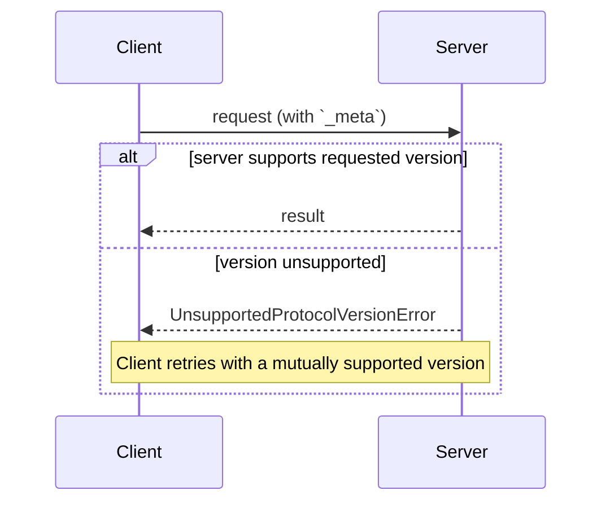

<div id="enable-section-numbers" />

本页定义客户端与服务器如何就通信内容达成一致：每个请求声明的协议版本、通过能力协商的可选扩展，以及如何与早期基于握手的协议修订版互操作。

协议没有版本协商握手。每个请求都携带自身的协议版本，服务器独立决定接受还是拒绝每个请求：



## 术语

本页使用以下术语描述不同协议修订版之间的互操作：

- **现代协议**：以逐请求元数据传递版本、身份和能力的协议版本，即修订版 `2026-07-28` 及之后的版本。
- **旧版协议**：通过 `initialize` 握手建立会话的协议版本，即 `2025-11-25` 及之前的版本。
- **双时代**：同时支持现代和旧版协议的实现。

## 协议版本协商

每个请求在 [`_meta`](/specification/2026-07-28/basic/index#meta) 字段中声明所使用的协议版本。在 HTTP 中，该值还通过 [`MCP-Protocol-Version` 请求头](/specification/2026-07-28/basic/transports/streamable-http#protocol-version-header)传递。

如果服务器没有实现请求所指定的版本，无论是因为它不了解该版本，还是了解但选择不支持，服务器都**必须**返回 [`UnsupportedProtocolVersionError`](/specification/2026-07-28/schema#unsupportedprotocolversionerror)，列出实际支持的版本：

```json
{
  "jsonrpc": "2.0",
  "id": 1,
  "error": {
    "code": -32022,
    "message": "Unsupported protocol version",
    "data": {
      "supported": ["2026-07-28", "2025-11-25"],
      "requested": "1900-01-01"
    }
  }
}
```

客户端**应当**从 `supported` 列表中选择双方都支持的版本并重试请求；如果不存在兼容版本，则向用户显示错误。

服务器**必须**实现 [`server/discover`](/specification/2026-07-28/server/discover)。客户端**可以**在发送其他任何请求之前调用它，预先了解服务器支持的版本，但这不是强制要求：客户端可以直接调用任何 RPC，并在首选版本不受支持时处理 `UnsupportedProtocolVersionError`。

## 扩展协商

客户端和服务器可以协商核心协议之外的可选[扩展](/docs/extensions/overview)。扩展通过能力中的 `extensions` 字段声明，该字段将扩展标识符映射到各扩展的设置对象。扩展标识符**必须**遵循 [`_meta` 键命名规则](/specification/2026-07-28/basic/index#meta)，并且必须包含前缀。

下面的客户端示例声明支持标识符为 `io.modelcontextprotocol/ui` 的 [MCP Apps 扩展](/extensions/apps/overview)：

```json
{
  "capabilities": {
    "roots": {},
    "extensions": {
      "io.modelcontextprotocol/ui": {
        "mimeTypes": ["text/html;profile=mcp-app"]
      }
    }
  }
}
```

下面是标识符为 `io.modelcontextprotocol/tasks` 的 [Tasks 扩展](/extensions/tasks/overview)示例：

```json
{
  "capabilities": {
    "tools": {},
    "extensions": {
      "io.modelcontextprotocol/tasks": {}
    }
  }
}
```

每个扩展都规定其设置对象的 Schema；空对象表示支持该扩展，但没有额外设置。

如果一方支持某个扩展，而另一方不支持，支持方**必须**恢复为核心协议行为，或使用适当的错误拒绝请求。扩展**应当**记录预期的回退行为。

## 与基于初始化的版本向后兼容

希望同时支持[旧版](#terminology)客户端（期待 `initialize` 握手）和[现代](#terminology)客户端（使用逐请求元数据）的服务器，**可以**同时实现两种行为。

需要与这两类服务器互操作的客户端，应使用具体传输方式的机制识别服务器所处的协议时代；各绑定页面对此作出了规定：

- [stdio](/specification/2026-07-28/basic/transports/stdio#backward-compatibility)：通过 `server/discover` 探测；只要错误不是已知的现代协议错误，就执行回退。
- [Streamable HTTP](/specification/2026-07-28/basic/transports/streamable-http#backward-compatibility)：尝试发送现代协议请求，并在回退前检查 `400 Bad Request` 的响应体。

在两种情况下，已知的现代 JSON-RPC 错误（如 [`UnsupportedProtocolVersionError`](/specification/2026-07-28/schema#unsupportedprotocolversionerror)）都表明服务器使用现代协议：客户端应改用受支持的版本重试，而不是回退。其他结果则表明服务器使用旧版协议。

协议时代的判断针对服务器，而非某个单独请求。客户端**应当**在服务器进程（stdio）或源（HTTP）的生命周期内缓存该结果，并且**可以**在相同服务器配置重启后继续保留；如果之后发现缓存的假设失效，再重新探测。

仅支持[现代](#terminology)版本的服务器，在任何传输方式下响应 `initialize` 请求而返回错误时，都**应当**在错误中说明所支持的协议版本：旧版客户端没有向新版前进的机制，这条消息可能是它们唯一能向用户展示的诊断信息。

### 兼容性矩阵

下表总结客户端与服务器处于各种协议时代组合时的预期结果：

| 客户端 | 服务器 | 结果 |
| -------- | -------- | ------------------------------------------------------------------------------------------------------------------------------------------------------------------------------------------------------------------------------------------------------------------------------------------------------------------------------------------------------------------------------------------------------------------------------------------------------------------------------------------------------------------------------------------- |
| 现代 | 现代 | 可以正常工作。`server/discover` 可选；版本不匹配时返回 `UnsupportedProtocolVersionError`，客户端使用双方都支持的版本重试。 |
| 现代 | 旧版 | 失败。服务器可能返回由实现自行定义的错误、保持静默，甚至按旧版语义处理一个无法单凭方法名判断时代的方法。在 stdio 中，客户端**应当**先发送 `server/discover`，让不兼容情况以确定的方式失败；随后向用户显示可据以采取行动的错误信息。 |
| 双时代 | 现代 | 可以正常工作。stdio 探测会返回 `DiscoverResult`（或 `UnsupportedProtocolVersionError`）；在 HTTP 中，第一个现代请求会成功，或返回现代协议错误。客户端继续使用现代协议。 |
| 双时代 | 旧版 | 可以正常工作。stdio：探测返回非现代协议错误或超时，客户端回退到 `initialize`。HTTP：现代请求返回 `4xx`，且响应体不是已知的现代协议错误，客户端回退到 `initialize`，并可能进一步回退到已弃用的 HTTP+SSE 传输。 |
| 旧版 | 现代 | 失败。stdio：服务器以 JSON-RPC 错误拒绝 `initialize`；具体错误码由实现自行定义，因为 `initialize` 是未知方法，而且请求也缺少必需的 `_meta` 字段。HTTP：请求缺少必需的请求头，会根据[服务器校验](/specification/2026-07-28/basic/transports/streamable-http#server-validation)规则以 `400 Bad Request` 拒绝；如果客户端使用已弃用的 HTTP+SSE 传输，则会在最初的 `GET` 时失败。旧版客户端没有向新版前进的机制。 |
| 旧版 | 双时代 | 可以正常工作。服务器响应 `initialize`，并按照协商出的旧版协议修订版为客户端提供服务。 |
| 旧版 | 旧版 | 按旧版协议修订版运行，不在本文讨论范围内。 |

双时代**服务器**根据客户端开始交互的方式选择行为：

- 携带现代逐请求 `_meta` 的请求，将按照本修订版以无状态方式处理。
- `initialize` 请求会选择旧版语义，并根据协商出的旧版协议版本，将其作用域限定在 stdio 进程（stdio）或会话（HTTP）内。

双时代服务器**可以**在同一个端点或进程中，并发服务于两个协议时代。
