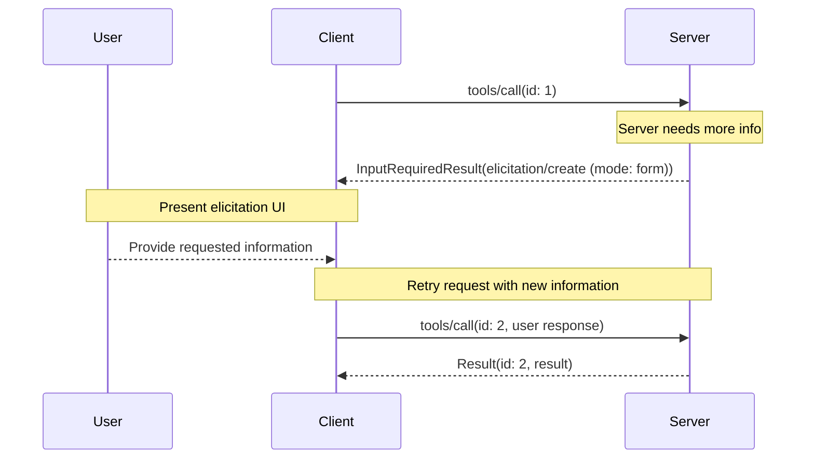
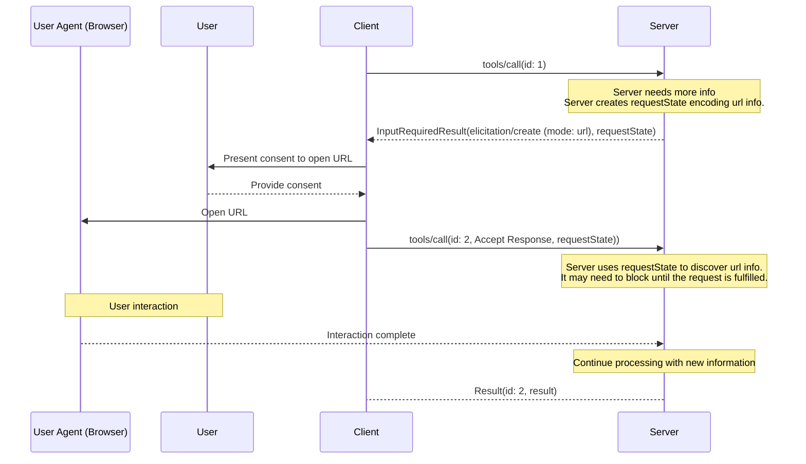
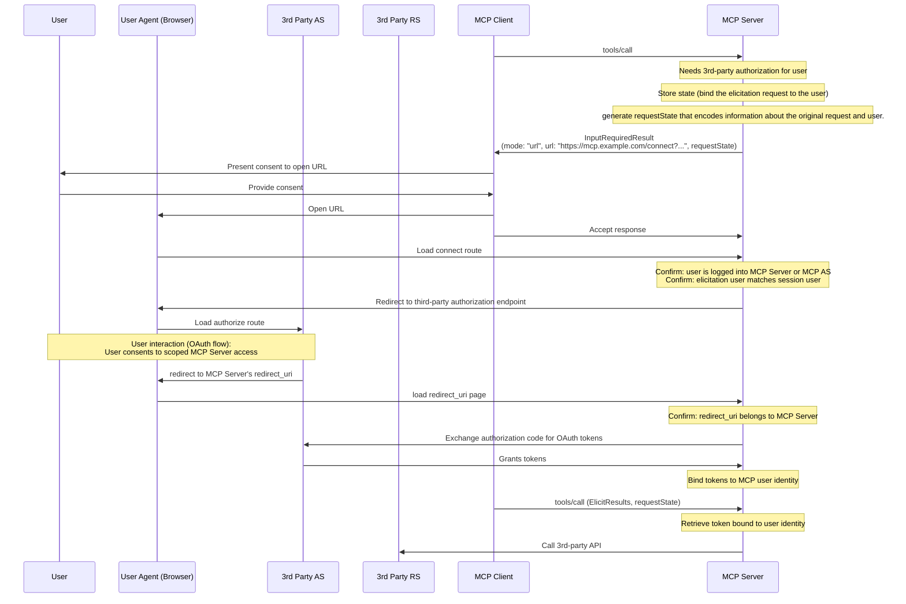

<div id="enable-section-numbers" />

Model Context Protocol（MCP）为服务器在交互过程中通过客户端向用户请求补充信息定义了标准方式。该流程让客户端保留对用户交互和数据共享的控制，同时让服务器能够动态收集必要信息。

信息征询支持两种模式：

- **表单模式**：服务器可以向用户请求结构化数据，并可选择使用 JSON Schema 校验响应
- **URL 模式**：服务器可以将用户引导至外部 URL，进行 _不得_ 经过 MCP Client 的敏感交互

## 用户交互模型

MCP 的信息征询功能允许将用户输入请求 _嵌套_ 在其他 MCP Server 功能内部，从而让服务器实现交互式工作流。

实现可以自由采用适合自身需求的界面形式来提供信息征询；协议本身不强制要求任何特定的用户交互模型。

<Warning>

出于可信度、安全保障与系统安全方面的考虑：

- 服务器**不得**通过表单模式征询密码、API Key、访问令牌或支付凭据等敏感信息
- 涉及此类敏感信息的交互，服务器**必须**使用 [URL 模式](#url-mode-elicitation-requests)

这里的“敏感信息”指能够授予访问权限或授权交易的机密和凭据。一般的联系信息或个人资料，例如姓名、电子邮件地址或用户名，并非一概禁止通过表单请求；服务器可以自行决定是否以表单模式请求此类数据，但用户必须能够审查并拒绝。

MCP Client **必须**：

- 通过界面明确展示是哪个服务器在请求信息
- 尊重用户隐私，提供清晰的拒绝与取消选项
- 对于表单模式，允许用户在发送前审查和修改响应
- 对于 URL 模式，清晰显示目标域名／主机，并在导航到目标 URL 前取得用户同意

</Warning>

## 能力

支持信息征询的客户端**必须**在每个请求的 `_meta.io.modelcontextprotocol/clientCapabilities` 中声明 `elicitation` 能力：

```json
{
  "_meta": {
    "io.modelcontextprotocol/clientCapabilities": {
      "elicitation": {
        "form": {},
        "url": {}
      }
    }
  }
}
```

为保持向后兼容，空的能力对象等同于仅声明支持 `form` 模式：

```jsonc
{
  "_meta": {
    "io.modelcontextprotocol/clientCapabilities": {
      "elicitation": {}, // Equivalent to { "form": {} }
    },
  },
}
```

声明 `elicitation` 能力的客户端，**必须**至少支持一种模式，即 `form` 或 `url`。

服务器**不得**发送采用客户端不支持模式的信息征询请求。

## 协议消息

### 信息征询请求

服务器**可以**在处理客户端请求期间，发送包含 `elicitation/create` 请求的 [`InputRequiredResult`](/specification/2026-07-28/basic/patterns/mrtr#inputrequiredresult)，向用户请求信息。

所有信息征询请求都**必须**包含以下参数：

| 名称 | 类型 | 选项 | 说明 |
| --------- | ------ | ------------- | -------------------------------------------------------------------------------------- |
| `mode` | string | `form`, `url` | 信息征询的模式。表单模式下可省略，省略时默认为 `"form"`。 |
| `message` | string | | 人类可读的消息，解释为什么需要此次交互。 |

`mode` 参数指定信息征询类型：

- `"form"`：在带内收集结构化数据，可选择进行 Schema 校验。数据会提供给客户端。
- `"url"`：通过 URL 导航进行带外交互。除 URL 本身外，数据**不会**提供给客户端。

为保持向后兼容，服务器**可以**省略表单模式信息征询请求的 `mode` 字段。客户端**必须**将未包含 `mode` 字段的请求视为表单模式。

### 表单模式信息征询请求

表单模式允许服务器直接通过 MCP Client 收集结构化数据。

表单模式信息征询请求**必须**指定 `mode: "form"`，或省略 `mode` 字段，并包含以下额外参数：

| 名称 | 类型 | 说明 |
| ----------------- | ------ | -------------------------------------------------------------- |
| `requestedSchema` | object | 定义预期响应结构的 JSON Schema。 |

#### 请求的 Schema

`requestedSchema` 参数允许服务器使用 JSON Schema 的受限子集，定义预期响应结构。

为简化客户端的用户体验，表单模式的信息征询 Schema 仅允许扁平对象，且属性只能使用基本类型。

Schema 限定为以下基本类型：

1. **字符串 Schema**

   ```json
   {
     "type": "string",
     "title": "Display Name",
     "description": "Description text",
     "minLength": 3,
     "maxLength": 50,
     "format": "email",
     "default": "user@example.com"
   }
   ```

   支持的格式：`email`、`uri`、`date`、`date-time`

2. **数值 Schema**

   ```json
   {
     "type": "number", // or "integer"
     "title": "Display Name",
     "description": "Description text",
     "minimum": 0,
     "maximum": 100,
     "default": 50
   }
   ```

3. **布尔值 Schema**

   ```json
   {
     "type": "boolean",
     "title": "Display Name",
     "description": "Description text",
     "default": false
   }
   ```

4. **枚举 Schema**

   单选枚举，不带标题：

   ```json
   {
     "type": "string",
     "title": "Color Selection",
     "description": "Choose your favorite color",
     "enum": ["Red", "Green", "Blue"],
     "default": "Red"
   }
   ```

   单选枚举，带标题：

   ```json
   {
     "type": "string",
     "title": "Color Selection",
     "description": "Choose your favorite color",
     "oneOf": [
       { "const": "#FF0000", "title": "Red" },
       { "const": "#00FF00", "title": "Green" },
       { "const": "#0000FF", "title": "Blue" }
     ],
     "default": "#FF0000"
   }
   ```

   多选枚举，不带标题：

   ```json
   {
     "type": "array",
     "title": "Color Selection",
     "description": "Choose your favorite colors",
     "minItems": 1,
     "maxItems": 2,
     "items": {
       "type": "string",
       "enum": ["Red", "Green", "Blue"]
     },
     "default": ["Red", "Green"]
   }
   ```

   多选枚举，带标题：

   ```json
   {
     "type": "array",
     "title": "Color Selection",
     "description": "Choose your favorite colors",
     "minItems": 1,
     "maxItems": 2,
     "items": {
       "anyOf": [
         { "const": "#FF0000", "title": "Red" },
         { "const": "#00FF00", "title": "Green" },
         { "const": "#0000FF", "title": "Blue" }
       ]
     },
     "default": ["#FF0000", "#00FF00"]
   }
   ```

客户端可以利用该 Schema：

1. 生成合适的输入表单
2. 在发送前校验用户输入
3. 为用户提供更完善的指导

所有基本类型都支持可选默认值，作为合理的初始值。支持默认值的客户端应当用这些值预先填充表单字段。

为简化客户端的用户体验，协议特意不支持复杂嵌套结构、对象数组（枚举以外）及其他高级 JSON Schema 功能。

#### 示例：简单文本请求

**输入请求（通过 [`InputRequiredResult.inputRequests`](/specification/2026-07-28/basic/patterns/mrtr#inputrequests) 传递）：**

```json
{
  "method": "elicitation/create",
  "params": {
    "mode": "form",
    "message": "Please provide your GitHub username",
    "requestedSchema": {
      "type": "object",
      "properties": {
        "name": {
          "type": "string"
        }
      },
      "required": ["name"]
    }
  }
}
```

**客户端结果（在重试请求的 `inputResponses` 中返回）：**

```json
{
  "action": "accept",
  "content": {
    "name": "octocat"
  }
}
```

#### 示例：结构化数据请求

**输入请求（通过 `InputRequiredResult.inputRequests` 传递）：**

```json
{
  "method": "elicitation/create",
  "params": {
    "mode": "form",
    "message": "Please provide your contact information",
    "requestedSchema": {
      "type": "object",
      "properties": {
        "name": {
          "type": "string",
          "description": "Your full name"
        },
        "email": {
          "type": "string",
          "format": "email",
          "description": "Your email address"
        },
        "age": {
          "type": "number",
          "minimum": 18,
          "description": "Your age"
        }
      },
      "required": ["name", "email"]
    }
  }
}
```

**客户端结果（在重试请求的 `inputResponses` 中返回）：**

```json
{
  "action": "accept",
  "content": {
    "name": "Monalisa Octocat",
    "email": "octocat@github.com",
    "age": 30
  }
}
```

### URL 模式信息征询请求

<Note>

**新功能：** URL 模式信息征询在 MCP 规范 `2025-11-25` 版本中引入，其设计和实现可能在今后的协议修订中变化。

</Note>

URL 模式允许服务器将用户引导至外部 URL，进行不得经过 MCP Client 的带外交互。这对身份验证流程、支付处理及其他敏感或安全操作至关重要。

URL 模式信息征询请求**必须**指定 `mode: "url"`、`message`，并包含以下额外参数：

| 名称 | 类型 | 说明 |
| ----- | ------ | ----------------------------------------- |
| `url` | string | 用户应当导航到的 URL。 |

`url` 参数**必须**包含有效 URL。

<Note>
  **重要**：URL 模式信息征询*不是*用来授权 MCP Client 访问 MCP Server 的；这由 [MCP 授权](../basic/authorization)负责。它用于 MCP Server 需要代表用户获取敏感信息或第三方授权的场景。MCP Client 的 Bearer Token 保持不变。客户端唯一的职责，是向用户说明服务器希望其打开的信息征询 URL 的相关背景。
</Note>

#### 示例：请求敏感数据

本例展示 URL 模式信息征询请求如何将用户引导至安全 URL，供其提交敏感信息，例如 API Key。同类请求也可以将用户引导至 OAuth 授权流程或支付流程，区别仅在 URL 与说明消息。

**输入请求（通过 `InputRequiredResult.inputRequests` 传递）：**

```json
{
  "method": "elicitation/create",
  "params": {
    "mode": "url",
    "url": "https://mcp.example.com/ui/set_api_key",
    "message": "Please provide your API key to continue."
  }
}
```

**客户端结果（在重试请求的 `inputResponses` 中返回）：**

```json
{
  "action": "accept"
}
```

`action: "accept"` 响应表示用户同意交互，并不表示交互已经完成。交互在带外进行，客户端不会直接获知其结果。客户端重试原请求时，服务器根据原样返回的 `requestState` 或自身保存的状态，判断带外交互是否完成，然后返回最终结果，或再次返回 `InputRequiredResult`。客户端**应当**提供手动控件，让用户重试或取消原请求，或以其他方式继续与客户端交互。

## 消息流程

### 表单模式流程



### URL 模式流程



## 响应动作

信息征询响应采用三种动作，清晰区分不同用户行为。这些动作同时适用于表单模式与 URL 模式。

```json
{
  "action": "accept", // or "decline" or "cancel"
  "content": {
    "propertyName": "value",
    "anotherProperty": 42
  }
}
```

三种响应动作分别是：

1. **接受**（`action: "accept"`）：用户明确批准并提交数据
   - 表单模式下：`content` 字段包含与请求 Schema 匹配的提交数据
   - URL 模式下：省略 `content` 字段
   - 例如：用户点击 "Submit"、"OK"、"Confirm" 等按钮

2. **拒绝**（`action: "decline"`）：用户明确拒绝请求
   - 通常省略 `content` 字段
   - 例如：用户点击 "Reject"、"Decline"、"No" 等按钮

3. **取消**（`action: "cancel"`）：用户未作出明确选择就关闭交互
   - 通常省略 `content` 字段
   - 例如：用户关闭对话框、点击外部区域、按下 Escape，或浏览器加载失败等

服务器应当恰当处理各个状态：

- **接受**：处理已提交的数据
- **拒绝**：处理明确拒绝，例如提供其他方案
- **取消**：处理关闭交互的情况，例如稍后再次询问

## 实现注意事项

### 状态性

使用[多轮往返请求](/specification/2026-07-28/basic/patterns/mrtr#multi-round-trip-requests)机制时，信息征询不要求服务器维护用户相关状态。

不过，如果保存了状态，实现信息征询的服务器**必须**遵循[安全最佳实践](/docs/2026-07-28/tutorials/security/security_best_practices)中的指导，将状态与各个用户安全关联。具体而言：

- 状态存储**必须**受到保护，防止未经授权的访问
- 对于远程 MCP Server，用户身份在可能时**必须**源自通过 [MCP 授权](../basic/authorization)获得的凭据，例如 `sub` 声明

<Note>
  本节示例为非规范性内容，旨在展示信息征询的潜在用法。实现者应当根据具体需求调整这些模式，同时保持安全最佳实践。
</Note>

### 通过 URL 模式征询敏感数据

对于需要敏感信息（如凭据或支付信息）才能访问外部 API 的服务器，URL 模式提供了一种安全机制，让用户提交此类信息而无需将其暴露给 MCP Client。

在此模式中：

1. 服务器将用户引导至通过 HTTPS 提供的安全网页
2. 页面在用户信任的域名上展示具有品牌标识的表单界面
3. 用户直接在安全表单中输入敏感凭据
4. 服务器安全保存凭据，并将其绑定到用户身份
5. 后续 MCP 请求使用保存的凭据访问 API

这种方式确保敏感凭据始终不会经过 LLM 上下文、MCP Client 或任何中间 MCP Server，降低客户端日志或其他攻击途径导致信息暴露的风险。

### 通过 URL 模式执行 OAuth 流程

URL 模式支持让 MCP Server 充当第三方资源服务器的 OAuth 客户端。
通过 URL 模式实现的外部 API 授权，与 [MCP 授权](../basic/authorization)相互独立。MCP Server **不得**依靠 URL 模式信息征询为用户授权访问自身。

#### 理解两者的区别

- **MCP 授权**：MCP Client 与 MCP Server 之间必需的 OAuth 流程，见[授权规范](../basic/authorization)
- **外部（第三方）授权**：MCP Server 与第三方资源服务器之间的可选授权，通过 URL 模式信息征询发起

在外部授权中，服务器同时充当：

- OAuth 资源服务器，面向 MCP Client
- OAuth 客户端，面向第三方资源服务器

示例场景：

- MCP Client 连接 MCP Server
- MCP Server 集成了多种不同的第三方服务
- MCP Client 调用需要访问第三方服务的工具时，MCP Server 需要该服务的凭据

关键安全要求如下：

1. **第三方凭据不得经过 MCP Client**：为保护安全边界，客户端绝不能看到第三方凭据
2. **MCP Server 不得将客户端凭据用于第三方服务**：这属于[令牌透传](/docs/2026-07-28/tutorials/security/security_best_practices#token-passthrough)，是被禁止的
3. **用户必须直接向 MCP Server 授权**：交互在 MCP 协议之外进行，不涉及 MCP Client
4. **MCP Server 负责令牌**：MCP Server 负责保存和管理通过 URL 模式获取的第三方令牌；换句话说，MCP Server 必须维护状态。

通过 URL 模式获取的凭据，与 MCP Client 用于访问 MCP Server 的凭据不同。MCP Server **不得**将通过 URL 模式获取的凭据传给 MCP Client。

<Note>
  有关更多背景，请参阅安全最佳实践中的[令牌透传一节](/docs/2026-07-28/tutorials/security/security_best_practices#token-passthrough)，了解为什么 MCP Server 不能充当透传代理。
</Note>

#### 实现模式

通过 URL 模式实现外部授权时：

1. MCP Server 作为第三方服务的 OAuth 客户端，生成授权 URL
2. MCP Server 保存内部状态，将信息征询请求与用户身份关联、绑定。
3. MCP Server 向客户端发送 URL 模式信息征询请求，包含能够启动授权流程的 URL，以及可选的 `requestState`，用于按需编码该征询请求和用户的信息。
4. 用户直接与第三方授权服务器完成 OAuth 流程
5. 第三方授权服务器重定向回 MCP Server
6. MCP Server 安全保存第三方令牌，并绑定到用户身份
7. 后续 MCP 请求可使用已保存的令牌，通过 API 访问第三方资源服务器

下面给出该模式的一种非规范性实现示例：



这种模式在保持清晰安全边界的同时，支持与需要用户授权的第三方服务进行丰富集成。

## 错误处理

服务器**不应当**假定信息征询请求总能成功，并且**必须**处理用户拒绝或取消征询，以及客户端未能处理请求的情况。

## 安全注意事项

1. 服务器**必须**将信息征询请求绑定到客户端与用户身份
1. 客户端**必须**清楚指明哪个服务器在请求信息
1. 客户端**应当**实现用户批准控件
1. 客户端**应当**允许用户随时拒绝信息征询请求
1. 客户端**应当**清楚展示请求哪些信息，以及为什么需要它们

### 安全处理 URL

请求信息征询的 MCP Server：

1. **不得**在 URL 征询请求中发送给客户端的 URL 里包含最终用户的敏感信息，例如凭据或个人身份信息等。
2. **不得**提供一个已预先认证、可访问受保护资源的 URL，因为恶意客户端可能利用该 URL 冒充用户。
3. **不应当**在表单模式征询请求的任何字段中包含打算供用户点击的 URL。
4. 在非开发环境中，**应当**使用 HTTPS URL。

这些服务器要求为客户端明确规定了何时向用户展示 URL，从而让下述客户端规则能够得到一致执行。

实现 URL 模式信息征询的客户端，**必须**谨慎处理 URL，防止用户在不知情时点击恶意链接。

处理 URL 模式信息征询请求时，MCP Client：

1. **不得**自动预先获取 URL 或其任何元数据。
2. 未经用户明确同意，**不得**打开 URL。
3. **必须**在用户同意前展示完整 URL，供其检查。
4. **必须**以安全方式打开服务器提供的 URL，不能让客户端或 LLM 检查网页内容或用户输入。例如，在 iOS 上，[SFSafariViewController](https://developer.apple.com/documentation/safariservices/sfsafariviewcontroller) 是合适的，而 [WkWebView](https://developer.apple.com/documentation/webkit/wkwebview) 则不合适。
5. **应当**突出显示 URL 的域名，减轻子域名欺骗风险。
6. 对含义不明或可疑的 URI，例如包含 Punycode 的 URI，**应当**显示警告。
7. 除 URL 征询请求中的 `url` 字段外，**不应当**将征询请求任何字段中的 URL 渲染为可点击链接；该例外仍须遵守上述限制。

### 识别用户

服务器**不得**在未经自身验证的情况下，依赖客户端提供的用户身份，因为这些信息可能被伪造。
服务器**应当**改为遵循[安全最佳实践](/docs/2026-07-28/tutorials/security/security_best_practices)。

非规范性示例：

- 错误做法：将用户输入的“我是 joe@example.com”视为权威身份信息
- 正确做法：依靠[授权](../basic/authorization)识别用户

### 表单模式安全

1. 服务器**不得**通过表单模式请求密码、API Key 等敏感信息
2. 客户端**应当**根据提供的 Schema 校验所有响应
3. 服务器**应当**校验收到的数据是否符合请求的 Schema

#### 网络钓鱼

URL 模式信息征询会返回 URL，攻击者可能将其转发给受害者。MCP Server **必须**在接受信息前，验证打开 URL 的用户身份。

通常可以利用 [MCP 授权服务器](../basic/authorization)，通过浏览器中的会话 Cookie 或等效机制识别用户，完成身份验证。

例如，URL 模式可能用于 OAuth 流程，此时 MCP Server 充当另一资源服务器的 OAuth 客户端。如果没有适当防护，可能发生以下钓鱼攻击：

1. 连接到正常服务器的恶意用户 Alice 触发信息征询请求
2. 正常服务器作为第三方授权服务器的 OAuth 客户端，生成授权 URL
3. Alice 的客户端展示 URL，并请求其同意
4. Alice 没有点击链接，而是诱骗同一正常服务器的受害用户 Bob 点击
5. Bob 打开链接并完成授权，以为自己正在授权自身与正常服务器之间的连接
6. 正常服务器收到第三方授权服务器的回调／重定向，并将其误认为 Alice 的请求
7. 第三方服务器的令牌绑定到了 Alice 的会话和身份，而非 Bob，导致账户被接管

为防止此类攻击，服务器**必须**确保发起信息征询请求的用户，即通过 MCP Client 访问服务器的最终用户，与完成授权流程的用户是同一个人。

实现方式有很多，最佳方案取决于具体实现。

一个常见的非规范性示例是：MCP Server 可以通过 Web 访问，并希望执行第三方授权码流程。为防止钓鱼，服务器应创建指向 `https://mcp.example.com/connect?...` 的 URL 模式信息征询，而非直接指向第三方授权端点。该“连接 URL”必须确认打开页面的用户，就是生成征询请求时对应的用户。例如，检查用户是否有有效会话 Cookie，且 Cookie 对应的用户与使用 MCP Client 生成 URL 模式征询的用户一致。可以比较 MCP Server 授权服务器提供的权威主体（`sub` 声明），与会话 Cookie 中的主体。页面确认是同一用户后，即可将用户引导至 `https://example.com/authorize?...` 的第三方授权服务器，完成正常 OAuth 流程。

在其他场景中，服务器可能无法通过 Web 访问，也无法使用会话 Cookie 识别用户。此时，服务器必须采用其他机制，确认打开征询 URL 的用户与生成征询请求时对应的用户相同。

无论采用何种实现，服务器都**必须**确保用户身份判定机制能够抵御攻击者修改征询 URL 的攻击。
