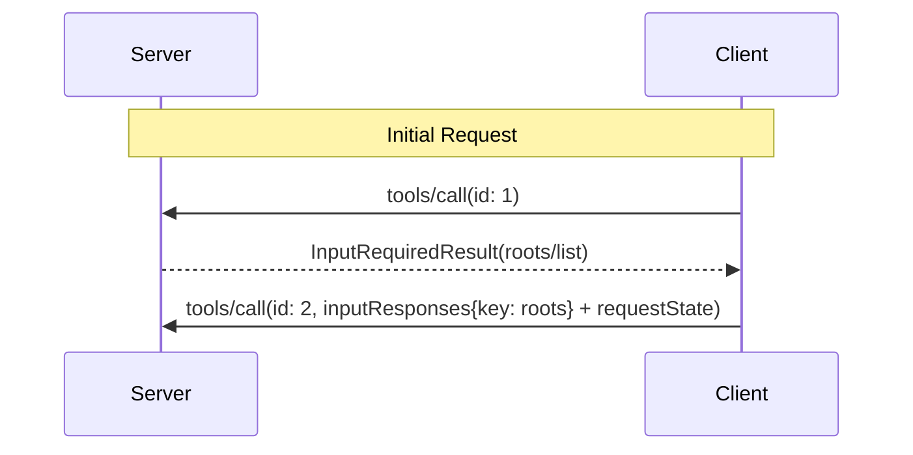

<div id="enable-section-numbers" />

<Warning>
  **已弃用**：自协议版本 `2026-07-28` 起，Roots 功能已被弃用（[SEP-2577](https://github.com/modelcontextprotocol/modelcontextprotocol/pull/2577)）。根据[功能生命周期政策](/community/feature-lifecycle)，该功能在本修订版发布后至少保留十二个月，之后才具备移除资格。新的实现**不应当**采用此功能；现有实现**应当**改为通过工具参数、资源 URI 或服务器配置传递目录或文件。详见[已弃用功能登记表](/specification/2026-07-28/deprecated)。
</Warning>

Model Context Protocol（MCP）为客户端向服务器提供文件系统“根目录”（roots）定义了标准方式。根目录告知服务器，客户端认为哪些目录和文件与当前任务相关，使服务器能够据此确定操作重点。这些信息只起指导作用，并非访问控制机制。协议不会强制服务器将操作限制在根目录范围内。服务器可以向支持该功能的客户端请求根目录列表。

## 用户交互模型

MCP 中的根目录通常通过工作区或项目配置界面提供。

例如，实现可以提供工作区／项目选择器，让用户选择服务器应当能够访问的目录和文件，也可以结合版本控制系统或项目文件自动检测工作区。

不过，实现可以自由采用适合自身需求的界面形式来提供根目录；协议本身不强制要求任何特定的用户交互模型。

## 能力

支持根目录的客户端**必须**在每个请求的 `_meta.io.modelcontextprotocol/clientCapabilities` 中声明 `roots` 能力：

```json
{
  "_meta": {
    "io.modelcontextprotocol/clientCapabilities": {
      "roots": {}
    }
  }
}
```

## 协议消息

### 列出根目录

服务器若要在处理客户端请求期间获取根目录，应发送包含 `roots/list` 请求的 `InputRequiredResult`：

**输入请求（通过 [`InputRequiredResult.inputRequests`](/specification/2026-07-28/basic/patterns/mrtr#inputrequests) 传递）：**

```json
{
  "method": "roots/list"
}
```

**客户端结果（在重试请求的 `inputResponses` 中返回）：**

```json
{
  "roots": [
    {
      "uri": "file:///home/user/projects/myproject",
      "name": "My Project"
    }
  ]
}
```

## 消息流程



## 数据类型

### Root

根目录定义包含：

- `uri`：根目录的唯一标识符。在当前规范中，该值**必须**是 `file://` URI。
- `name`：可选的人类可读名称，用于显示。

不同使用场景下的根目录示例：

#### 项目目录

```json
{
  "uri": "file:///home/user/projects/myproject",
  "name": "My Project"
}
```

#### 多个仓库

```json
[
  {
    "uri": "file:///home/user/repos/frontend",
    "name": "Frontend Repository"
  },
  {
    "uri": "file:///home/user/repos/backend",
    "name": "Backend Repository"
  }
]
```

## 错误处理

如果发生错误，客户端无需携带错误消息重新执行最初的调用，因为在 `InputRequiredResult` 模式下，服务器并未等待响应。

## 安全注意事项

1. 客户端**必须**：
   - 仅提供具有适当权限的根目录
   - 校验所有根目录 URI，防止路径遍历
   - 实施适当的访问控制
   - 监控根目录的可访问性

2. 服务器**应当**：
   - 处理根目录变得不可用的情况
   - 操作时遵守根目录边界
   - 根据提供的根目录校验所有路径

## 实现指南

1. 客户端**应当**：
   - 向服务器提供根目录前，提示用户同意
   - 提供清晰的根目录管理界面
   - 提供根目录前，验证其可访问性
   - 监控根目录变化

2. 服务器**应当**：
   - 使用前检查客户端是否声明根目录能力
   - 操作时遵守根目录边界
   - 适当缓存根目录信息
