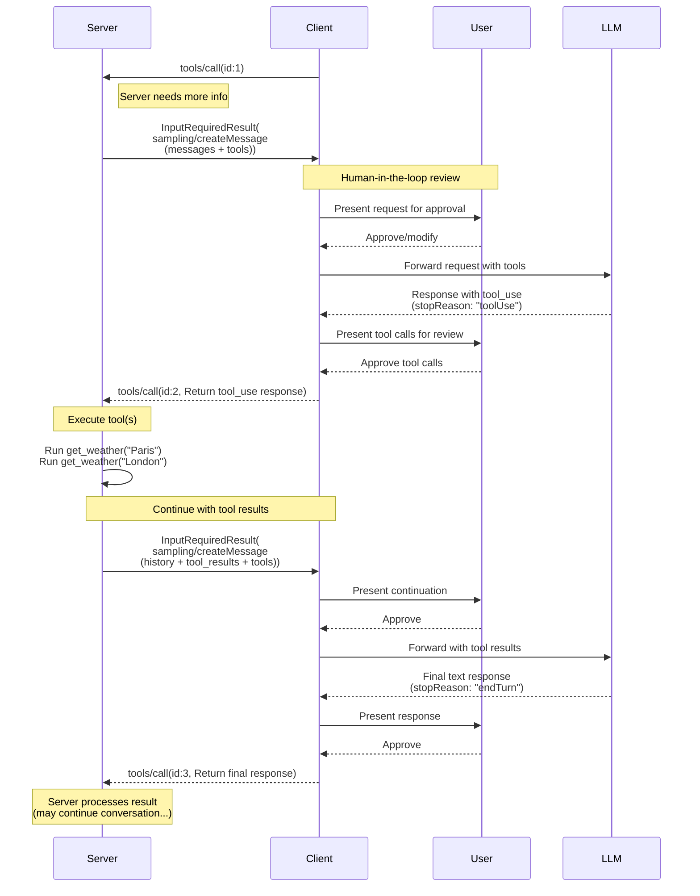
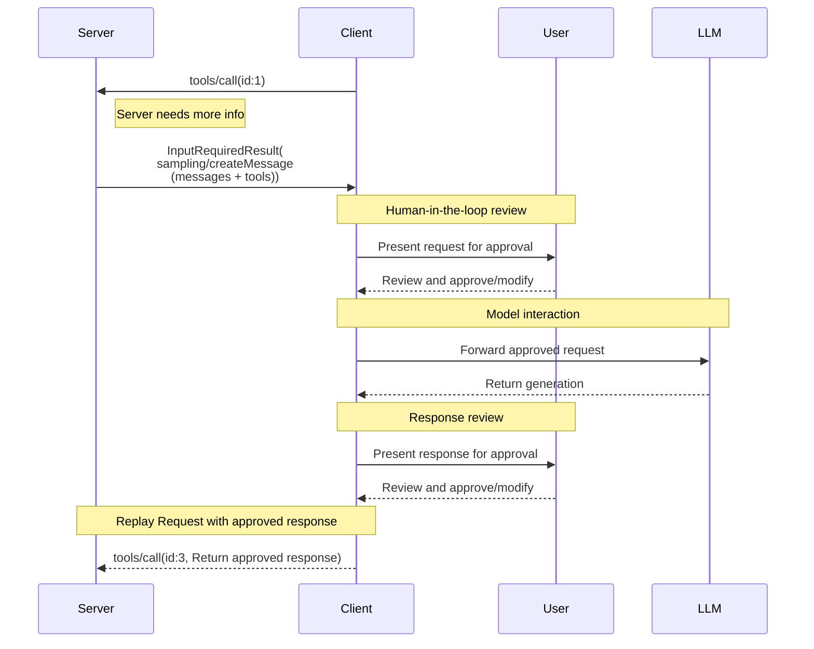

<div id="enable-section-numbers" />

<Warning>
  **已弃用**：自协议版本 `2026-07-28` 起，Sampling 功能已被弃用（[SEP-2577](https://github.com/modelcontextprotocol/modelcontextprotocol/pull/2577)）。根据[功能生命周期政策](/community/feature-lifecycle)，该功能在本修订版发布后至少保留十二个月，之后才具备移除资格。新的实现**不应当**采用此功能；现有实现**应当**改为直接集成 LLM 提供商的 API。详见[已弃用功能登记表](/specification/2026-07-28/deprecated)。
</Warning>

Model Context Protocol（MCP）为服务器通过客户端向语言模型请求 LLM 采样（“补全”或“生成”）定义了标准方式。该流程让客户端保留对模型访问、选择和权限的控制，同时使服务器能够利用 AI 能力，而无需在服务器端持有 API Key。服务器可以请求基于文本、音频或图像的交互，并可选择在提示中包含来自 MCP Server 的上下文。

## 用户交互模型

MCP 的采样功能允许将 LLM 调用 _嵌套_ 在其他 MCP Server 功能内部，从而让服务器实现智能体行为。

实现可以自由采用适合自身需求的界面形式来提供采样；协议本身不强制要求任何特定的用户交互模型。

<Warning>

出于可信度、安全保障与系统安全方面的考虑，**应当**始终让人类参与流程，并有能力拒绝采样请求。

应用**应当**：

- 提供便于直观审查采样请求的界面
- 允许用户在发送前查看和编辑提示
- 在交付前展示生成的响应，供用户审查

</Warning>

## 采样中的工具

服务器可以在采样请求中提供 `tools` 数组和可选的 `toolChoice` 配置，请求客户端的 LLM 在采样过程中使用工具。`tools` 数组中的工具定义仅作用于当前采样请求，无需与已注册的工具对应。这样，服务器就能实现智能体行为：LLM 调用专门指定的工具、接收结果，并继续对话，整个过程都在同一次采样请求流程中完成。

客户端**必须**通过 `sampling.tools` 能力声明支持工具使用，才能接收启用工具的采样请求。对于未通过 `sampling.tools` 能力声明支持工具使用的客户端，服务器**不得**向其发送启用工具的采样请求。

## 能力

支持采样的客户端**必须**在每个请求的 `_meta.io.modelcontextprotocol/clientCapabilities` 中声明 `sampling` 能力：

**基本采样：**

```json
{
  "_meta": {
    "io.modelcontextprotocol/clientCapabilities": {
      "sampling": {}
    }
  }
}
```

**支持工具使用：**

```json
{
  "_meta": {
    "io.modelcontextprotocol/clientCapabilities": {
      "sampling": {
        "tools": {}
      }
    }
  }
}
```

**支持上下文纳入（已弃用）：**

```json
{
  "_meta": {
    "io.modelcontextprotocol/clientCapabilities": {
      "sampling": {
        "context": {}
      }
    }
  }
}
```

<Note>
  根据[功能生命周期政策](/community/feature-lifecycle#deprecating-a-feature)，`includeContext` 参数的 `"thisServer"` 和 `"allServers"` 值已被弃用（[SEP-2596](https://github.com/modelcontextprotocol/modelcontextprotocol/pull/2596)），其移除时间不会晚于 Sampling 功能本身。服务器**应当**避免使用这些值，例如可以直接省略 `includeContext`，因为默认值为 `"none"`；除非客户端声明了 `sampling.context` 能力，否则**不应当**使用它们。详见[已弃用功能登记表](/specification/2026-07-28/deprecated)。
</Note>

## 协议消息

### 创建消息

服务器若要在处理客户端请求期间请求语言模型生成内容，应发送包含 `sampling/createMessage` 请求的 `InputRequiredResult`：

**输入请求（通过 [`InputRequiredResult.inputRequests`](/specification/2026-07-28/basic/patterns/mrtr#inputrequests) 传递）：**

```json
{
  "method": "sampling/createMessage",
  "params": {
    "messages": [
      {
        "role": "user",
        "content": {
          "type": "text",
          "text": "What is the capital of France?"
        }
      }
    ],
    "modelPreferences": {
      "hints": [
        {
          "name": "claude-3-sonnet"
        }
      ],
      "costPriority": 0.3,
      "intelligencePriority": 0.8,
      "speedPriority": 0.5
    },
    "temperature": 0.1,
    "systemPrompt": "You are a helpful assistant.",
    "includeContext": "thisServer",
    "maxTokens": 100
  }
}
```

**客户端结果（在重试请求的 `inputResponses` 中返回）：**

```json
{
  "role": "assistant",
  "content": {
    "type": "text",
    "text": "The capital of France is Paris."
  },
  "model": "claude-3-sonnet-20240307",
  "stopReason": "endTurn"
}
```

### 使用工具的采样

下图展示使用工具进行采样的完整流程，包括多轮工具循环：



要请求支持工具使用的 LLM 生成，服务器在请求中包含 `tools`，并可选择包含 `toolChoice`：

**输入请求（服务器 -> 客户端，通过 `InputRequiredResult.inputRequests` 传递）：**

```json
{
  "method": "sampling/createMessage",
  "params": {
    "messages": [
      {
        "role": "user",
        "content": {
          "type": "text",
          "text": "What's the weather like in Paris and London?"
        }
      }
    ],
    "tools": [
      {
        "name": "get_weather",
        "description": "Get current weather for a city",
        "inputSchema": {
          "type": "object",
          "properties": {
            "city": {
              "type": "string",
              "description": "City name"
            }
          },
          "required": ["city"]
        }
      }
    ],
    "toolChoice": {
      "mode": "auto"
    },
    "maxTokens": 1000
  }
}
```

**客户端结果（客户端 -> 服务器，在重试请求的 `inputResponses` 中返回）：**

```json
{
  "role": "assistant",
  "content": [
    {
      "type": "tool_use",
      "id": "call_abc123",
      "name": "get_weather",
      "input": {
        "city": "Paris"
      }
    },
    {
      "type": "tool_use",
      "id": "call_def456",
      "name": "get_weather",
      "input": {
        "city": "London"
      }
    }
  ],
  "model": "claude-3-sonnet-20240307",
  "stopReason": "toolUse"
}
```

### 多轮工具循环

收到 LLM 的工具使用请求后，服务器通常会：

1. 执行所请求的工具调用。
2. 将工具结果附加到消息中，发送新的采样请求
3. 接收 LLM 响应，其中可能包含新的工具调用
4. 按需重复；服务器可以限制最大迭代次数，例如在最后一轮传入 `toolChoice: {mode: "none"}`，强制生成最终结果

**包含工具结果的后续输入请求（服务器 -> 客户端，通过 `InputRequiredResult.inputRequests` 传递）：**

```json
{
  "method": "sampling/createMessage",
  "params": {
    "messages": [
      {
        "role": "user",
        "content": {
          "type": "text",
          "text": "What's the weather like in Paris and London?"
        }
      },
      {
        "role": "assistant",
        "content": [
          {
            "type": "tool_use",
            "id": "call_abc123",
            "name": "get_weather",
            "input": { "city": "Paris" }
          },
          {
            "type": "tool_use",
            "id": "call_def456",
            "name": "get_weather",
            "input": { "city": "London" }
          }
        ]
      },
      {
        "role": "user",
        "content": [
          {
            "type": "tool_result",
            "toolUseId": "call_abc123",
            "content": [
              {
                "type": "text",
                "text": "Weather in Paris: 18°C, partly cloudy"
              }
            ]
          },
          {
            "type": "tool_result",
            "toolUseId": "call_def456",
            "content": [
              {
                "type": "text",
                "text": "Weather in London: 15°C, rainy"
              }
            ]
          }
        ]
      }
    ],
    "tools": [
      {
        "name": "get_weather",
        "description": "Get current weather for a city",
        "inputSchema": {
          "type": "object",
          "properties": {
            "city": { "type": "string" }
          },
          "required": ["city"]
        }
      }
    ],
    "maxTokens": 1000
  }
}
```

**最终客户端结果（客户端 -> 服务器，在重试请求的 `inputResponses` 中返回）：**

```json
{
  "role": "assistant",
  "content": {
    "type": "text",
    "text": "Based on the current weather data:\n\n- **Paris**: 18°C and partly cloudy - quite pleasant!\n- **London**: 15°C and rainy - you'll want an umbrella.\n\nParis has slightly warmer and drier conditions today."
  },
  "model": "claude-3-sonnet-20240307",
  "stopReason": "endTurn"
}
```

## 消息内容约束

### 工具结果消息

用户消息包含工具结果（type: "tool_result"）时，**必须**只包含工具结果。不允许在同一条消息中混合工具结果与其他内容类型，例如文本、图像或音频。

这一约束确保兼容为工具结果使用专门角色的提供商 API，例如 OpenAI 的 "tool" 角色和 Gemini 的 "function" 角色。

**有效：单个工具结果：**

```json
{
  "role": "user",
  "content": {
    "type": "tool_result",
    "toolUseId": "call_123",
    "content": [{ "type": "text", "text": "Result data" }]
  }
}
```

**有效：多个工具结果：**

```json
{
  "role": "user",
  "content": [
    {
      "type": "tool_result",
      "toolUseId": "call_123",
      "content": [{ "type": "text", "text": "Result 1" }]
    },
    {
      "type": "tool_result",
      "toolUseId": "call_456",
      "content": [{ "type": "text", "text": "Result 2" }]
    }
  ]
}
```

**无效：混合内容：**

```json
{
  "role": "user",
  "content": [
    {
      "type": "text",
      "text": "Here are the results:"
    },
    {
      "type": "tool_result",
      "toolUseId": "call_123",
      "content": [{ "type": "text", "text": "Result data" }]
    }
  ]
}
```

### 工具使用与结果的配对

在采样中使用工具时，每条包含 `ToolUseContent` 块的助手消息，后面都**必须**立即跟随一条完全由 `ToolResultContent` 块组成的用户消息，之后才能出现任何其他消息。每项工具使用，例如 `id: $id`，都要匹配对应的工具结果，其 `toolUseId: $id` 与之相符。

这一要求确保：

- 对话继续之前，所有工具调用都已得到结果
- 提供商 API 能够并发处理多项工具调用，并并行获取结果
- 对话保持一致的请求—响应模式

**有效序列示例：**

1. 用户消息：“巴黎和伦敦的天气怎么样？”
2. 助手消息：`ToolUseContent`（`id: "call_abc123", name: "get_weather", input: {city: "Paris"}`）+ `ToolUseContent`（`id: "call_def456", name: "get_weather", input: {city: "London"}`）
3. 用户消息：`ToolResultContent`（`toolUseId: "call_abc123", content: "18°C, partly cloudy"`）+ `ToolResultContent`（`toolUseId: "call_def456", content: "15°C, rainy"`）
4. 助手消息：用文本比较两座城市的天气

**无效序列：缺少工具结果：**

1. 用户消息：“巴黎和伦敦的天气怎么样？”
2. 助手消息：`ToolUseContent`（`id: "call_abc123", name: "get_weather", input: {city: "Paris"}`）+ `ToolUseContent`（`id: "call_def456", name: "get_weather", input: {city: "London"}`）
3. 用户消息：`ToolResultContent`（`toolUseId: "call_abc123", content: "18°C, partly cloudy"`）← 缺少 call_def456 的结果
4. 助手消息：文本响应；无效，因为尚未为所有工具调用提供结果

## 跨 API 兼容性

采样规范旨在兼容多种 LLM 提供商的 API，例如 Claude、OpenAI 和 Gemini。兼容性方面的关键设计决策如下：

### 消息角色

MCP 使用两种角色："user" 和 "assistant"。

工具使用请求通过 CreateMessageResult 中的 "assistant" 角色发送。
工具结果通过 "user" 角色的消息返回。
包含工具结果的消息不能包含其他类型的内容。

### 工具选择模式

`CreateMessageRequest.params.toolChoice` 控制模型使用工具的能力：

- `{mode: "auto"}`：模型自行决定是否使用工具，默认值
- `{mode: "required"}`：模型必须在完成前使用至少一个工具
- `{mode: "none"}`：模型不得使用任何工具

### 并行工具使用

MCP 允许模型并行发出多个工具使用请求，即返回 `ToolUseContent` 数组。各主要提供商的 API 都支持这一点：

- **Claude**：原生支持并行工具使用
- **OpenAI**：支持并行工具调用，可以用 `parallel_tool_calls: false` 禁用
- **Gemini**：原生支持并行函数调用

封装支持禁用并行工具使用的提供商时，实现可以通过扩展提供该选项，但它不属于 MCP 核心规范。

## 消息流程



## 数据类型

### 消息

采样消息**必须**包含取值为 `"user"` 或 `"assistant"` 的 `role` 字段，以及表示消息数据的 `content` 字段。

一次采样请求中的消息列表，**不应当**在不同请求之间保留。

`content` 字段可以包含：

#### 文本内容

```json
{
  "type": "text",
  "text": "The message content"
}
```

#### 图像内容

```json
{
  "type": "image",
  "data": "base64-encoded-image-data",
  "mimeType": "image/jpeg"
}
```

#### 音频内容

```json
{
  "type": "audio",
  "data": "base64-encoded-audio-data",
  "mimeType": "audio/wav"
}
```

### 模型偏好

MCP 中的模型选择需要仔细抽象，因为服务器和客户端可能使用不同的 AI 提供商，而各提供商提供的模型也不相同。服务器不能仅凭名称要求某个特定模型，因为客户端可能无法访问该模型，或更倾向于使用其他提供商能力相当的模型。

为此，MCP 实现了一套偏好系统，将抽象的能力优先级与可选的模型提示相结合：

#### 能力优先级

服务器通过三个归一化的优先级值（0-1）表达需求：

- `costPriority`：降低成本有多重要？值越高，越偏好便宜的模型。
- `speedPriority`：低延迟有多重要？值越高，越偏好速度快的模型。
- `intelligencePriority`：高级能力有多重要？值越高，越偏好能力强的模型。

#### 模型提示

优先级帮助客户端根据特征选择模型，而 `hints` 允许服务器推荐特定模型或模型系列：

- 提示被视为子字符串，用于灵活匹配模型名称
- 按偏好顺序评估多个提示
- 客户端**可以**将提示映射到其他提供商的等效模型
- 提示仅供参考，最终模型选择由客户端决定

例如：

```json
{
  "hints": [
    { "name": "claude-3-sonnet" }, // Prefer Sonnet-class models
    { "name": "claude" } // Fall back to any Claude model
  ],
  "costPriority": 0.3, // Cost is less important
  "speedPriority": 0.8, // Speed is very important
  "intelligencePriority": 0.5 // Moderate capability needs
}
```

客户端根据这些偏好，从可用选项中选择适合的模型。例如，客户端无法访问 Claude 模型、但能够访问 Gemini 时，可以基于相似能力，将 sonnet 提示映射为 `gemini-1.5-pro`。

### 系统提示

可选的 `systemPrompt` 字段允许服务器请求特定的系统提示。客户端**可以**修改或忽略该字段，无需通知服务器。

### 纳入上下文

`includeContext` 参数指定期望客户端在响应中纳入哪些上下文信息：

- `"none"`：不纳入额外上下文。
- `"thisServer"`：纳入来自请求服务器的上下文。
- `"allServers"`：纳入来自所有已连接 MCP Server 的上下文。

`"thisServer"` 和 `"allServers"` 值已被弃用；见[能力](#capabilities)。

客户端**可以**修改或忽略该字段，无需通知服务器。例如，客户端可以判断，遵循某个请求的该字段将需要向服务器共享敏感信息，因此相应限制其响应内容。

### 采样参数

可以通过以下参数微调 LLM 采样：

- `temperature`：控制模型响应的随机性。值越高，随机性越强；值越低，输出越稳定。有效范围取决于模型提供商。
- `maxTokens`：最多生成的 token 数量，必填。
- `stopSequences`：触发生成停止的序列数组。
- `metadata`：提供商特有的额外参数。

客户端**必须**遵守 `maxTokens` 参数。

客户端**可以**修改或忽略 `temperature`、`stopSequences` 和 `metadata`。例如，客户端使用的模型可能不支持其中一个或多个参数，因此无法利用它们。

### 结果字段

采样结果包含以下字段：

- `role`：消息角色，见[消息](#messages)。
- `content`：消息内容，可以是以下两种形式之一：
  - 响应只包含一个内容块时，使用单个内容块，例如单条文本响应。
  - 响应包含一个或多个内容块时，使用内容块数组，例如多项工具调用或混合内容。

  内容块类型见[消息](#messages)。

- `model`：生成消息的模型名称。
- `stopReason`：采样停止的原因（如果已知）。规范定义了以下非穷尽的停止原因，但实现**可以**提供任意自定义值：
  - `"endTurn"`：当前参与者将对话交还给另一方。
  - `"stopSequence"`：消息生成遇到请求的某个 `stopSequences`。
  - `"maxTokens"`：已达到 token 上限。
  - `"toolUse"`：模型希望使用一个或多个工具。

## 错误处理

如果发生错误，或用户拒绝采样请求，客户端无需携带错误消息重新执行最初的调用，因为在 `InputRequiredResult` 模式下，服务器并未等待响应。

## 安全注意事项

1. 客户端**应当**实现用户批准控件
2. 双方都**应当**校验消息内容
3. 客户端**应当**尊重模型偏好提示
4. 客户端**应当**实施速率限制
5. 双方都**必须**恰当处理敏感数据

在采样中使用工具时，还需考虑以下安全要求：

6. 服务器**必须**确保：响应 `stopReason: "toolUse"` 时，每个 `ToolUseContent` 项都有一个 `ToolResultContent` 项与之对应，其 `toolUseId` 相匹配；并且用户消息只包含工具结果，不包含其他内容类型
7. 双方都**应当**为工具循环设置迭代上限
