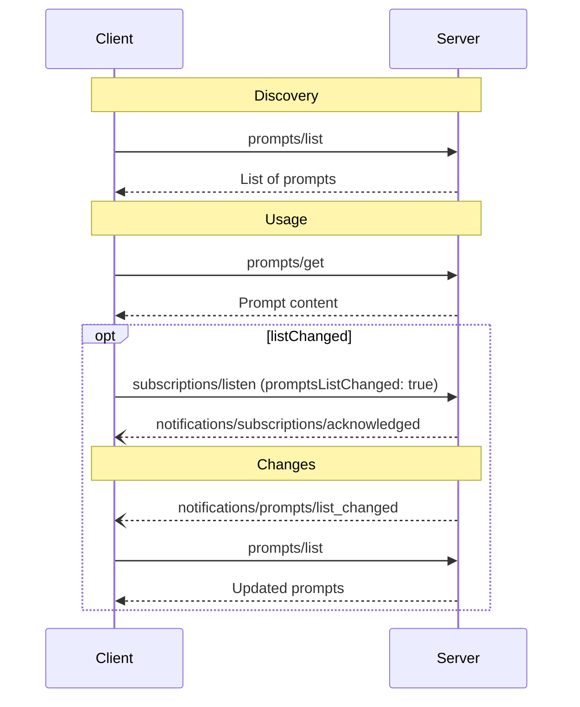

<div id="enable-section-numbers" />

Model Context Protocol（MCP）为服务器向客户端提供提示模板定义了标准方式。通过提示模板，服务器可以提供与语言模型交互所需的结构化消息和指令。客户端能够发现可用模板、获取其内容，并传入参数进行定制。

<Note>
  为简洁起见，本页的请求示例省略了 `_meta` 请求元数据（`io.modelcontextprotocol/protocolVersion`、`io.modelcontextprotocol/clientInfo` 和 `io.modelcontextprotocol/clientCapabilities`）。每个请求都**必须**包含必需的 `_meta` 字段；详见 [`_meta`](/specification/2026-07-28/basic/index#meta)。
</Note>

## 用户交互模型

提示模板被设计为**用户控制**：服务器向客户端提供模板，目的是让用户能够明确选择何时使用它们。这里强调的是由谁决定使用时机，而非由谁编写内容。模板内容由服务器定义。

提示模板通常通过界面中由用户发起的命令触发，让用户能够自然地发现和调用可用模板。

例如，可以通过斜杠命令提供：


不过，实现者可以自由采用适合自身需求的界面形式来提供提示模板；协议本身不强制要求任何特定的用户交互模型。

## 能力

支持提示模板的服务器**必须**在其 [`DiscoverResult`](/specification/2026-07-28/schema#discoverresult) 中声明 `prompts` 能力：

```json
{
  "capabilities": {
    "prompts": {
      "listChanged": true
    }
  }
}
```

`listChanged` 表示可用提示模板列表变化时，服务器是否会发送通知。

声明了 `prompts` 能力的服务器**必须**响应 `prompts/list` 请求，返回当前请求客户端可用的提示模板集合。该集合**可以**为空，也**可以**随时间变化（见[列表变更通知](#list-changed-notification)），但**不得**因连接不同而变化，也不得因同一连接上其他请求的副作用而变化。集合**可以**根据请求提供的授权而变化，例如仅返回调用方已获授权的权限范围允许访问的模板，因为凭据是每个请求的输入，并非连接状态。

## 协议消息

### 列出提示模板

客户端发送 `prompts/list` 请求，获取可用提示模板。此操作支持[分页](/specification/2026-07-28/server/utilities/pagination)与[缓存](/specification/2026-07-28/server/utilities/caching)。

**请求：**

```json
{
  "jsonrpc": "2.0",
  "id": 1,
  "method": "prompts/list",
  "params": {
    "cursor": "optional-cursor-value"
  }
}
```

**响应：**

```json
{
  "jsonrpc": "2.0",
  "id": 1,
  "result": {
    "resultType": "complete",
    "prompts": [
      {
        "name": "code_review",
        "title": "Request Code Review",
        "description": "Asks the LLM to analyze code quality and suggest improvements",
        "arguments": [
          {
            "name": "code",
            "description": "The code to review",
            "required": true
          }
        ],
        "icons": [
          {
            "src": "https://example.com/review-icon.svg",
            "mimeType": "image/svg+xml",
            "sizes": ["any"]
          }
        ]
      }
    ],
    "nextCursor": "next-page-cursor",
    "ttlMs": 600000,
    "cacheScope": "public"
  }
}
```

### 获取提示模板

客户端发送 `prompts/get` 请求，获取指定模板。参数可以通过[补全 API](/specification/2026-07-28/server/utilities/completion) 自动补全。

**请求：**

```json
{
  "jsonrpc": "2.0",
  "id": 2,
  "method": "prompts/get",
  "params": {
    "name": "code_review",
    "arguments": {
      "code": "def hello():\n    print('world')"
    }
  }
}
```

**响应：**

```json
{
  "jsonrpc": "2.0",
  "id": 2,
  "result": {
    "resultType": "complete",
    "description": "Code review prompt",
    "messages": [
      {
        "role": "user",
        "content": {
          "type": "text",
          "text": "Please review this Python code:\ndef hello():\n    print('world')"
        }
      }
    ]
  }
}
```

服务器也**可以**使用 [`InputRequiredResult`](/specification/2026-07-28/basic/patterns/mrtr#inputrequiredresult) 响应 `prompts/get`，表明解析模板之前还需要额外输入。这遵循[多轮往返请求](/specification/2026-07-28/basic/patterns/mrtr#multi-round-trip-requests)机制。重试请求时，客户端在请求参数中包含 `inputResponses`，以及服务器提供的 `requestState`（如果存在）。

### 列表变更通知

可用提示模板列表变化时，声明了 `listChanged` 能力的服务器**应当**向已打开 [`subscriptions/listen`](/specification/2026-07-28/basic/patterns/subscriptions) 流、且过滤条件包含 `promptsListChanged: true` 的客户端发送通知：

```json
{
  "jsonrpc": "2.0",
  "method": "notifications/prompts/list_changed"
}
```

## 消息流程



## 数据类型

### Prompt

提示模板定义包含：

- `name`：提示模板的唯一标识符
- `title`：可选的人类可读模板名称，用于显示。
- `description`：可选的人类可读说明
- `icons`：可选的图标数组，用于在界面中显示
- `arguments`：可选的定制参数列表

### PromptMessage

提示模板中的消息可以包含：

- `role`：取值为 "user" 或 "assistant"，表示发言者
- `content`：以下某一种内容类型：

<Note>
  提示模板消息中的所有内容类型都支持可选的[注解](/specification/2026-07-28/server/resources#annotations)，用于提供受众、优先级和修改时间等元数据。
</Note>

#### 文本内容

文本内容表示纯文本消息：

```json
{
  "type": "text",
  "text": "The text content of the message"
}
```

这是自然语言交互中最常用的内容类型。

#### 图像内容

图像内容允许在消息中包含视觉信息：

```json
{
  "type": "image",
  "data": "base64-encoded-image-data",
  "mimeType": "image/png"
}
```

图像数据**必须**经过 base64 编码，并包含有效的 MIME 类型，从而支持依赖视觉上下文的多模态交互。

#### 音频内容

音频内容允许在消息中包含音频信息：

```json
{
  "type": "audio",
  "data": "base64-encoded-audio-data",
  "mimeType": "audio/wav"
}
```

音频数据必须经过 base64 编码，并包含有效的 MIME 类型，从而支持依赖音频上下文的多模态交互。

#### 资源链接

提示模板消息**可以**包含指向[资源](/specification/2026-07-28/server/resources)的链接，以提供额外上下文或数据，而无需直接嵌入资源内容。此时，提示模板消息返回一个可由客户端获取的 URI：

```json
{
  "type": "resource_link",
  "uri": "file:///project/src/main.rs",
  "name": "main.rs",
  "description": "Primary application entry point",
  "mimeType": "text/x-rust"
}
```

资源链接与普通资源支持相同的[资源注解](/specification/2026-07-28/server/resources#annotations)，帮助客户端理解如何使用它们。

#### 嵌入式资源

嵌入式资源允许在消息中直接引用服务器端资源：

```json
{
  "type": "resource",
  "resource": {
    "uri": "resource://example",
    "mimeType": "text/plain",
    "text": "Resource content"
  }
}
```

资源可以包含文本或二进制（blob）数据，并且**必须**包含：

- 有效的资源 URI
- 恰当的 MIME 类型
- 文本内容或经过 base64 编码的 blob 数据，两者之一

借助嵌入式资源，提示模板可以将服务器管理的文档、代码示例或其他参考资料，无缝地直接融入对话流程。

## 错误处理

对于常见失败情况，服务器**应当**返回标准 JSON-RPC 错误：

- 提示模板名称无效：`-32602`（Invalid params）
- 缺少必填参数：`-32602`（Invalid params）
- 内部错误：`-32603`（Internal error）

## 实现注意事项

1. 服务器**应当**在处理之前校验提示模板参数
2. 客户端**应当**为大型提示模板列表处理分页
3. 双方都**应当**遵守能力协商结果

## 安全

实现**必须**仔细校验提示模板的所有输入和输出，防止注入攻击或未经授权的资源访问。
