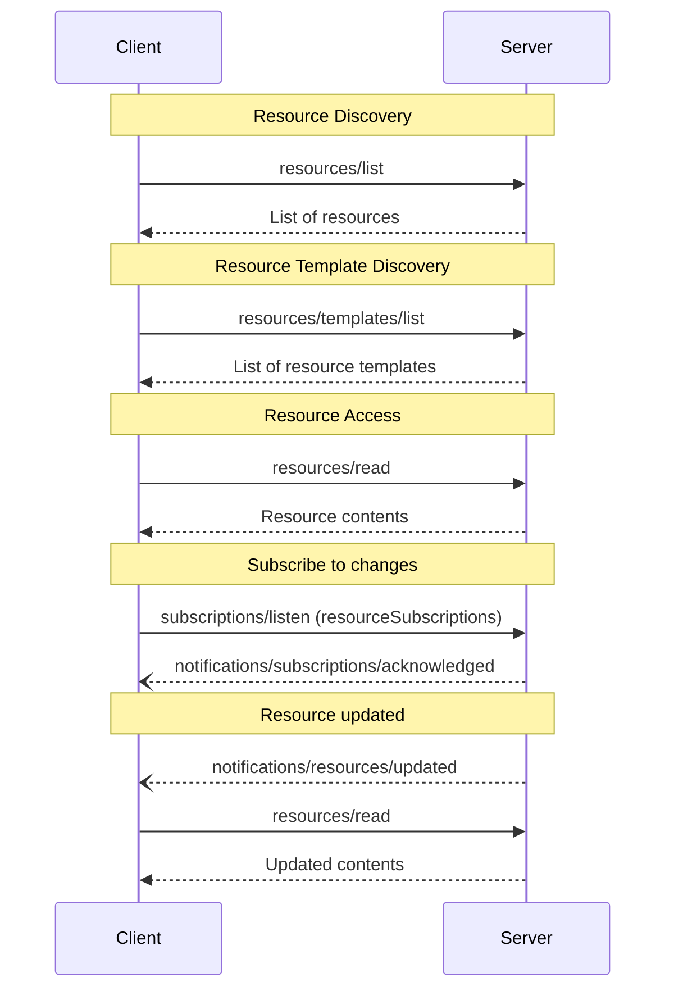

<div id="enable-section-numbers" />

Model Context Protocol（MCP）为服务器向客户端提供资源定义了标准方式。资源让服务器能够共享为语言模型提供上下文的数据，例如文件、数据库 Schema 或应用特有的信息。每个资源都由一个 [URI](https://datatracker.ietf.org/doc/html/rfc3986) 唯一标识。

<Note>
  为简洁起见，本页的请求示例省略了 `_meta` 请求元数据（`io.modelcontextprotocol/protocolVersion`、`io.modelcontextprotocol/clientInfo` 和 `io.modelcontextprotocol/clientCapabilities`）。每个请求都**必须**包含必需的 `_meta` 字段；详见 [`_meta`](/specification/2026-07-28/basic/index#meta)。
</Note>

## 用户交互模型

MCP 中的资源被设计为**应用驱动**，由宿主应用根据自身需求决定如何纳入上下文。

例如，应用可以：

- 通过树形或列表视图等界面元素提供资源，供用户明确选择
- 允许用户搜索和筛选可用资源
- 根据启发式规则或 AI 模型的选择，自动纳入上下文


不过，实现可以自由采用适合自身需求的界面形式来提供资源；协议本身不强制要求任何特定的用户交互模型。

## 能力

支持资源的服务器**必须**声明 `resources` 能力：

```json
{
  "capabilities": {
    "resources": {
      "listChanged": true,
      "subscribe": true
    }
  }
}
```

该能力支持两项可选功能：

- `listChanged`：可用资源列表变化时，服务器是否会发送通知。
- `subscribe`：服务器是否支持针对特定资源的更新通知；这些资源通过 subscriptions/listen 中的 resourceSubscriptions 过滤条件请求。

服务器可以分别声明任意一项、同时声明两项，也可以两项都不声明。

既不支持 `listChanged` 也不支持 `subscribe` 的服务器，可以将它们省略：

```json
{
  "capabilities": {
    "resources": {}
  }
}
```

声明了 `resources` 能力的服务器**必须**响应 `resources/list` 请求，返回当前请求客户端可用的资源集合。该集合**可以**为空，也**可以**随时间变化（见[列表变更通知](#list-changed-notification)），但**不得**因连接不同而变化，也不得因同一连接上其他请求的副作用而变化。集合**可以**根据请求提供的授权而变化，例如仅返回调用方已获授权的权限范围允许访问的资源，因为凭据是每个请求的输入，并非连接状态。

## 协议消息

### 列出资源

客户端发送 `resources/list` 请求，发现可用资源。此操作支持[分页](/specification/2026-07-28/server/utilities/pagination)与[缓存](/specification/2026-07-28/server/utilities/caching)。

**请求：**

```json
{
  "jsonrpc": "2.0",
  "id": 1,
  "method": "resources/list",
  "params": {
    "cursor": "optional-cursor-value"
  }
}
```

**响应：**

```json
{
  "jsonrpc": "2.0",
  "id": 1,
  "result": {
    "resultType": "complete",
    "resources": [
      {
        "uri": "file:///project/src/main.rs",
        "name": "main.rs",
        "title": "Rust Software Application Main File",
        "description": "Primary application entry point",
        "mimeType": "text/x-rust",
        "icons": [
          {
            "src": "https://example.com/rust-file-icon.png",
            "mimeType": "image/png",
            "sizes": ["48x48"]
          }
        ]
      }
    ],
    "nextCursor": "next-page-cursor",
    "ttlMs": 300000,
    "cacheScope": "public"
  }
}
```

### 读取资源

客户端发送 `resources/read` 请求，获取资源内容。此操作支持[缓存](/specification/2026-07-28/server/utilities/caching)。

**请求：**

```json
{
  "jsonrpc": "2.0",
  "id": 2,
  "method": "resources/read",
  "params": {
    "uri": "file:///project/src/main.rs"
  }
}
```

**响应：**

```json
{
  "jsonrpc": "2.0",
  "id": 2,
  "result": {
    "resultType": "complete",
    "contents": [
      {
        "uri": "file:///project/src/main.rs",
        "mimeType": "text/x-rust",
        "text": "fn main() {\n    println!(\"Hello world!\");\n}"
      }
    ],
    "ttlMs": 60000,
    "cacheScope": "private"
  }
}
```

对于单个 `resources/read` 请求，服务器**可以**返回多份资源内容。例如，读取某个目录资源时，服务器可以返回多个文件的内容。

服务器也**可以**使用 [`InputRequiredResult`](/specification/2026-07-28/basic/patterns/mrtr#inputrequiredresult) 响应 `resources/read`，表明读取资源之前还需要额外输入。这遵循[多轮往返请求](/specification/2026-07-28/basic/patterns/mrtr#multi-round-trip-requests)机制。重试请求时，客户端在请求参数中包含 `inputResponses`，以及服务器提供的 `requestState`（如果存在）。

另外，如果 `uri` 的方案为 `https://`，客户端可以直接通过 Web 获取资源。详见[常见 URI 方案一节](#https%3A%2F%2F)。

### 资源模板

资源模板让服务器能够通过 [URI 模板](https://datatracker.ietf.org/doc/html/rfc6570)提供参数化资源。参数可以通过[补全 API](/specification/2026-07-28/server/utilities/completion) 自动补全。
此操作支持[分页](/specification/2026-07-28/server/utilities/pagination)与[缓存](/specification/2026-07-28/server/utilities/caching)。

**请求：**

```json
{
  "jsonrpc": "2.0",
  "id": 3,
  "method": "resources/templates/list",
  "params": {
    "cursor": "optional-cursor-value"
  }
}
```

**响应：**

```json
{
  "jsonrpc": "2.0",
  "id": 3,
  "result": {
    "resultType": "complete",
    "resourceTemplates": [
      {
        "uriTemplate": "file:///{path}",
        "name": "Project Files",
        "title": "📁 Project Files",
        "description": "Access files in the project directory",
        "mimeType": "application/octet-stream",
        "icons": [
          {
            "src": "https://example.com/folder-icon.png",
            "mimeType": "image/png",
            "sizes": ["48x48"]
          }
        ]
      }
    ],
    "nextCursor": "next-page-cursor",
    "ttlMs": 300000,
    "cacheScope": "public"
  }
}
```

### 列表变更通知

可用资源列表变化时，声明了 `listChanged` 能力的服务器**应当**发送通知：

```json
{
  "jsonrpc": "2.0",
  "method": "notifications/resources/list_changed"
}
```

### 订阅

客户端发送 [`subscriptions/listen`][subscriptions-listen] 请求，并在 `notifications.resourceSubscriptions` 中列出资源 URI，以订阅特定资源的变更通知。每当被监视的资源发生变化，服务器都会通过建立的流发送 `notifications/resources/updated`。

```json
{
  "jsonrpc": "2.0",
  "method": "notifications/resources/updated",
  "params": {
    "_meta": { "io.modelcontextprotocol/subscriptionId": 4 },
    "uri": "file:///project/src/main.rs"
  }
}
```

完整的协议机制，包括确认、`subscriptionId` 关联和取消，见[订阅][subscriptions]。

[subscriptions-listen]: /specification/2026-07-28/schema#subscriptionslistenrequest
[subscriptions]: /specification/2026-07-28/basic/patterns/subscriptions

## 消息流程



## 数据类型

### Resource

资源定义包含：

- `uri`：资源的唯一标识符
- `name`：资源名称。
- `title`：可选的人类可读资源名称，用于显示。
- `description`：可选说明
- `icons`：可选的图标数组，用于在界面中显示
- `mimeType`：可选的 MIME 类型
- `size`：可选的大小，以字节为单位

### 资源内容

资源可以包含文本或二进制数据：

#### 文本内容

```json
{
  "uri": "file:///example.txt",
  "mimeType": "text/plain",
  "text": "Resource content"
}
```

#### 二进制内容

```json
{
  "uri": "file:///example.png",
  "mimeType": "image/png",
  "blob": "base64-encoded-data"
}
```

### 注解

资源、资源模板和内容块都支持可选注解，向客户端提示如何使用或展示资源：

- **`audience`**：一个数组，表示资源的预期受众。有效值为 `"user"` 和 `"assistant"`。例如，`["user", "assistant"]` 表示内容对两者都有用。
- **`priority`**：0.0 到 1.0 之间的数值，表示资源的重要程度。1 表示“最重要”（实际上是必需的），0 表示“最不重要”（完全可选）。
- **`lastModified`**：ISO 8601 格式的时间戳，表示资源的最后修改时间，例如 `"2025-01-12T15:00:58Z"`。

带注解的资源示例：

```json
{
  "uri": "file:///project/README.md",
  "name": "README.md",
  "title": "Project Documentation",
  "mimeType": "text/markdown",
  "annotations": {
    "audience": ["user"],
    "priority": 0.8,
    "lastModified": "2025-01-12T15:00:58Z"
  }
}
```

客户端可以利用这些注解：

- 根据预期受众筛选资源
- 确定哪些资源应当优先纳入上下文
- 展示修改时间，或按最近修改时间排序

## 常见 URI 方案

协议定义了几种标准 URI 方案。该列表并不穷尽所有方案，实现始终可以自由使用额外的自定义 URI 方案。

### https://

表示可通过 Web 获取的资源。

服务器仅在客户端能够自行直接从 Web 获取并加载资源，也就是无需通过 MCP Server 读取资源时，才**应当**使用此方案。

对于其他场景，即使服务器本身需要通过互联网下载资源内容，也**应当**优先使用其他 URI 方案，或定义自有方案。

### file://

用于标识行为类似文件系统的资源，但资源无需映射到真实的物理文件系统。

MCP Server **可以**使用 [XDG MIME 类型](https://specifications.freedesktop.org/shared-mime-info-spec/0.14/ar01s02.html#id-1.3.14)标识 file:// 资源，例如用 `inode/directory` 表示没有其他标准 MIME 类型的非普通文件（如目录）。

### git://

Git 版本控制集成。

### 自定义 URI 方案

自定义 URI 方案**必须**符合 [RFC3986](https://datatracker.ietf.org/doc/html/rfc3986)，并考虑上述指导原则。

## 错误处理

请求的资源不存在时，服务器**必须**返回错误码为 `-32602`（Invalid Params）的 JSON-RPC 错误。对于内部错误，服务器**应当**返回 `-32603`。

为保持向后兼容，客户端也**应当**将 `-32002` 视为资源未找到错误，因为较早的协议版本采用该错误码。

对于不存在的资源，服务器**不得**返回空的 `contents` 数组。空数组的含义不明确：既可能表示资源存在但没有内容，也可能表示资源根本不存在。

错误示例：

```json
{
  "jsonrpc": "2.0",
  "id": 5,
  "error": {
    "code": -32602,
    "message": "Resource not found",
    "data": {
      "uri": "file:///nonexistent.txt"
    }
  }
}
```

## 安全注意事项

1. 服务器**必须**校验所有资源 URI
2. 对于敏感资源，**应当**实施访问控制
3. 二进制数据**必须**正确编码
4. 操作前**应当**检查资源权限
5. 提供 `file://` 资源时，服务器**必须**清理文件路径，防止目录遍历攻击
