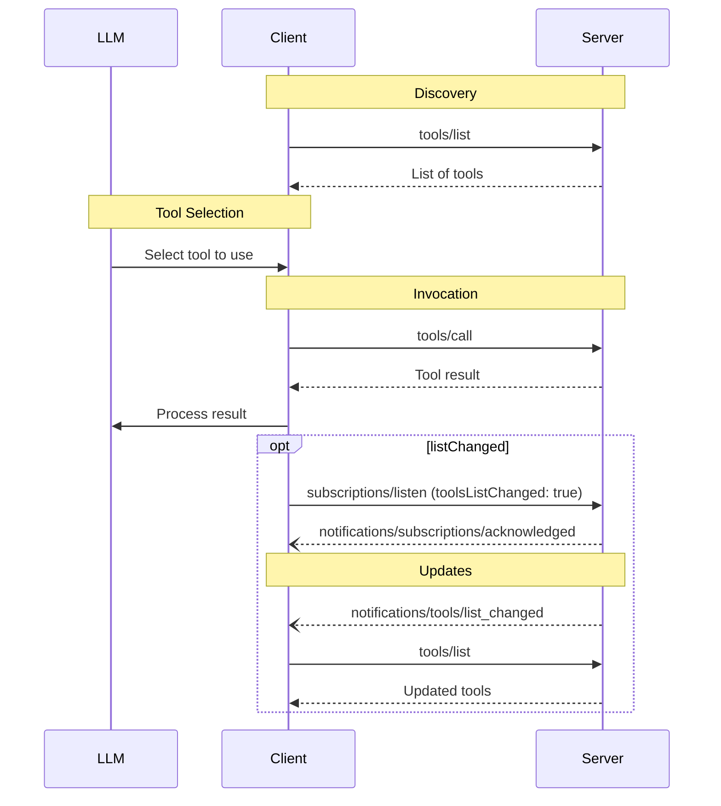

<div id="enable-section-numbers" />

Model Context Protocol（MCP）允许服务器提供可由语言模型调用的工具。工具让模型能够与外部系统交互，例如查询数据库、调用 API 或执行计算。每个工具都有唯一名称，并包含描述其 Schema 的元数据。

<Note>
  为简洁起见，本页的请求示例省略了 `_meta` 请求元数据（`io.modelcontextprotocol/protocolVersion`、`io.modelcontextprotocol/clientInfo` 和 `io.modelcontextprotocol/clientCapabilities`）。每个请求都**必须**包含必需的 `_meta` 字段；详见 [`_meta`](/specification/2026-07-28/basic/index#meta)。
</Note>

## 用户交互模型

MCP 中的工具被设计为**模型控制**：语言模型可以根据对上下文的理解及用户提示，自动发现和调用工具。

不过，实现可以自由采用适合自身需求的界面形式来提供工具；协议本身不强制要求任何特定的用户交互模型。

<Warning>

出于可信度、安全保障与系统安全方面的考虑，**应当**始终让人类参与流程，并有能力拒绝工具调用。

应用**应当**：

- 通过界面明确展示向 AI 模型提供了哪些工具
- 工具调用时显示清晰的视觉指示
- 执行操作时向用户提供确认提示，确保人类参与流程

</Warning>

## 能力

支持工具的服务器**必须**声明 `tools` 能力：

```json
{
  "capabilities": {
    "tools": {
      "listChanged": true
    }
  }
}
```

`listChanged` 表示可用工具列表变化时，服务器是否会发送通知。

声明了 `tools` 能力的服务器**必须**响应 `tools/list` 请求，返回当前请求客户端可用的工具集合。该集合**可以**为空，也**可以**随时间变化（见[列表变更通知](#list-changed-notification)），但**不得**因连接不同而变化，也不得因同一连接上其他请求的副作用而变化。集合**可以**根据请求提供的授权而变化，例如仅返回调用方已获授权的权限范围允许访问的工具，因为凭据是每个请求的输入，并非连接状态。

服务器**应当**按确定性的顺序返回工具，也就是说，底层工具集合未变化时，各次请求的排序应保持一致。确定性排序让客户端能够可靠地缓存工具列表，也能在工具被纳入模型上下文时提高 LLM 提示缓存命中率。

## 协议消息

### 列出工具

客户端发送 `tools/list` 请求，发现可用工具。此操作支持[分页](/specification/2026-07-28/server/utilities/pagination)与[缓存](/specification/2026-07-28/server/utilities/caching)。

**请求：**

```json
{
  "jsonrpc": "2.0",
  "id": 1,
  "method": "tools/list",
  "params": {
    "cursor": "optional-cursor-value"
  }
}
```

**响应：**

```json
{
  "jsonrpc": "2.0",
  "id": 1,
  "result": {
    "resultType": "complete",
    "tools": [
      {
        "name": "get_weather",
        "title": "Weather Information Provider",
        "description": "Get current weather information for a location",
        "inputSchema": {
          "type": "object",
          "properties": {
            "location": {
              "type": "string",
              "description": "City name or zip code"
            }
          },
          "required": ["location"]
        },
        "icons": [
          {
            "src": "https://example.com/weather-icon.png",
            "mimeType": "image/png",
            "sizes": ["48x48"]
          }
        ]
      }
    ],
    "nextCursor": "next-page-cursor",
    "ttlMs": 300000,
    "cacheScope": "public"
  }
}
```

### 调用工具

客户端发送 `tools/call` 请求，调用工具：

**请求：**

```json
{
  "jsonrpc": "2.0",
  "id": 2,
  "method": "tools/call",
  "params": {
    "name": "get_weather",
    "arguments": {
      "location": "New York"
    }
  }
}
```

**响应：**

```json
{
  "jsonrpc": "2.0",
  "id": 2,
  "result": {
    "resultType": "complete",
    "content": [
      {
        "type": "text",
        "text": "Current weather in New York:\nTemperature: 72°F\nConditions: Partly cloudy"
      }
    ],
    "isError": false
  }
}
```

### 需要输入的工具结果

服务器**可以**使用 [`InputRequiredResult`](/specification/2026-07-28/basic/patterns/mrtr#inputrequiredresult) 响应 `tools/call`，表明完成工具调用之前还需要额外输入。这遵循[多轮往返请求](/specification/2026-07-28/basic/patterns/mrtr#multi-round-trip-requests)机制。

携带输入响应重试请求时，客户端在请求参数中包含 `inputResponses`，以及服务器提供的 `requestState`（如果存在）：

**需要输入的响应：**

```json
{
  "jsonrpc": "2.0",
  "id": 2,
  "result": {
    "resultType": "input_required",
    "inputRequests": {
      "github_login": {
        "method": "elicitation/create",
        "params": {
          "mode": "form",
          "message": "Please provide your GitHub username",
          "requestedSchema": {
            "type": "object",
            "properties": {
              "name": { "type": "string" }
            },
            "required": ["name"]
          }
        }
      }
    },
    "requestState": "eyJsb2NhdGlvbiI6Ik5ldyBZb3JrIn0..."
  }
}
```

**携带输入响应重试：**

```json
{
  "jsonrpc": "2.0",
  "id": 3,
  "method": "tools/call",
  "params": {
    "name": "get_weather",
    "arguments": {
      "location": "New York"
    },
    "inputResponses": {
      "github_login": {
        "action": "accept",
        "content": {
          "name": "octocat"
        }
      }
    },
    "requestState": "eyJsb2NhdGlvbiI6Ik5ldyBZb3JrIn0..."
  }
}
```

请注意，最初请求与重试请求的 JSON-RPC `id` **必须**不同。

### 列表变更通知

可用工具列表变化时，声明了 `listChanged` 能力的服务器**应当**向已打开 [`subscriptions/listen`](/specification/2026-07-28/basic/patterns/subscriptions) 流、且过滤条件包含 `toolsListChanged: true` 的客户端发送通知：

```json
{
  "jsonrpc": "2.0",
  "method": "notifications/tools/list_changed"
}
```

## 消息流程



## 数据类型

### Tool

工具定义包含：

- `name`：工具的唯一标识符
- `title`：可选的人类可读工具名称，用于显示。
- `description`：人类可读的功能说明
- `icons`：可选的图标数组，用于在界面中显示
- `inputSchema`：定义预期参数的 JSON Schema
  - 遵循 [JSON Schema 使用指南](/specification/2026-07-28/basic#json-schema-usage)
  - 没有 `$schema` 字段时，默认采用 2020-12
  - **必须**是有效的 JSON Schema 对象，不能是 `null`
  - 对于没有参数的工具，可以采用以下任一种有效方式：
    - `{ "type": "object", "additionalProperties": false }` — **推荐**：明确只接受空对象
    - `{ "type": "object" }` — 接受任何对象，包括带有属性的对象
  - 属性**可以**包含 [`x-mcp-header`](#x-mcp-header) 注解，将参数值作为 HTTP 请求头提供
- `outputSchema`：可选的 JSON Schema，定义预期输出结构
  - 遵循 [JSON Schema 使用指南](/specification/2026-07-28/basic#json-schema-usage)
  - 没有 `$schema` 字段时，默认采用 2020-12
- `annotations`：可选属性，用于描述工具行为

<Warning>
  出于可信度、安全保障与系统安全方面的考虑，客户端**必须**将工具注解视为不可信，除非它们来自可信服务器。
</Warning>

#### 工具名称

- 工具名称长度**应当**为 1 到 128 个字符，包含 1 和 128。
- 工具名称**应当**区分大小写。
- **应当**仅允许以下字符：ASCII 大小写字母（A-Z、a-z）、数字（0-9）、下划线（\_）、连字符（-）和点号（.）
- 工具名称**不应当**包含空格、逗号或其他特殊字符。
- 工具名称在同一服务器内**应当**唯一。
- 有效工具名称示例：
  - `getUser`
  - `DATA_EXPORT_v2`
  - `admin.tools.list`

<Note>

工具名称的唯一性范围限于单个服务器。汇聚多个服务器工具的客户端或代理，**可能**遇到名称冲突，例如两个服务器都提供 `search` 工具，并且**应当**实施消歧策略，例如在工具名称前加上服务器标识符。

服务器 `name`（来自 `serverInfo`）不保证在不同服务器之间唯一，因此**不应当**依赖它来消除歧义。

</Note>

#### x-mcp-header

`x-mcp-header` 扩展属性允许服务器指定某些工具参数，在使用 [Streamable HTTP 传输](/specification/2026-07-28/basic/transports/streamable-http#custom-headers-from-tool-parameters)时，将这些参数映射到 HTTP 请求头中。这样，负载均衡器、代理、WAF 等网络中间设备就能根据参数值路由和处理请求，无需解析请求体。

`x-mcp-header` 属性直接放在需要映射的属性所对应的 JSON Schema 中，其值指定最终 `Mcp-Param-{name}` HTTP 请求头的名称部分。

**`x-mcp-header` 值的约束：**

- **不得**为空
- **必须**符合 HTTP 字段名 token 语法（`1*tchar`，[RFC 9110 第 5.1 节](https://datatracker.ietf.org/doc/html/rfc9110#section-5.1)）
- **不得**包含控制字符，包括回车（CR，`\r`）或换行（LF，`\n`）
- 在 `inputSchema` 中，所有 `x-mcp-header` 值**必须**在不区分大小写的情况下保持唯一
- **必须**仅用于基本类型（integer、string、boolean）的参数。不允许用于类型为 `number` 的参数。整数值**必须**位于 IEEE754 双精度浮点数能够安全表示的整数范围内，即 −2<sup>53</sup>+1 到 2<sup>53</sup>−1
- **必须**仅用于从 Schema 根节点 _静态可达_ 的属性，具体定义见[由工具参数生成自定义请求头](/specification/2026-07-28/basic/transports/streamable-http#custom-headers-from-tool-parameters)；该节也定义了如何从调用参数中提取请求头值

使用 Streamable HTTP 传输的客户端**必须**拒绝任何 `x-mcp-header` 值违反上述约束的工具定义。拒绝意味着客户端**必须**将无效工具排除在 `tools/list` 的结果之外。拒绝工具定义时，客户端**应当**记录警告，包含工具名称及拒绝原因。这样，单个格式错误的工具定义就不会阻止其他有效工具使用。使用其他传输方式（如 stdio）的客户端，**可以**完全忽略 `x-mcp-header` 注解。

**带有 `x-mcp-header` 的工具定义示例：**

```json
{
  "name": "execute_sql",
  "description": "Execute SQL on Google Cloud Spanner",
  "inputSchema": {
    "type": "object",
    "properties": {
      "region": {
        "type": "string",
        "description": "The region to execute the query in",
        "x-mcp-header": "Region"
      },
      "query": {
        "type": "string",
        "description": "The SQL query to execute"
      }
    },
    "required": ["region", "query"]
  }
}
```

在本例中，使用 `"region": "us-west1"` 调用工具时，客户端会向 HTTP 请求添加 `Mcp-Param-Region: us-west1` 请求头。

<Warning>

服务器开发者**不应当**用 `x-mcp-header` 标记密码、API Key、令牌、个人身份信息等敏感参数，因为请求头值对网络中间设备可见。

</Warning>

### 工具结果

工具结果可以包含[**结构化**](#structured-content)或**非结构化**内容。

**非结构化**内容通过结果的 `content` 字段返回，可以包含多个不同类型的内容项：

<Note>
  所有内容类型（文本、图像、音频、资源链接和嵌入式资源）都支持可选的[注解](/specification/2026-07-28/server/resources#annotations)，用于提供受众、优先级及修改时间等元数据。它们与资源和提示模板采用相同的注解格式。
</Note>

#### 文本内容

```json
{
  "type": "text",
  "text": "Tool result text"
}
```

#### 图像内容

```json
{
  "type": "image",
  "data": "base64-encoded-data",
  "mimeType": "image/png",
  "annotations": {
    "audience": ["user"],
    "priority": 0.9
  }
}
```

#### 音频内容

```json
{
  "type": "audio",
  "data": "base64-encoded-audio-data",
  "mimeType": "audio/wav"
}
```

#### 资源链接

工具**可以**返回指向[资源](/specification/2026-07-28/server/resources)的链接，以提供额外上下文或数据。此时，工具返回一个可供客户端订阅或获取的 URI：

```json
{
  "type": "resource_link",
  "uri": "file:///project/src/main.rs",
  "name": "main.rs",
  "description": "Primary application entry point",
  "mimeType": "text/x-rust"
}
```

资源链接与普通资源支持相同的[资源注解](/specification/2026-07-28/server/resources#annotations)，帮助客户端理解如何使用它们。

<Info>
  工具返回的资源链接，不保证会出现在 `resources/list` 请求的结果中。
</Info>

#### 嵌入式资源

服务器**可以**通过合适的 [URI 方案](./resources#common-uri-schemes)嵌入[资源](/specification/2026-07-28/server/resources)，提供额外上下文或数据。使用嵌入式资源的服务器**应当**实现 `resources` 能力：

```json
{
  "type": "resource",
  "resource": {
    "uri": "file:///project/src/main.rs",
    "mimeType": "text/x-rust",
    "text": "fn main() {\n    println!(\"Hello world!\");\n}",
    "annotations": {
      "audience": ["user", "assistant"],
      "priority": 0.7,
      "lastModified": "2025-05-03T14:30:00Z"
    }
  }
}
```

嵌入式资源与普通资源支持相同的[资源注解](/specification/2026-07-28/server/resources#annotations)，帮助客户端理解如何使用它们。

#### 结构化内容

**结构化**内容通过结果的 `structuredContent` 字段，以 JSON 值的形式返回。它可以是任意 JSON 值，包括对象、数组、字符串、数字、布尔值或 null；如果工具定义了 `outputSchema`，则必须符合该 Schema。

为保持向后兼容，返回结构化内容的工具也应当在 TextContent 块中返回序列化后的 JSON。

<Note>

`structuredContent` 是由服务器生成的结果数据，与 LLM 的“结构化输出”（受 Schema 约束的模型生成）无关。

</Note>

#### 输出 Schema

工具还可以提供输出 Schema，用于校验结构化结果。
如果提供了输出 Schema：

- 服务器**必须**提供符合该 Schema 的结构化结果。
- 客户端**应当**根据该 Schema 校验结构化结果。

带有输出 Schema 的工具示例：

```json
{
  "name": "get_weather_data",
  "title": "Weather Data Retriever",
  "description": "Get current weather data for a location",
  "inputSchema": {
    "type": "object",
    "properties": {
      "location": {
        "type": "string",
        "description": "City name or zip code"
      }
    },
    "required": ["location"]
  },
  "outputSchema": {
    "type": "object",
    "properties": {
      "temperature": {
        "type": "number",
        "description": "Temperature in celsius"
      },
      "conditions": {
        "type": "string",
        "description": "Weather conditions description"
      },
      "humidity": {
        "type": "number",
        "description": "Humidity percentage"
      }
    },
    "required": ["temperature", "conditions", "humidity"]
  }
}
```

该工具的有效响应示例：

```json
{
  "jsonrpc": "2.0",
  "id": 5,
  "result": {
    "resultType": "complete",
    "content": [
      {
        "type": "text",
        "text": "{\"temperature\": 22.5, \"conditions\": \"Partly cloudy\", \"humidity\": 65}"
      }
    ],
    "structuredContent": {
      "temperature": 22.5,
      "conditions": "Partly cloudy",
      "humidity": 65
    }
  }
}
```

采用数组输出 Schema 的工具示例：

```json
{
  "name": "list_users",
  "title": "User List",
  "description": "Returns a list of all users",
  "inputSchema": {
    "type": "object",
    "properties": {}
  },
  "outputSchema": {
    "type": "array",
    "items": {
      "type": "object",
      "properties": {
        "id": { "type": "string" },
        "name": { "type": "string" },
        "email": { "type": "string" }
      },
      "required": ["id", "name", "email"]
    }
  }
}
```

采用数组输出的工具所对应的有效响应示例：

```json
{
  "jsonrpc": "2.0",
  "id": 6,
  "result": {
    "resultType": "complete",
    "content": [
      {
        "type": "text",
        "text": "Found 2 users: Alice (alice@example.com) and Bob (bob@example.com)."
      }
    ],
    "structuredContent": [
      { "id": "1", "name": "Alice", "email": "alice@example.com" },
      { "id": "2", "name": "Bob", "email": "bob@example.com" }
    ]
  }
}
```

提供输出 Schema 可以通过以下方式，帮助客户端和 LLM 理解并正确处理结构化工具输出：

- 支持对响应进行严格的 Schema 校验
- 提供类型信息，便于与编程语言集成
- 指导客户端和 LLM 正确解析并使用返回的数据
- 改善文档和开发者体验

### Schema 示例

#### 默认采用 2020-12 Schema 的工具：

```json
{
  "name": "calculate_sum",
  "description": "Add two numbers",
  "inputSchema": {
    "type": "object",
    "properties": {
      "a": { "type": "number" },
      "b": { "type": "number" }
    },
    "required": ["a", "b"]
  }
}
```

#### 显式采用 draft-07 Schema 的工具：

```json
{
  "name": "calculate_sum",
  "description": "Add two numbers",
  "inputSchema": {
    "$schema": "http://json-schema.org/draft-07/schema#",
    "type": "object",
    "properties": {
      "a": { "type": "number" },
      "b": { "type": "number" }
    },
    "required": ["a", "b"]
  }
}
```

#### 无参数的工具：

```json
{
  "name": "get_current_time",
  "description": "Returns the current server time",
  "inputSchema": {
    "type": "object",
    "additionalProperties": false
  }
}
```

## 有状态工具

<Note>

本节是工具设计的非规范性指导。协议没有状态句柄这一概念；从通信层面看，句柄只是工具结果中的普通字符串，以及后续工具调用中的普通参数。

</Note>

MCP 没有协议级会话，因此服务器无法依靠隐式的逐连接状态，将一次工具调用与下一次调用关联起来。需要跨调用维护状态的服务器，例如购物篮、打开的浏览器上下文或数据库事务，应当让创建工具返回一个显式句柄，并在后续调用中接受该句柄作为参数。

例如，管理购物篮的服务器可以提供：

```jsonc
// → tools/call
{ "name": "create_basket", "arguments": {} }

// ← result
{
  "content": [{ "type": "text", "text": "Created basket bsk_a1b2c3" }],
  "structuredContent": { "basket_id": "bsk_a1b2c3" }
}

// → tools/call
{
  "name": "add_item",
  "arguments": { "basket_id": "bsk_a1b2c3", "sku": "..." }
}
```

模型负责在后续调用中继续传递 `basket_id`；服务器以该键保存购物篮内容，并在每次调用时查找。

设计句柄时，服务器应当考虑：

- **授权。** 对于经过认证的服务器，句柄只是名称，并非能力凭据。服务器应当在每次调用时，针对句柄校验调用方的授权。对于未经过认证的服务器，句柄必然承担 Bearer Token 的作用，应当以足够高的熵生成，例如 UUIDv4，并限定有效期。
- **不透明性。** 在句柄中编码内部结构会诱使调用方解析或猜测；不透明标识符则不会。
- **生命周期。** 句柄的寿命长于任意单次连接，因此服务器的保留策略应当写在创建工具的说明中，例如“购物篮在 24 小时未活动后过期”，让模型在决定创建状态时能够看到。
- **过期错误。** 使用过期或未知句柄的调用，应当返回明确说明原因的工具执行错误，使模型能够通过创建新句柄恢复。

## 错误处理

工具采用两种错误报告机制：

1. **协议错误**表示请求结构本身存在问题，模型通常不容易自行修复：
   - 未知工具
   - 请求格式错误，即请求不符合 [CallToolRequest Schema](/specification/2026-07-28/schema#calltoolrequest)
   - 服务器错误

   这些错误以标准 JSON-RPC 错误返回：

   ```json
   {
     "jsonrpc": "2.0",
     "id": 3,
     "error": {
       "code": -32602,
       "message": "Unknown tool: invalid_tool_name"
     }
   }
   ```

2. **工具执行错误**包含可采取行动的反馈，语言模型可以据此自行纠正，并调整参数重试：
   - API 失败
   - 输入校验错误，例如日期格式错误、数值超出范围
   - 业务逻辑错误

   它们在工具结果中通过 `isError: true` 报告：

   ```json
   {
     "jsonrpc": "2.0",
     "id": 4,
     "result": {
       "resultType": "complete",
       "content": [
         {
           "type": "text",
           "text": "Invalid departure date: must be in the future. Current date is 08/08/2025."
         }
       ],
       "isError": true
     }
   }
   ```

客户端**可以**将协议错误提供给语言模型，尽管这类错误不太容易成功恢复。
客户端**应当**将工具执行错误提供给语言模型，使模型能够自行纠正。

## 安全注意事项

1. 服务器**必须**：
   - 校验所有工具输入
   - 实施适当的访问控制
   - 对工具调用进行速率限制
   - 清理工具输出

2. 客户端**应当**：
   - 对敏感操作提示用户确认
   - 调用服务器前向用户展示工具输入，避免恶意或意外的数据外泄
   - 将工具结果传给 LLM 前进行校验
   - 使用 `inputSchema` 和 `outputSchema` 校验工具输入与输出时，遵循 [`$ref` 解析要求](/specification/2026-07-28/basic/index#ref-resolution)
   - 为工具调用设置超时
   - 记录工具使用情况，以便审计
