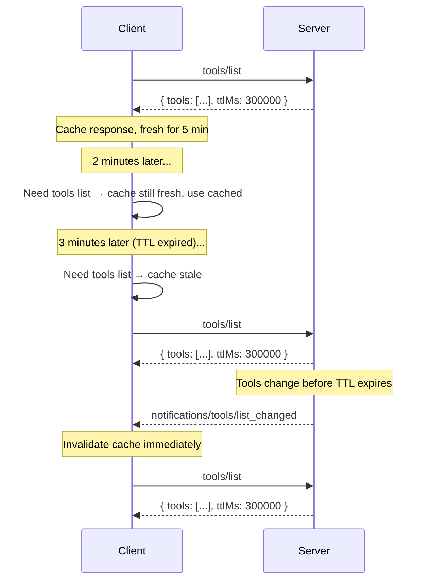

<div id="enable-section-numbers" />

Model Context Protocol（MCP）支持缓存某些结果，让客户端能够缓存响应，减少不必要的重复获取。
缓存与[变更通知](#interaction-with-notifications)互为补充，两种机制可以共存。

## 可缓存的结果

对于以下操作返回的 `resultType: "complete"` 结果，服务器必须包含缓存提示：

- `server/discover`
- `tools/list`
- `prompts/list`
- `resources/list`
- `resources/templates/list`
- `resources/read`

`resultType: "input_required"` 的中间结果（见[多轮往返请求](/specification/2026-07-28/basic/patterns/mrtr)）不可缓存，也不携带缓存提示。

## 缓存键

缓存响应由请求方法及会影响结果的请求参数共同标识，例如 `resources/read` 的 `uri`，或分页列表请求的 `cursor`。如果某个请求的方法或参数与产生缓存响应的原请求不同，客户端**不得**为它返回该缓存响应。

通过[多轮往返请求](/specification/2026-07-28/basic/patterns/mrtr)机制重试请求产生的结果，也就是请求携带 `inputResponses` 或 `requestState` 时产生的结果，**不得**缓存，因为它们依赖未包含在缓存键中的输入。

## 缓存模型

MCP 的可缓存结果通过两个字段向客户端提供缓存提示：

- <b>存活时间（TTL）字段</b> `ttlMs` 是以毫秒为单位的整数，指定客户端可以在多长时间内将结果视为新鲜。
- <b>缓存作用域字段</b> `cacheScope` 指出缓存响应的预期作用域，取值为 `"public"` 或 `"private"`。

### 存活时间（TTL）字段

`ttlMs` 是服务器提供的提示，表示客户端可以在多少毫秒内将结果视为新鲜，其语义类似 HTTP `Cache-Control: max-age`。

- 如果 `ttlMs` 为 `0`，响应**应当**立即被视为过期。客户端可以在每次需要结果时重新获取。
- 如果 `ttlMs` 为正数，客户端**应当**在收到响应后的相应毫秒数内，将结果视为新鲜。
- 如果缺少 `ttlMs`，客户端**应当**采用默认值 `0`，即立即过期，并依赖自身的缓存启发式规则或通知。这种情况只应出现在较旧的服务器版本中。
- 如果 `ttlMs` 为负数，客户端**应当**忽略该值，将其视为 `0`。

服务器**必须**提供 `>= 0` 的 `ttlMs` 值。

<Note>
  TTL 只是**新鲜度提示**，并非保证。服务器可以在 TTL 到期前修改底层数据。TTL 告诉客户端，在多长时间内可以合理地避免重复获取，而不是保证数据在这段时间内保持不变。
</Note>

#### 新鲜度计算

客户端记录收到响应时的本地时间（`t_received`）。满足以下条件时，响应被视为**新鲜**：

```
now < t_received + ttlMs
```

TTL 到期后，响应变为**过期**，客户端**应当**在下一次访问时重新获取。

客户端**不应当**将 TTL 视为触发后台自动刷新的轮询间隔。TTL 是新鲜度提示：客户端在需要数据时检查新鲜度，只有过期后才重新获取。如果实现选择进行轮询，就**必须**采用抖动和退避策略。

如果有理由认为数据已经变化，例如工具调用返回了意外错误，表明方法未找到或参数无效，客户端**可以**在 TTL 到期前重新获取。

如果重新获取时出错，例如网络故障或服务器停机，客户端**可以**返回过期响应。

### 缓存作用域字段

`cacheScope` 字段控制哪些主体可以缓存响应，类似 HTTP `Cache-Control: public` 与 `Cache-Control: private`。

| 值 | 含义 |
| ----------- | --------------------------------------------------------------------------------------------------------------------------------------------------------------------------------------------------------------------------------------------------------------------------------- |
| `"public"` | 响应不包含用户专属数据。任何客户端、共享网关或缓存代理都**可以**存储缓存响应，并将其提供给任意用户。 |
| `"private"` | 响应包含不应在调用方之间共享的私有数据。缓存响应**可以**在同一授权上下文中复用。不同授权上下文之间**不得**共享缓存，例如不同访问令牌需要不同缓存。 |

#### 选择缓存作用域

- **`"public"`** 适用于对所有用户都相同的工具列表、提示模板列表和资源模板列表。
- **`"private"`** 适用于依赖已认证用户的 `resources/read` 结果，或按用户筛选、因用户而异的列表结果。

## 与通知的配合

TTL 与服务器推送通知互为补充：

- 服务器**可以**提供 `ttlMs`，而不在能力中声明 `listChanged: true`。此时，客户端完全依赖基于 TTL 的新鲜度判断。
- 服务器**可以**既声明 `listChanged: true`，**又**提供 `ttlMs`。此时，客户端可利用 TTL 避免在通知之间进行不必要的重复获取，而通知则作为立即失效的信号。

当缓存响应仍然新鲜时，如果收到相关通知，该通知会使缓存响应**失效**，并应当立即将其视为过期。



## 与分页的配合

列表结果采用[分页](/specification/2026-07-28/server/utilities/pagination)时，每一页都是可独立缓存的响应，这与 HTTP `Cache-Control` 处理分页资源的方式一致。

- 每页响应都携带自己的 `ttlMs` 值，各页的新鲜度计时从收到该页时开始。
- 服务器**可以**为不同页面返回不同的 `ttlMs` 值，例如稳定列表的前几页采用较长 TTL，最后一页采用较短 TTL。
- 缓存页到期时，客户端**应当**使用该页的游标重新获取。
- 协议不保证跨页一致性。如果两次页面获取之间底层数据发生变化，客户端可能看到重复或遗漏。
- 需要完整列表一致快照的客户端，**应当**从头重新获取，不携带游标。
- 如果游标失效，例如服务器对先前有效的游标返回错误，客户端**应当**丢弃所有缓存页，并从头重新获取。

对于同一个列表请求，服务器**必须**为所有响应页采用相同的 `cacheScope`。例如，`tools/list` 响应的第一页如果使用 `cacheScope: "private"`，该请求之后的所有页面也都**必须**为 `"private"`。

## 安全注意事项

`cacheScope` 为 `"public"` 表示响应不包含用户专属数据，可以安全共享。服务器必须意识到，即使结果来自经过认证的端点，带有 `"public"` `cacheScope` 的响应仍可能在不同调用方之间共享。例如，经过认证的 `tools/list` 调用结果若具有 `"public"` `cacheScope`，就可能被客户端缓存，并在最初请求的授权上下文之外共享，也就是不同访问令牌可以使用同一份缓存。

服务器实现者：

- 应当确保 `cacheScope` 正确反映该原语预期的可见范围。
- 必须对每个原语实施适当的访问控制，不得仅依靠 `cacheScope` 防止未经授权的原语访问。
