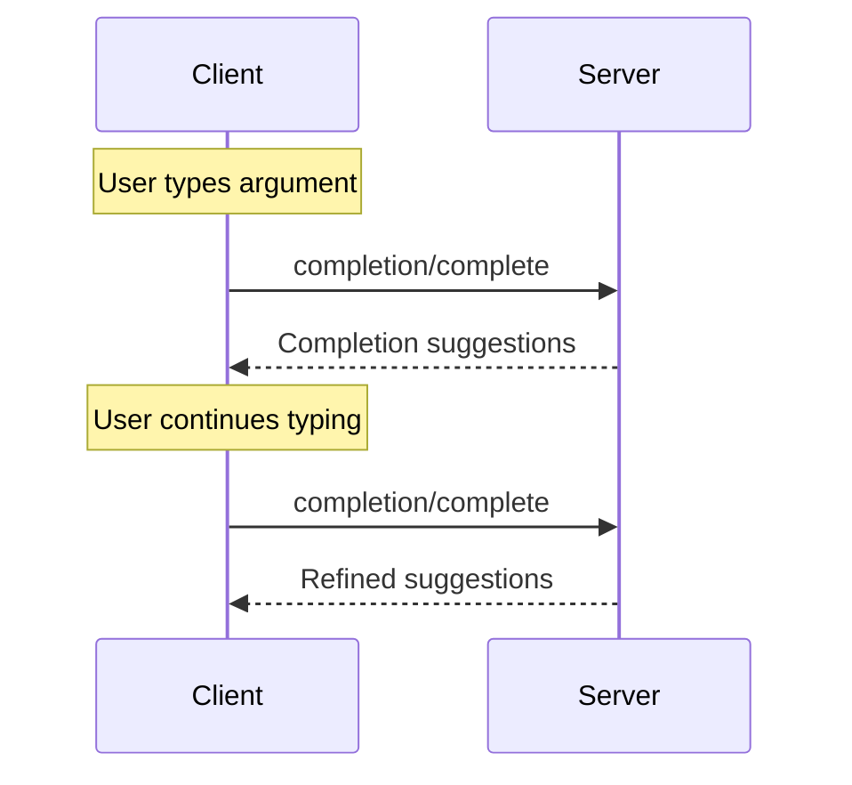

<div id="enable-section-numbers" />

Model Context Protocol（MCP）为服务器提供提示模板和资源模板参数的自动补全建议定义了标准方式。用户为特定提示模板（按名称标识）或资源模板（按 URI 标识）填写参数值时，服务器可以提供与上下文相关的建议。

<Note>
  为简洁起见，本页的请求示例省略了 `_meta` 请求元数据（`io.modelcontextprotocol/protocolVersion`、`io.modelcontextprotocol/clientInfo` 和 `io.modelcontextprotocol/clientCapabilities`）。每个请求都**必须**包含必需的 `_meta` 字段；详见 [`_meta`](/specification/2026-07-28/basic/index#meta)。
</Note>

## 用户交互模型

MCP 中的补全功能旨在支持类似 IDE 代码补全的交互体验。

例如，应用可以在用户输入时通过下拉框或弹出菜单展示补全建议，并允许用户筛选和选择可用选项。

不过，实现可以自由采用适合自身需求的界面形式来提供补全；协议本身不强制要求任何特定的用户交互模型。

## 能力

支持补全的服务器**必须**声明 `completions` 能力：

```json
{
  "capabilities": {
    "completions": {}
  }
}
```

## 协议消息

### 请求补全

要获取补全建议，客户端发送 `completion/complete` 请求，并通过引用类型指定需要补全的对象：

**请求：**

```json
{
  "jsonrpc": "2.0",
  "id": 1,
  "method": "completion/complete",
  "params": {
    "ref": {
      "type": "ref/prompt",
      "name": "code_review"
    },
    "argument": {
      "name": "language",
      "value": "py"
    }
  }
}
```

**响应：**

```json
{
  "jsonrpc": "2.0",
  "id": 1,
  "result": {
    "resultType": "complete",
    "completion": {
      "values": ["python", "pytorch", "pyside"],
      "total": 10,
      "hasMore": true
    }
  }
}
```

对于具有多个参数的提示模板或 URI 模板，客户端应在 `context.arguments` 对象中包含已经完成的参数值，为后续请求提供上下文。

**请求：**

```json
{
  "jsonrpc": "2.0",
  "id": 1,
  "method": "completion/complete",
  "params": {
    "ref": {
      "type": "ref/prompt",
      "name": "code_review"
    },
    "argument": {
      "name": "framework",
      "value": "fla"
    },
    "context": {
      "arguments": {
        "language": "python"
      }
    }
  }
}
```

**响应：**

```json
{
  "jsonrpc": "2.0",
  "id": 1,
  "result": {
    "resultType": "complete",
    "completion": {
      "values": ["flask"],
      "total": 1,
      "hasMore": false
    }
  }
}
```

### 引用类型

协议支持两类补全引用：

| 类型 | 说明 | 示例 |
| -------------- | ----------------------------------------- | --------------------------------------------------- |
| `ref/prompt` | 按名称引用提示模板 | `{"type": "ref/prompt", "name": "code_review"}` |
| `ref/resource` | 引用资源 URI 或 URI 模板 | `{"type": "ref/resource", "uri": "file:///{path}"}` |

### 补全结果

服务器返回按相关性排序的补全值数组，并具有以下特征：

- 每次响应最多 100 项
- 可选的可用匹配项总数
- 表示是否还有更多结果的布尔值

## 消息流程



## 数据类型

### CompleteRequest

- `ref`：一个 `PromptReference` 或 `ResourceTemplateReference`。对于 `ResourceTemplateReference`，`uri` 是 URI 或 URI 模板。
- `argument`：包含以下字段的对象：
  - `name`：参数名称
  - `value`：当前值
- `context`：包含以下字段的对象：
  - `arguments`：已解析参数名称到其值的映射。

### CompleteResult

- `completion`：包含以下字段的对象：
  - `values`：建议数组，最多 100 项
  - `total`：可选的匹配项总数
  - `hasMore`：是否还有更多结果的标志

## 错误处理

对于常见失败情况，服务器**应当**返回标准 JSON-RPC 错误：

- 方法未找到：`-32601`（Capability not supported）
- 提示模板名称无效：`-32602`（Invalid params）
- 缺少必填参数：`-32602`（Invalid params）
- 内部错误：`-32603`（Internal error）

## 实现注意事项

1. 服务器**应当**：
   - 按相关性排序返回建议
   - 在适当情况下实现模糊匹配
   - 对补全请求进行速率限制
   - 校验所有输入

2. 客户端**应当**：
   - 对快速连续的补全请求进行防抖处理
   - 在适当情况下缓存补全结果
   - 妥善处理缺失或不完整的结果

## 安全

实现**必须**：

- 校验所有补全输入
- 实施适当的速率限制
- 控制敏感建议的访问权限
- 防止通过补全泄露信息
