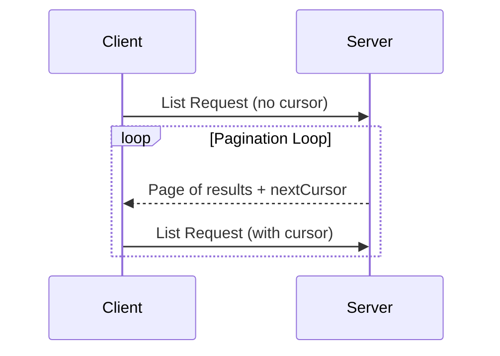

<div id="enable-section-numbers" />

Model Context Protocol（MCP）支持对可能返回大量结果的列表操作进行分页。分页让服务器能够分批返回较小的结果集，而不必一次返回全部结果。

通过互联网连接外部服务时，分页尤其重要；本地集成也可以借助分页，避免大型数据集带来的性能问题。

<Note>
  为简洁起见，本页的请求示例省略了 `_meta` 请求元数据（`io.modelcontextprotocol/protocolVersion`、`io.modelcontextprotocol/clientInfo` 和 `io.modelcontextprotocol/clientCapabilities`）。每个请求都**必须**包含必需的 `_meta` 字段；详见 [`_meta`](/specification/2026-07-28/basic/index#meta)。
</Note>

## 分页模型

MCP 采用基于不透明游标的分页方式，而不是页码方式。

- **游标**是一个不透明的字符串令牌，表示结果集中的某个位置
- **每页大小**由服务器决定，客户端**不得**假定每页大小固定

## 响应格式

当服务器发送包含以下内容的**响应**时，分页开始：

- 当前页的结果
- 如果还有更多结果，则包含可选的 `nextCursor` 字段

```json
{
  "jsonrpc": "2.0",
  "id": "123",
  "result": {
    "resultType": "complete",
    "resources": [...],
    "nextCursor": "eyJwYWdlIjogM30=",
    "ttlMs": 300000,
    "cacheScope": "public"
  }
}
```

## 请求格式

收到游标后，客户端可以在后续请求中携带该游标，_继续_ 分页：

```json
{
  "jsonrpc": "2.0",
  "id": "124",
  "method": "resources/list",
  "params": {
    "cursor": "eyJwYWdlIjogMn0="
  }
}
```

## 分页流程



## 支持分页的操作

以下 MCP 操作支持分页：

- `resources/list` — 列出可用资源
- `resources/templates/list` — 列出资源模板
- `prompts/list` — 列出可用提示模板
- `tools/list` — 列出可用工具

## 实现指南

1. 服务器**应当**：
   - 提供稳定的游标
   - 妥善处理无效游标

2. 客户端**应当**：
   - 将缺少 `nextCursor` 视为结果已结束
   - 同时支持分页和不分页的流程

3. 客户端**必须**将游标视为不透明令牌：
   - 不对游标格式作任何假设
   - 不尝试解析或修改游标
   - 除了判断是否提供了非 null 值之外，不根据游标值作出其他判断；例如，空字符串也是有效游标，因此**不得**将其视为结果结束

## 错误处理

无效游标**应当**返回错误码 -32602（Invalid params）。
